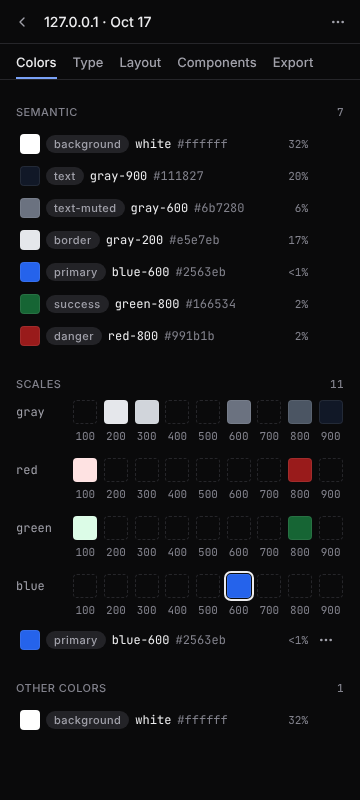
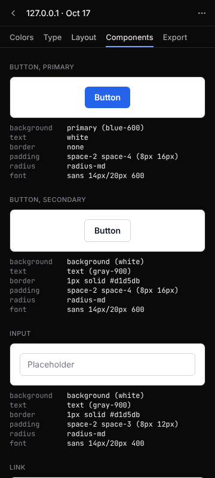
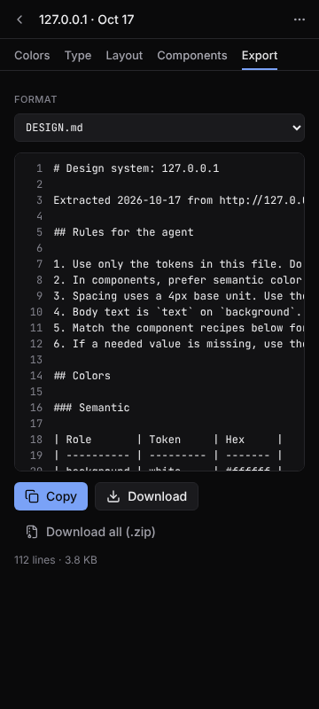

# WebStyle Extractor for AI Agents

A Chrome extension (with a Firefox build and a command-line version) that reads the design system of the website in your current tab and exports it as a **DESIGN.md** plus token files that an AI coding agent such as Claude Code or Cursor can follow: colors in light and dark themes, typography, spacing and layout, motion, and component styles with their hover, focus and active states.

One click, nothing leaves your browser. Free and open source under the MIT license.

<p>
  
  
  
</p>

## Why

AI coding agents read files, but they cannot see a live website. Screenshots are lossy, values copied from DevTools are slow, and raw CSS is noisy, so agent-written UI drifts from the brand. WebStyle turns a page into a short, structured file of real tokens and rules the agent can follow. It never invents a value: everything in the output was found on the page.

## What it extracts

- **Colors:** merged near-duplicates ranked by usage, with semantic roles (background, surface, text, text-muted, border, primary, accent, success, warning, danger, focus-ring, overlay) and numeric scales such as `gray-100` to `gray-900`.
- **Light and dark themes:** each semantic role in both themes when the site has them, read from its stylesheets or, with Advanced capture, by emulating the other color scheme.
- **Translucent colors:** kept with their real alpha and named like `black/10` or `blue-600/20`, with the color they actually look like on their background.
- **Site variable names:** when the site defines `--brand-primary` or `--surface`, those names become the token names (switchable in Settings).
- **Typography:** font families with full stacks, web fonts (family, weights and provider, never the files), a type scale, composite text styles (`h1`, `body`, `overline` and so on) and letter spacing.
- **Layout tokens:** the spacing scale and its 4 or 8 px base unit, containers, grid columns, gaps, radii, border widths, shadows, opacity, z-index layers, `@media` breakpoints and, with Advanced capture, how type and layout change across widths.
- **Motion and gradients:** durations, easing curves, commonly animated properties, reduced-motion support, and linear, radial and conic gradients.
- **Components:** recipes for buttons, inputs, links, headings, cards, badges, nav bars, tabs, alerts and tables, written in tokens, with hover, focus and active states and the focus ring.
- **Stack:** the CSS framework (Tailwind CSS, Bootstrap, MUI, Chakra UI, shadcn/ui, Radix Themes, Ant Design, Bulma) and icon library (Lucide, Heroicons, Font Awesome, Material, Bootstrap Icons, Phosphor, Tabler, Remix), with icon size and stroke.
- **Trust:** a WCAG contrast check for every text pair, a confidence level with reasons for every token, and a consistency report (near-duplicate colors, off-scale spacing, distinct counts, contrast failures, a missing focus style).

## What you get

13 export formats. Download all (.zip), Write to project and the CLI place each file at the path shown; single downloads are named `<hostname>-<file>`.

| Export                             | Path                                                                                             | Use it for                                                                                   |
| ---------------------------------- | ------------------------------------------------------------------------------------------------ | -------------------------------------------------------------------------------------------- |
| DESIGN.md                          | `DESIGN.md`                                                                                      | Drop into your repo and point your agent at it. Rules plus every token and component recipe. |
| prompt.md (compact prompt)         | `design/prompt.md`                                                                               | 40 lines or fewer to paste into v0, Lovable, Bolt or a chat.                                 |
| tokens.json (DTCG)                 | `design/tokens.json`, `design/tokens.dark.json`                                                  | Style Dictionary and other tools that read the Design Tokens format. Dark file when needed.  |
| theme.css (Tailwind v4)            | `design/theme.css`                                                                               | `@import` it after `tailwindcss` to get `bg-primary`, `text-text-muted`, `p-4` and so on.    |
| tailwind.webstyle.js (Tailwind v3) | `design/tailwind.webstyle.js`                                                                    | Merge into your config; it uses `theme.extend` and never overwrites your own config.         |
| variables.css                      | `design/variables.css`                                                                           | Plain custom properties for any stack, with the site's own variable names.                   |
| shadcn-theme.css (shadcn/ui)       | `design/shadcn-theme.css`                                                                        | A shadcn/ui theme in `oklch()` or legacy HSL.                                                |
| styleguide.html (style guide)      | `design/styleguide.html`                                                                         | A self-contained page showing every token and component state.                               |
| AGENTS.md block                    | `AGENTS.md`                                                                                      | Design rules for agents that read AGENTS.md, inside marked lines.                            |
| Cursor rules (.mdc)                | `.cursor/rules/design-system.mdc`                                                                | A Cursor project rule for component and style files.                                         |
| CLAUDE.md block                    | `CLAUDE.md`                                                                                      | Imports `@DESIGN.md` for Claude Code, inside marked lines.                                   |
| Figma variables                    | `design/figma/Primitives.tokens.json`, `Semantic.Light.tokens.json`, `Semantic.Dark.tokens.json` | Figma's native variable import: Primitives, then Semantic with Light and Dark modes.         |
| audit.md (consistency report)      | `design/audit.md`                                                                                | A checklist of inconsistencies to clean up.                                                  |
| Component screenshots (opt-in)     | `design/screenshots/<kind>-<variant>[-dark].png`                                                 | Pictures of each recipe, linked from DESIGN.md.                                              |

The AGENTS.md and CLAUDE.md blocks sit between `<!-- webstyle:start -->` and `<!-- webstyle:end -->`, so writing them into an existing file changes only the text between those lines.

## Install

### From source (now)

You need Node.js 20 or newer and pnpm (`corepack enable` gives you pnpm).

```bash
git clone https://github.com/ankitmaurya-16/webstyle-extractor-for-ai-agents.git
cd webstyle-extractor-for-ai-agents
pnpm install
pnpm build
```

Then load it in Chrome (version 116 or newer):

1. Open `chrome://extensions`.
2. Turn on **Developer mode** (top right).
3. Click **Load unpacked** and choose the `.output/chrome-mv3` folder.
4. Pin **WebStyle Extractor for AI Agents** from the puzzle-piece menu so the icon is always in the toolbar.

Edge uses the same build: open `edge://extensions`, turn on **Developer mode** and load the same folder.

### Firefox

```bash
pnpm build:firefox
```

1. Open `about:debugging` and choose **This Firefox**.
2. Click **Load Temporary Add-on** and choose `.output/firefox-mv3/manifest.json`.

Firefox 128 or newer is needed. The panel opens as a Firefox sidebar. **Advanced capture** and **Write to project** are not available on Firefox, because it has no debugger or File System Access API; everything else works. A temporary add-on is removed when Firefox restarts. The `GECKO_ID` placeholder `webstyle-extractor@example.invalid` in `wxt.config.js` must be replaced with an address you control before submitting to addons.mozilla.org.

## How to use

1. **Open a website** whose look you want to reuse: your brand site, a client site or a reference.
2. **Click the WebStyle icon** in the toolbar, or press **Alt+Shift+D**. The side panel opens.
3. **Choose options** on Home if you want them:
   - **Scroll to load content** scrolls the page first so lazy content renders, then scrolls back.
   - **Advanced capture** (see below) reads more with Chrome's debugger.
   - **Include screenshots** saves pictures of each component on this computer.
4. **Click Extract design system.** The shortcut starts it without a click. A basic extraction takes a second or two.
5. **Review the results** in the tabs: **Colors**, **Type**, **Layout**, **Motion**, **Components**, **Insights** and **Export**.
   - Click any swatch to copy its hex. Use the **Light / Dark** switch in the header when the site has both themes.
   - In **Components**, the state switcher shows Default, Hover, Focus and Active, and the focus ring card comes first.
   - **Insights** shows the framework, icons, contrast pairs, the consistency report, low-confidence items to check first, and what was read (frames, shadow roots).
   - Open a token's **⋯** menu to **Rename** it, **Set role** for the current theme, **Merge into** another token, **Exclude** it from every export, or switch between the site's name and the generated name. Edits are kept as a log and replayed after every re-run, so they survive. **⋯ → Reset to extracted** clears them.
6. **Export:** pick a format in the **Export** tab, then **Copy** or **Download**. **Copy prompt** copies the compact prompt in one click. Tick the formats you want, then **Download all (.zip)** or **Write to {project}**.
7. **Give it to your agent.** Save `DESIGN.md` in the root of your project (or write the files straight into it) and tell the agent to follow it, for example:

   > Read DESIGN.md and follow its rules. Build a pricing card and a signup form that match it, including hover, focus and dark mode.

   The CLAUDE.md block references `@DESIGN.md` for Claude Code; the Cursor rule does the same for Cursor.

Every extraction is kept in **History** (the clock icon) on your computer. **Re-run** in the results menu re-reads the page and replaces that snapshot's capture of it.

### Advanced capture

Turn on **Advanced capture** on Home. The first time, Chrome asks for permission to use its debugger; it is never requested at install, and declining leaves basic extraction working. **Options** chooses what it does:

- **Deep scan** reads every stylesheet, including those served from other origins, so breakpoints, variables and state rules are complete.
- **Dark theme** captures the other color scheme by emulating it (for sites that switch with `prefers-color-scheme`; sites that switch with a class or attribute are never toggled, and their other theme comes from their stylesheets).
- **Hover and focus states** forces each state on sample components and reads the exact result.
- **Widths** captures the page at other widths (default 375, 768 and 1280 px) for the Responsive section.

While it runs, Chrome shows a **"started debugging this browser"** bar, and the page visibly changes theme or width for a moment. The debugger is detached as soon as the capture ends, fails or is cancelled, or when you close the panel. If one stage fails, the rest is kept and a banner names what is missing. You can revoke the permission in **Settings**. Not available on Firefox.

### More tools

- **Pick element** (Home or the results menu) extracts one component. Hover the page to outline an element, use the arrow keys (or the Parent and Child buttons) to move up or down, and click or press Enter to select; Escape cancels. The result is saved as a component snapshot, and **Add to snapshot…** copies its recipe into another snapshot.
- **Add this page** (results menu) adds the page now in the tab to the open snapshot, so one snapshot can cover a whole site (up to 20 pages, each weighted equally). Pages on another site ask first. The **N pages** chip lists them.
- **Allow on this site** grants access to one site, so adding pages, picking and highlighting there work without clicking the toolbar icon on each page. **Settings → Allowed sites** removes it.
- **Highlight on page:** turn it on in Settings, then click the eye button on a token or recipe to outline where it is used on the page. Outlines are temporary and clear when you click again, choose another token, navigate or close the panel.
- **Compare:** **Compare with…** in the results menu, or select two snapshots in History and click **Compare**, shows what was added, removed, changed and renamed. **Export diff.md** saves it.
- **Map to my tokens** reads your own DTCG JSON, CSS custom properties or Tailwind v4 `@theme` file and matches each extracted token (exact, close or none). **Use my token names in exports** renames matched tokens everywhere, and DESIGN.md lists the values your system lacks. **Export mapping.md** saves the table.
- **Write to project:** **Settings → Projects → Link a project folder**, adjust the file paths if you like, then **Write to {project}** in the Export tab. A summary lists new, updated and unchanged files. Nothing is ever deleted, and your own Tailwind config is never overwritten. Not available on Firefox.
- **Import and export snapshots:** **Export snapshot** in the results menu, or **Export all** and **Export selected** in History, save `.webstyle.json` files; **Import** in History reads them (v1 files are upgraded). The CLI reads and writes the same files.
- **Settings:** Appearance (System, Dark or Light), capture defaults, Advanced capture permission, site variable names, shadcn format (oklch or HSL), Highlight on page, allowed sites, linked projects, and the version, source link and shortcut.

### Tips

- **Scroll to load content** helps on pages that load as you scroll. Without it, WebStyle reads what is rendered, up to about three screens below the fold and 4,000 elements.
- **Change the shortcut** at `chrome://extensions/shortcuts` (also linked from the panel menu).
- **Local files:** to read `file://` pages, open the extension's details in `chrome://extensions` and turn on **Allow access to file URLs**.
- **Upgrading from v1:** your snapshots and most edits are upgraded automatically. Re-run an old snapshot to read states, themes and more.

### When it can't read a page

| You see                         | Why                                                                                                   | What to do                                                                      |
| ------------------------------- | ----------------------------------------------------------------------------------------------------- | ------------------------------------------------------------------------------- |
| Can't read this page            | Chrome blocks extensions on `chrome://` pages, the Web Store, the PDF viewer and `view-source:`       | Open a regular website.                                                         |
| Give access to this tab         | The extension only gets access to a tab when you click its icon, press the shortcut or allow the site | Click the toolbar icon, press Alt+Shift+D, or use Allow on this site.           |
| Too little to read              | Fewer than 30 visible elements, or the page is drawn on a canvas                                      | Turn on Scroll to load content and re-run. Canvas or WebGL pages can't be read. |
| Something went wrong            | The page took over 10 s, or it navigated during the run                                               | Wait for the page to finish loading and retry.                                  |
| Couldn't start Advanced capture | Another debugger, such as DevTools, is attached to the tab                                            | Close the other debugging tool and retry, or run a basic extraction.            |
| Partial banner                  | Some stylesheets come from another origin, or an Advanced stage failed                                | Colors, type and spacing are still read; use Advanced capture with Deep scan.   |

## Command line (for agents)

The `webstyle-extractor` npm package extracts a design system with no browser window and no human in the loop. An agent can run:

```bash
npx webstyle-extractor extract https://example.com --out .
```

It writes the files at the paths above into `--out`, plus `snapshot.webstyle.json`. It needs Node.js 20 or newer and Playwright's Chromium; if Chromium is missing, it prints `npx playwright install chromium` and exits with code 1.

```text
webstyle extract <url...> [options]
webstyle diff <a.webstyle.json> <b.webstyle.json> [--out diff.md]
webstyle map <snapshot.webstyle.json> --tokens <file> [--out mapping.md]
webstyle --version | --help
```

| Option                             | What it does                                                                                                            |
| ---------------------------------- | ----------------------------------------------------------------------------------------------------------------------- |
| `--out <dir>`                      | Output folder (default `./webstyle-output/<hostname>`; with several separate URLs, one subfolder per host)              |
| `--formats <list\|all>`            | Default `design-md,prompt,dtcg,tailwind-v4,css-vars,shadcn,agents-md,cursor-rules,claude-md`; `all` writes every format |
| `--merge`                          | Merge all URLs into one site snapshot (same site only)                                                                  |
| `--allow-cross-site`               | Allow `--merge` across sites                                                                                            |
| `--dark` / `--no-dark`             | Capture the other theme when the site uses `prefers-color-scheme` (default on)                                          |
| `--states`                         | Forced hover, focus and active states                                                                                   |
| `--deep`                           | Deep scan of every stylesheet                                                                                           |
| `--widths <list>`                  | Extra widths, for example `375,768,1280` (at most 4, from 320 to 1920)                                                  |
| `--scroll`                         | Auto-scroll before collecting                                                                                           |
| `--screenshots`                    | Component screenshots                                                                                                   |
| `--site-names` / `--no-site-names` | Use the site's variable names as token names (default on)                                                               |
| `--shadcn-format <oklch\|hsl>`     | shadcn theme format (default `oklch`)                                                                                   |
| `--wait <ms>`                      | Extra wait after load (default 0)                                                                                       |
| `--timeout <ms>`                   | Page timeout (default 30000)                                                                                            |
| `--json`                           | Print the snapshot JSON to stdout instead of writing files                                                              |

`diff` and `map` print to stdout unless `--out` is given.

| Exit code | Meaning                                               |
| --------- | ----------------------------------------------------- |
| 0         | Success (failed Advanced stages are warned on stderr) |
| 1         | Usage error or missing browser                        |
| 2         | Page failed to load or timed out                      |
| 3         | Too little to read                                    |
| 4         | Internal error                                        |

The CLI sees what a signed-out browser sees, so pages behind a login are not read. More in [cli/README.md](cli/README.md).

## Privacy

- **No network requests from the extension.** No analytics, no remote code, no AI calls. The production build sets `connect-src 'none'`, so Chrome itself blocks any request from the extension, and an end-to-end test checks for zero requests across every feature. Deep scan reads stylesheets through the debugger, never by downloading them.
- **The CLI loads only the pages you give it** (and their resources, as any browser does). It sends nothing anywhere else and has no telemetry.
- **Minimal permissions:** `activeTab`, `scripting`, `sidePanel` and `storage` are required. `debugger` (Advanced capture) and access to a site ("Allow on this site", one site at a time) are optional, asked only when you click, and revocable in Settings. No content scripts.
- **Read-only, with four opt-in exceptions.** It reads computed styles, tag names, roles, class names, ARIA attributes and font names. It never reads page text, form values, cookies or storage. It changes the page only for the picker outline, highlight outlines, auto-scroll and Advanced capture's emulation, each temporary and removed when done.
- **Local data.** Snapshots and opt-in screenshots stay in your browser's IndexedDB until you delete them. Files are written only when you download them or write to a folder you linked.

## Development

| Command                          | What it does                                                                                         |
| -------------------------------- | ---------------------------------------------------------------------------------------------------- |
| `pnpm dev`                       | Opens Chrome with the extension loaded and hot reload                                                |
| `pnpm build`                     | Production build to `.output/chrome-mv3`                                                             |
| `pnpm zip`                       | Chrome Web Store zip in `.output/` (also used for Edge)                                              |
| `pnpm build:firefox`             | Firefox build to `.output/firefox-mv3`                                                               |
| `pnpm zip:firefox`               | Firefox zip in `.output/`                                                                            |
| `pnpm lint:firefox`              | Builds for Firefox and runs `web-ext lint`                                                           |
| `pnpm test`                      | Unit and component tests (Vitest)                                                                    |
| `pnpm test:e2e`                  | End-to-end tests (Playwright) against the built extension and `tests/fixtures`                       |
| `pnpm lint`, `pnpm format:check` | ESLint and Prettier                                                                                  |
| `pnpm size`                      | Checks the bundle budgets (extractor 70 KB, picker and highlighter 15 KB each, panel 300 KB gzipped) |
| `pnpm cli:build`                 | Builds the CLI to `cli/dist`; then run `node cli/dist/webstyle.js extract <url>`                     |
| `pnpm messages`                  | Regenerates `public/_locales/en/messages.json` from `scripts/messages-source.js`                     |

The code is JavaScript with React 19 (JSX), built with WXT and Vite, styled with Tailwind CSS v4 and Radix UI:

```text
entrypoints/extractor.js     runs in the page on demand, reads computed styles   -> RawSnapshotV2
entrypoints/picker.js        element picker overlay (opt-in, temporary)
entrypoints/highlighter.js   "where is this used" outlines (opt-in, temporary)
entrypoints/background.js    stateless service worker: injects scripts, runs Advanced capture
src/advanced/                Advanced capture plan over a CdpClient (chrome.debugger or Playwright)
src/analyze/                 pure analysis in a Web Worker                       -> DesignSystemV2
entrypoints/sidepanel/       React side panel: review, edit, history, export, settings
src/export/                  pure exporters for the 13 formats
cli/                         the webstyle command, reusing the same core in Node
```

The full specification is in [`docs/`](docs): product brief, the v2 spec, user flows with acceptance criteria, architecture, data model, message contracts, UI spec, non-functional requirements and milestones. [CONTRIBUTING.md](CONTRIBUTING.md) explains how to work on the code.

## Release checklist

- [ ] Bump the version in `package.json` and `cli/package.json` (they match).
- [ ] Replace the gecko id placeholder `webstyle-extractor@example.invalid` (`GECKO_ID` in `wxt.config.js`) with an address you control.
- [ ] Run `pnpm lint`, `pnpm format:check`, `pnpm test`, `pnpm test:e2e`, `pnpm size` and `pnpm lint:firefox`.
- [ ] Import the Figma export into Figma by hand (Primitives, then the Semantic Light and Dark files) and check it loads without errors.
- [ ] Smoke test the Chrome build on current Edge, and the Firefox build on Firefox 128 or newer: extract, review, export, history (plus Advanced capture and Write to project on Edge).
- [ ] Run the 20-site accuracy check by hand, including dark mode and states.
- [ ] Regenerate the store screenshots in both panel themes and update the store listings ([docs/store-listing.md](docs/store-listing.md)).
- [ ] Build `pnpm zip` and `pnpm zip:firefox` and submit to the Chrome Web Store, Microsoft Edge Add-ons and addons.mozilla.org.
- [ ] Publish the CLI to npm: `pnpm cli:build`, then `npm publish` in `cli/`.

## License

[MIT](LICENSE) © 2026 Ankit Maurya
