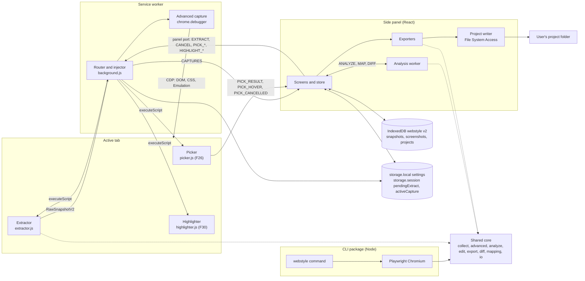

# Architecture

The extension keeps the v1 shape: a script injected into the page reads styles, a stateless service worker routes and drives the optional debugger, and the React side panel analyzes (in a Web Worker), exports and keeps snapshots in IndexedDB. v2 adds two small on-demand page scripts (picker and highlighter), Advanced capture over `chrome.debugger`, project-folder writing, and a Node CLI that runs the same core modules in Playwright Chromium. Nothing leaves the browser; only the CLI loads pages.

## Components



| Component | File | Runs in | Lifetime | Responsibilities |
| --- | --- | --- | --- | --- |
| Extractor | `entrypoints/extractor.js` (WXT unlisted script) | The page's isolated world, every accessible frame | Installed once per frame | Installs `self.__webstyle` with `collect(options)` and `readRecipe(selector)`; the service worker calls it with `executeScript({ func, args })` |
| Picker | `entrypoints/picker.js` (unlisted, 15 KB or less) | The page's isolated world, top frame | Until Escape, selection, PICK_STOP or panel disconnect | Installs `self.__webstylePicker` with `start`, `stop` and `key`; outlines the hovered element and sends PICK_HOVER, PICK_RESULT or PICK_CANCELLED |
| Highlighter | `entrypoints/highlighter.js` (unlisted, 15 KB or less) | The page's isolated world, top frame | Until cleared | Installs `self.__webstyleHighlighter` with `show(match)` and `clear()`; draws up to 200 outlines |
| Service worker | `entrypoints/background.js`, with logic in `src/platform/extract-handler.js` and `src/platform/overlays.js` | Extension background | Wakes on events, stops when idle | Opens the panel (`sidePanel` on Chrome, `sidebarAction.open()` on Firefox, through `openPanelOnAction` and `openPanelFromGesture` in `src/platform/chrome.js`), handles the shortcut, injects scripts, runs Advanced capture, cleans up on panel disconnect and after a restart |
| Advanced capture | `src/advanced/plan.js`, `src/advanced/cdp-client.js` | Service worker (extension) or Node (CLI) | One capture | Deep scan, dark emulation, forced states and widths against a `CdpClient` |
| Review UI | `entrypoints/sidepanel/` | Side panel page (Firefox sidebar) | While the panel is open | Screens, edits, persistence, Path A theme capture, screenshot cropping, analysis and export |
| Analysis worker | `src/analyze/worker.js` | Web Worker started by the panel | One request, then terminated | ANALYZE (analyze plus edit replay), MAP and DIFF |
| Exporters | `src/export/` | Side panel and CLI | On demand | Pure functions from DesignSystemV2 to file text |
| Project writer | `src/project/` | Side panel | On demand | Writes files to a linked folder with marked-block merging |
| Storage | `src/storage/` | IndexedDB, chrome.storage | Until deleted | Snapshots, screenshots, projects, settings, the v1 migration |
| CLI | `cli/src/` | Node 20 or newer with Playwright Chromium | One command | `webstyle extract`, `diff` and `map` |

## Module boundaries

- Only `entrypoints/` and `src/platform/` call `chrome.*`. `src/platform/` wraps tabs, scripting, storage, runtime, permissions and the debugger client so tests can mock them. `src/project/` uses the File System Access handles it is given.
- `src/analyze/`, `src/export/`, `src/edit/`, `src/diff/` and `src/mapping/` are pure: no `chrome.*`, no DOM, no I/O. `src/detect/`, `src/contrast/`, `src/audit/`, `src/io/` and `src/model/` are pure too.
- `src/advanced/plan.js` knows only the `CdpClient` interface, so the extension and the CLI run the same stages.
- The page scripts import only from `src/collect/` and `src/model/`. Color math (culori) runs only in the panel, the worker and the CLI.
- The panel and the worker talk only through the messages in `src/messaging.js`.
- Every UI string goes through `t()` in `src/i18n.js`; exporters never call it, so exports stay English.

## Source folders

| Path | Responsibility |
| --- | --- |
| `src/collect/` | Page side: DOM walk, translucent backdrop blending, stylesheet and variable reading, state-rule matching, specificity, selectors, overlays, auto-scroll |
| `src/advanced/` | `CdpClient` (chrome.debugger implementation) and the capture plan |
| `src/analyze/` | v2 analysis: pooling, themes and Path A, translucency, site variables, colors, typography, layout, motion, gradients, recipes, responsive table, confidence; `assemble.js` turns capture results into analysis input for both the panel and the CLI |
| `src/detect/` | Framework, icon library and variable-name rules |
| `src/contrast/` | WCAG 2.x contrast results (F27) |
| `src/audit/` | Consistency report (F29) |
| `src/edit/` | `applyEdit`, edit replay and token-reference refresh |
| `src/export/` | One file per format, the file map, the zip |
| `src/diff/` | Snapshot diff and `diff.md` (F39) |
| `src/mapping/` | Token-file parsers, matching, name application and `mapping.md` (F38) |
| `src/io/` | Snapshot import and export with zod schemas (F40) |
| `src/project/` | File-map validation, write planning and marked-block merging (F37) |
| `src/model/` | Ordered enums, stable ids, the same-site rule, design read helpers and highlight matching |
| `src/storage/` | IndexedDB stores, settings and the v1 migration |
| `src/platform/` | `chrome.*` wrappers, error classifier, extract handler, overlay injection, screenshot cropping |
| `src/i18n.js` | `t(key, ...subs)` over `chrome.i18n.getMessage`, plus `Intl` date and number helpers |
| `cli/` | The `webstyle-extractor` npm package |

## The CdpClient interface

Advanced capture is written once against this interface. The extension implements it with `chrome.debugger` (`chromeDebuggerClient` in `src/advanced/cdp-client.js`, which also has `attach()`); the CLI implements it with a Playwright CDP session (`playwrightCdpClient` in `cli/src/cdp.js`).

```js
/**
 * @typedef {object} CdpClient
 * @property {(method: string, params?: object) => Promise<any>} send
 * @property {(event: string, handler: (params: any) => void) => () => void} on  returns unsubscribe
 * @property {() => Promise<void>} detach  safe to call twice
 *
 * @typedef {object} AdvancedOptions
 * @property {boolean} deepScan  F23
 * @property {boolean} dark      F13 emulation (media mechanism only)
 * @property {boolean} states    F12 forced states
 * @property {number[]} widths   F24, at most 4 between 320 and 1920; none within 50 px of the current width
 */
// Stages: 'attach' | 'deep-scan' | 'light' | 'dark' | 'states' | `width-${n}` | 'detach'
```

CDP methods used: `DOM.enable`, `DOM.getDocument`, `DOM.querySelector`, `CSS.enable`, `CSS.styleSheetAdded` (event), `CSS.getStyleSheetText`, `CSS.forcePseudoState`, `Emulation.setEmulatedMedia`, `Emulation.setDeviceMetricsOverride` and `Emulation.clearDeviceMetricsOverride`. Limits: 5 MB of stylesheet text, 3 state targets per recipe and 30 in all, 8 s per stage and 20 s for the plan.

## Tech stack

Pin exact versions in `package.json`. The code is JavaScript (ES modules and JSX); the API and data-model docs keep TypeScript notation only to describe shapes.

| Layer | Packages |
| --- | --- |
| Extension framework | wxt, @wxt-dev/module-react |
| Language | JavaScript (ES modules, JSX), no TypeScript |
| UI | react, react-dom (19) |
| Styling | tailwindcss (v4), @tailwindcss/vite |
| Accessible primitives | @radix-ui/react-tabs, react-dropdown-menu, react-dialog, react-tooltip, react-toast, react-toggle-group, react-switch, react-popover |
| Icons | lucide-react |
| State | zustand |
| Color math | culori |
| Storage | idb |
| Zip | fflate |
| Validation | zod |
| Fonts | @fontsource-variable/inter, @fontsource/jetbrains-mono |
| Testing | vitest, @testing-library/react, jsdom, fake-indexeddb, @playwright/test |
| Linting | eslint, @eslint/js, globals, eslint-plugin-react-hooks, eslint-plugin-react, prettier; web-ext for Firefox |
| CLI | playwright (runtime), tsup (build) |

## Permissions

| Permission | Kind | Why | Granted |
| --- | --- | --- | --- |
| activeTab | Required | Temporary access to the tab the user invoked the extension on | Toolbar click or shortcut |
| scripting | Required | Inject the extractor, picker and highlighter | Install |
| sidePanel | Required (Chrome) | The only UI | Install |
| storage | Required | Settings, the pending-shortcut flag and `activeCapture` | Install |
| debugger | Optional (Chrome) | Advanced capture: deep scan, dark emulation, forced states, widths | Prompt from a click on the Advanced capture switch or Grant in Settings; revocable in Settings |
| `https://*/*`, `http://*/*` | Optional host patterns | Add pages, pick and highlight without a toolbar click on each page | "Allow on this site" requests exactly `<origin>/*` for one site; removable in Settings, Allowed sites |

No required host permissions, no `content_scripts`, no `downloads`, `tabs` or `clipboardWrite` permission. Downloads use a Blob link created in the panel, and copying uses `navigator.clipboard` during a click. Screenshots use `tabs.captureVisibleTab`, which works under activeTab or a granted host. Permission requests and `showDirectoryPicker` run in the panel, inside the user's click.

The Firefox build requests `activeTab`, `scripting` and `storage`, with the same optional host patterns and no `debugger`.

## Access model

| Action | Needs | How the user grants it |
| --- | --- | --- |
| Extract, re-run | Access to the tab | Toolbar click or shortcut (activeTab), or "Allow on this site" |
| Add a page to a snapshot (F25) | Access to the new page | Same as above; "Allow on this site" avoids clicking for every page |
| Pick an element (F26) | Access to the tab | Same as above |
| Highlight on page (F30) | Access to the tab, and Highlight turned on in Settings | Same as above |
| Component screenshots (F36) | Access to the tab | Same as above; uses `tabs.captureVisibleTab` |
| Advanced capture (F12, F13, F23, F24) | Optional `debugger` permission plus tab access | Permission prompt on first use |
| Write to project (F37) | Read-write permission on a chosen folder | Folder picker, re-confirmed by the browser when needed |

## Manifest config

WXT builds the manifest from `wxt.config.js`. It adds `side_panel` (Chrome) or `sidebar_action` (Firefox) from the `sidepanel` entrypoint and icons from `public/icon/`. Name, description, action title and command description come from `public/_locales/en/messages.json`.

```js
// wxt.config.js (abridged)
export const GECKO_ID = 'webstyle-extractor@example.invalid'; // replace before submitting to AMO

manifest: ({ mode, browser }) => ({
  name: '__MSG_extName__',
  description: '__MSG_extDescription__',
  default_locale: 'en',
  ...(browser === 'firefox'
    ? {
        browser_specific_settings: { gecko: { id: GECKO_ID, strict_min_version: '128.0' } },
        permissions: ['activeTab', 'scripting', 'storage'],
        optional_host_permissions: ['https://*/*', 'http://*/*'],
      }
    : {
        minimum_chrome_version: '116',
        permissions: ['activeTab', 'scripting', 'sidePanel', 'storage'],
        optional_permissions: ['debugger'],
        optional_host_permissions: ['https://*/*', 'http://*/*'],
      }),
  action: { default_title: '__MSG_actionTitle__' },
  commands: {
    extract: { suggested_key: { default: 'Alt+Shift+D' }, description: '__MSG_commandExtract__' },
  },
  // Production only: the dev server needs network access.
  ...(mode === 'production'
    ? { content_security_policy: { extension_pages: "script-src 'self'; object-src 'self'; connect-src 'none'" } }
    : {}),
});
```

The end-to-end build (`WXT_E2E=1`, output `.output/chrome-mv3-e2e`) adds `host_permissions` for `http://127.0.0.1/*` and `http://localhost/*` and makes `debugger` a required permission, because automation cannot click the toolbar icon or answer a permission prompt. It is never shipped; the manifest unit test checks the store build.

## The CLI

`cli/` is the npm package `webstyle-extractor` with the `webstyle` command. tsup builds two outputs: `dist/webstyle.js` (the Node CLI with the shared core inlined; only Playwright stays external) and `dist/collector.iife.js` (the collector the CLI evaluates in each page).

For each URL the CLI opens a Playwright Chromium context with `bypassCSP: true` and a 1280 x 800 viewport, waits for load (plus up to 5 s of network idle and `--wait`), evaluates the collector, calls `collect()`, runs the Advanced capture plan through a Playwright CDP session when any of dark, states, deep scan or widths is on, adds the Path A theme capture with `withOverrideCapture`, then analyzes and exports in Node with the extension's code. Output follows the file map in [api.md](api.md#file-map), plus `snapshot.webstyle.json`. See [cli/README.md](../cli/README.md).

## Deviations from docs/v2-spec.md

The code differs from the spec in these ways. Each is intentional and recorded here so the docs describe the code.

| Spec says | Code does | Why |
| --- | --- | --- |
| `.ts` file names (`src/model/types.ts`, `src/advanced/plan.ts`, `src/i18n.ts`, `entrypoints/picker.ts` and so on) | `.js` and `.jsx` files with JSDoc typedefs | The project language is JavaScript (v1 decision log) |
| One `figma-variables.json` with two collections | Three DTCG files: `design/figma/Primitives.tokens.json` (mode "Value"), `Semantic.Light.tokens.json` and `Semantic.Dark.tokens.json`; the Light and Dark files are written only when that theme exists | Figma's native variable import reads one file per mode |
| Capture has `id`, `pageUrl`, `mode`, `viewportWidth`, `method`, `capturedAt`, `raw` | Captures also carry `kind: 'base' \| 'theme' \| 'width'` | Analysis must tell width captures (responsive table only) from theme captures |
| DTCG letter spacing as a `dimension` in em | The `tracking` group writes `{ "$type": "number", "$value": <em>, "$extensions": { "com.webstyle": { "unit": "em" } } }`; inside `typography` tokens, `letterSpacing` is a px dimension (em times font size) | DTCG dimensions allow only px and rem |
| Migration derives role edits as `mode: 'light'` | Role edits use the mode of the v1 capture (`raw.colorScheme`), the snapshot's primary theme | A v1 dark-site snapshot's roles belong to its dark theme |
| Path A capture built from the page's stylesheets | The service worker returns only real captures; the panel (and the CLI, through `withOverrideCapture` in `src/analyze/assemble.js`) builds the `stylesheet-override` capture from the base capture's variable definitions and theme rules | The data is already in the base capture, and building it outside the page keeps the extractor small and identical in both hosts |
| EXTRACT is a runtime message | The panel sends EXTRACT, CANCEL, PICK_\* and HIGHLIGHT_\* over the `panel` port so progress and cancellation work; the service worker also still answers EXTRACT sent with `runtime.sendMessage` (no progress) | Progress and cancel need the long-lived port; the runtime message keeps v1 callers and tests working |
| The picker is keyboard-driven on the page | The Picking screen's Parent, Child and Select buttons send `ArrowUp`, `ArrowDown` and `Enter` to the page picker with a PICK_KEY message | The page may not have focus while the user is in the panel |
| Root package not named | The root package is `webstyle-extractor-extension` (private) | So the CLI package can be `webstyle-extractor` |

### Open gaps

Known limits of the current code:

- Tabs hover is not captured from stylesheets: state rules are matched against the tab list, not a single tab. Forced states (Advanced capture) still read it.
- Only the first representative of each variant is matched against stylesheet state rules.
- With only stylesheet overrides (Path A) for the other theme, contrast pairs are computed for the active theme only; emulated themes (Path B) get pairs for both.
- Settings shows the Advanced option defaults only after the debugger permission is granted; the default export selection is set from the Export tab checklist.
- Manual checks not automated: the Figma import (AC-F35.4), the Firefox sidebar and smoke checklist (AC-F43.3, AC-F43.5) and the Edge smoke checklist (AC-F43.6).
