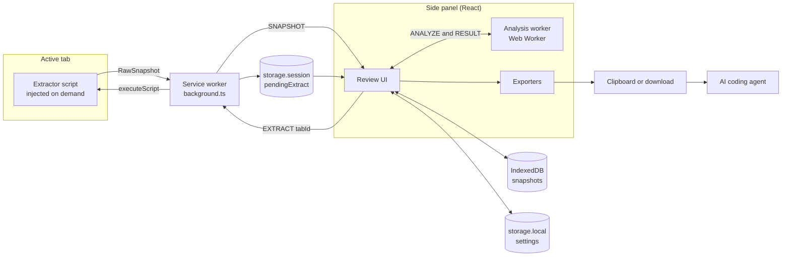

# Architecture

The extension has four runtime parts with one job each: an extractor injected into the page reads styles, a stateless service worker routes, the React side panel analyzes (in a Web Worker) and exports, and IndexedDB keeps snapshots. Nothing leaves the browser.

## Components



| Component | File | Runs in | Lifetime | Responsibilities |
| --- | --- | --- | --- | --- |
| Extractor | `entrypoints/extractor.js` (WXT unlisted script) | The page's isolated world | One run | Walk the DOM in slices, read computed styles, aggregate, return a RawSnapshot |
| Service worker | `entrypoints/background.js` with logic in `src/platform/extract-handler.js` | Extension background | Wakes on events, stops when idle | Open the panel on icon click, handle the shortcut, inject the extractor, map Chrome errors to error codes |
| Review UI | `entrypoints/sidepanel/` | Side panel page | While the panel is open | Screens, edits, persistence, starting analysis and exports |
| Analysis worker | `src/analyze/worker.js` | Web Worker started by the panel | One analysis | Run `analyze(raw)` and report progress |
| Exporters | `src/export/` | Side panel | On demand | Pure functions from DesignSystem to file text |
| Storage | `src/storage/` | IndexedDB, chrome.storage | Until deleted | Snapshots, settings, the pending-shortcut flag |

## Module boundaries

- Only `entrypoints/` and `src/platform/` call `chrome.*`. `src/platform/` wraps tabs, scripting, storage and runtime so tests can mock them.
- `src/analyze/` and `src/export/` are pure: no `chrome.*`, no DOM, no I/O.
- The extractor imports only from `src/collect/` and `src/model/`.
- The panel and the worker talk only through the messages in `src/messaging.js`.

## Tech stack

Use the latest stable version of each package at project start and pin exact versions in `package.json`. The side panel, worker and exporters are written in JavaScript; the API and data-model docs keep TypeScript notation only to describe shapes.

| Layer | Packages |
| --- | --- |
| Extension framework | wxt, @wxt-dev/module-react |
| Language | JavaScript (ES modules, JSX), no TypeScript |
| UI | react, react-dom (19) |
| Styling | tailwindcss (v4), @tailwindcss/vite |
| Accessible primitives | @radix-ui/react-tabs, react-dropdown-menu, react-dialog, react-tooltip, react-toast |
| Icons | lucide-react |
| State | zustand |
| Color math | culori |
| Storage | idb |
| Zip | fflate |
| Fonts | @fontsource-variable/inter, @fontsource/jetbrains-mono |
| Testing | vitest, @testing-library/react, jsdom, fake-indexeddb, @playwright/test |
| Linting | eslint, @eslint/js, globals, eslint-plugin-react-hooks, eslint-plugin-react, prettier |

## Permissions

| Permission | Why | Granted |
| --- | --- | --- |
| activeTab | Temporary access to the tab the user invoked the extension on | Toolbar click or shortcut |
| scripting | Inject the extractor into that tab | Install |
| sidePanel | The only UI | Install |
| storage | Settings and the pending-shortcut flag | Install |

No host permissions, no optional permissions, no `content_scripts`, no `downloads` or `clipboardWrite` permission. Downloads use a Blob link created in the panel, and copying uses `navigator.clipboard` during a click.

## Manifest config

WXT builds the manifest from this config. It adds `side_panel` from the `sidepanel` entrypoint and icons from `public/icon/`.

```js
// wxt.config.js (abridged: the real file also adds the e2e build switch)
import { defineConfig } from 'wxt';
import tailwindcss from '@tailwindcss/vite';

export default defineConfig({
  modules: ['@wxt-dev/module-react'],
  vite: () => ({ plugins: [tailwindcss()] }),
  manifest: {
    name: 'WebStyle Extractor for AI Agents',
    description:
      "Extract any website's colors, fonts and spacing into a DESIGN.md your AI coding agent can follow. Free, open source, local.",
    minimum_chrome_version: '116',
    permissions: ['activeTab', 'scripting', 'sidePanel', 'storage'],
    action: { default_title: 'Extract design system' },
    commands: {
      extract: {
        suggested_key: { default: 'Alt+Shift+D' },
        description: 'Extract the design system of this page',
      },
    },
  },
});
```

For production builds only, also set `content_security_policy.extension_pages` to `script-src 'self'; object-src 'self'; connect-src 'none'` so the no-network rule is enforced by Chrome. The dev server needs network access, so leave it out in development, and confirm the production build still loads.
