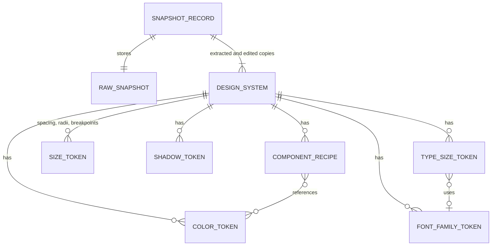

# Data model

Each extraction produces one SnapshotRecord holding the raw page data and two DesignSystems: the extracted copy, which never changes, and the edited copy, which the user changes and exporters read.

## Entities



## Types

Shapes are written in TypeScript notation for clarity; the code is JavaScript, with ordered enums and JSDoc typedefs in `src/model/types.js`. Token ids are stable within a snapshot (`c1`, `t1`, `s1` and so on, assigned by analysis) so edits survive re-renders.

```ts
export type Hex = string; // lowercase '#rrggbb' or '#rrggbbaa'
export type Step = 100 | 200 | 300 | 400 | 500 | 600 | 700 | 800 | 900;
export type HueFamily =
  | 'gray' | 'red' | 'orange' | 'yellow' | 'green'
  | 'teal' | 'blue' | 'indigo' | 'purple' | 'pink';
export type SemanticRole =
  | 'background' | 'surface' | 'text' | 'text-muted' | 'border'
  | 'primary' | 'accent' | 'success' | 'warning' | 'danger';
export type UsageContext = 'text' | 'background' | 'border' | 'interactive';
export type RecipeProperty =
  | 'background-color' | 'color' | 'border' | 'border-radius' | 'padding'
  | 'font-family' | 'font-size' | 'font-weight' | 'line-height' | 'box-shadow';
export type ExportFormat = 'design-md' | 'dtcg' | 'tailwind-v4' | 'tailwind-v3' | 'css-vars';

// ---------- Page side: returned by the extractor ----------
export interface ValueStat {
  value: string;            // computed CSS value, px for lengths
  count: number;            // elements using it
  weight: number;           // visible area (fills) or character count (text)
  contexts: UsageContext[];
}

export interface ComponentSample {
  kind: 'button' | 'input' | 'link' | 'h1' | 'h2' | 'h3' | 'h4' | 'h5' | 'h6';
  styles: Record<RecipeProperty, string>;
  count: number;            // elements sharing exactly these styles
}

export interface RawSnapshot {
  url: string;
  title: string;
  capturedAt: number;       // epoch ms
  viewport: { width: number; height: number };
  rootFontSizePx: number;
  colorScheme: 'light' | 'dark';
  elementsSampled: number;
  truncated: boolean;       // stopped at the element cap or time budget
  colors: ValueStat[];      // one entry per value and context set, so text, fill and border weights stay apart
  fontFamilies: ValueStat[];
  fontSizes: ValueStat[];
  fontWeights: ValueStat[];
  lineHeights: ValueStat[];
  spacing: ValueStat[];     // padding, margin and gap
  radii: ValueStat[];
  shadows: ValueStat[];
  cssVariables: Record<string, string>;
  breakpoints: number[];    // px, most frequently used first
  stylesheets: { readable: number; unreadable: number };
  samples: ComponentSample[];
  // One entry per distinct text style, value 'size|lineHeight|weight|fontFamily', contexts are the
  // tag names using it (h1, p, ...). Pairs each size with its line height, weight and family.
  textStyles: ValueStat[];
}

// ---------- Analysis side: built by the worker ----------
export interface ColorToken {
  id: string;
  name: string;             // 'gray-900', 'blue-600', 'white', 'black' or a user rename
  hex: Hex;
  oklch: { l: number; c: number; h: number | null };
  family: HueFamily | 'white' | 'black';
  step: Step | null;
  roles: SemanticRole[];    // semantic aliases that point at this token
  usageShare: number;       // 0 to 1
  contexts: UsageContext[];
  mergedFrom: Hex[];
  excluded: boolean;
}

export interface FontFamilyToken {
  id: string;
  name: string;             // 'sans' | 'serif' | 'mono' | 'display' or a user rename
  stack: string[];          // ['Inter', 'system-ui', 'sans-serif']
  usageShare: number;
  excluded: boolean;
}

export interface TypeSizeToken {
  id: string;
  name: string;             // 'xs' | 'sm' | 'base' | 'lg' | 'xl' | '2xl' ... '6xl'
  sizePx: number;
  lineHeightPx: number | null; // null means 'normal'
  weight: number;
  familyId: string | null;
  headings: Array<'h1' | 'h2' | 'h3' | 'h4' | 'h5' | 'h6'>;
  usageShare: number;
  excluded: boolean;
}

export interface SizeToken {
  id: string;
  name: string;             // 'space-4', 'radius-md', 'radius-full', 'md'
  px: number;               // radius-full is 9999
  usageShare: number;
  excluded: boolean;
}

export interface ShadowToken {
  id: string;
  name: string;             // 'shadow-sm' ... 'shadow-2xl'; 'shadow-xs' joins when there are 6
  value: string;            // CSS box-shadow
  blurPx: number;
  usageShare: number;
  excluded: boolean;
}

// ref is '<category>.<name>', e.g. 'color.blue-600'. id follows the token through renames and
// merges; raw is the page value, used when the token is excluded (AC-F6.5).
export type TokenRef = { ref: string; id: string; raw: string };

export interface ComponentRecipe {
  id: string;
  kind: 'button' | 'input' | 'link' | 'heading';
  variant: 'primary' | 'secondary' | 'default' | 'h1' | 'h2' | 'h3' | 'h4' | 'h5' | 'h6';
  styles: Partial<Record<RecipeProperty, TokenRef | string>>;
  excluded: boolean;
}

export interface DesignSystem {
  meta: {
    sourceUrl: string;
    hostname: string;
    capturedAt: number;
    colorScheme: 'light' | 'dark';
    partial: Array<'breakpoints' | 'cssVariables'>;
    truncated: boolean;
    stylesheets: { readable: number; unreadable: number }; // for the DESIGN.md notes
  };
  colors: ColorToken[];
  typography: { families: FontFamilyToken[]; sizes: TypeSizeToken[] };
  spacing: { baseUnitPx: 4 | 8 | null; tokens: SizeToken[] };
  radii: SizeToken[];
  shadows: ShadowToken[];
  breakpoints: SizeToken[];
  components: ComponentRecipe[];
}

// ---------- Storage ----------
export interface SnapshotRecord {
  id: string;               // crypto.randomUUID()
  schemaVersion: 1;
  url: string;
  hostname: string;
  title: string;
  capturedAt: number;
  raw: RawSnapshot;
  extracted: DesignSystem;  // never modified
  edited: DesignSystem;     // edited by the user, read by exporters
}

export interface SnapshotSummary {
  id: string;
  hostname: string;
  title: string;
  capturedAt: number;
  topColors: Hex[];         // five most-used, for the history strip
}

export interface Settings {
  lastExportFormat: ExportFormat;
}
```

## Naming rules

Scale names come from OKLCH values computed with culori. The ranges below are start values tuned on the fixtures. Pure white (L at least 0.99, chroma under 0.01) is `white` and pure black (L at most 0.01) is `black`; neither joins a scale. Translucent colors keep their family but take no step and are named `<family>-alpha-<percent>`, for example `black-alpha-50`.

A color's usage share is the mean of its share of text weight (characters), fill weight (area) and border weight (length), over the contexts the page uses, so the three units never mix.

| Hue family | OKLCH rule |
| --- | --- |
| gray | chroma under 0.02, or chroma relative to lightness, c / (L × (1 − L)), under 0.25. Tuned on the fixtures: plain chroma 0.03 called Tailwind's #111827 blue and pastel tints such as #dcfce7 gray |
| red | hue 0 to 40 or 345 to 360 |
| orange | hue 40 to 75 |
| yellow | hue 75 to 115 |
| green | hue 115 to 165 |
| teal | hue 165 to 215 |
| blue | hue 215 to 265 |
| indigo | hue 265 to 290 |
| purple | hue 290 to 320 |
| pink | hue 320 to 345 |

| Step | OKLCH lightness |
| --- | --- |
| 100 | 0.93 and above |
| 200 | 0.86 to 0.93 |
| 300 | 0.78 to 0.86 |
| 400 | 0.70 to 0.78 |
| 500 | 0.62 to 0.70 |
| 600 | 0.54 to 0.62 |
| 700 | 0.45 to 0.54 |
| 800 | 0.35 to 0.45 |
| 900 | below 0.35 |

| Semantic role | Rule |
| --- | --- |
| background | Color with the largest background weight |
| surface | Next most-used background color, if its weight is at least 5% of background's |
| text | Color with the largest text weight |
| text-muted | Next most-used text color with lower contrast against background than text, not saturated, and with at least 3:1 contrast (so white button labels are not muted text) |
| border | Color with the largest border weight |
| primary | Most-used interactive color (counted per element) with chroma of at least 0.08; on a tie a button fill beats a link color |
| accent | Next saturated interactive color whose hue differs from primary by at least 30 degrees |
| success, warning, danger | Saturated colors in the green, yellow or orange, and red families, used on at least 2 elements, that are not primary |

Token references use `<category>.<name>` with categories `color`, `font`, `text` (sizes), `space`, `radius`, `shadow` and `breakpoint`.

## Storage schema

| Store | Key | Value |
| --- | --- | --- |
| IndexedDB database `webstyle`, version 1, object store `snapshots` | keyPath `id`; indexes `byCapturedAt`, `byHostname` | SnapshotRecord |
| chrome.storage.local | `settings` | Settings |
| chrome.storage.session | `pendingExtract` | `{ tabId, windowId, at }`, set by the shortcut handler and cleared by the panel |

Schema changes bump the IndexedDB version and migrate in the `upgrade` callback; `schemaVersion` on each record allows per-record migration.
