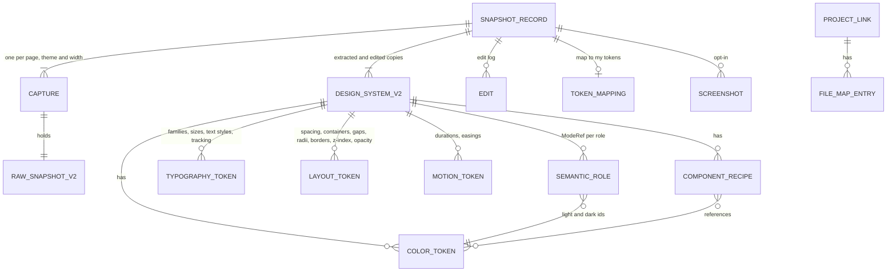

# Data model

Each snapshot is one SnapshotRecordV2. It holds the raw captures (one per page, theme and width), the extracted DesignSystemV2 (a pure analysis of all captures), the user's edit log and the edited copy (the extracted copy with the edits replayed), which exporters read. Token ids are value-based, so the edit log survives re-runs, merged pages and Advanced re-captures.

## Entities



## Types

Shapes are written in TypeScript notation for clarity. The code is JavaScript: `src/model/types.js` holds the ordered enums (`SEMANTIC_ROLES`, `THEME_MODES`, `INTERACTION_STATES`, `HUE_FAMILIES`, `STEPS`, `COMPONENT_KINDS`, `RECIPE_PROPERTIES`, `EXPORT_FORMATS`, `DEFAULT_EXPORT_SELECTION`, `CATEGORIES`, `SCHEMA_VERSION`), and modules document their own shapes with JSDoc typedefs. v1 types not repeated here (`ValueStat`, `ComponentSample`, `RawSnapshot`) keep their v1 definitions, shown at the end.

```ts
// ---------- Shared ----------
export type Hex = string; // lowercase '#rrggbb', or '#rrggbbaa' when translucent
export type Step = 100 | 200 | 300 | 400 | 500 | 600 | 700 | 800 | 900;
export type HueFamily =
  | 'gray' | 'red' | 'orange' | 'yellow' | 'green'
  | 'teal' | 'blue' | 'indigo' | 'purple' | 'pink';
export type ThemeMode = 'light' | 'dark';
export type InteractionState = 'default' | 'hover' | 'focus' | 'focus-visible' | 'active';
export interface Confidence { level: 'high' | 'medium' | 'low'; score: number; reasons: string[] }

export type SemanticRole =
  | 'background' | 'surface' | 'text' | 'text-muted' | 'border'
  | 'primary' | 'accent' | 'success' | 'warning' | 'danger'
  | 'focus-ring' | 'overlay';                                   // last two new in v2

export type UsageContext =
  | 'text' | 'background' | 'border' | 'interactive' | 'gradient' | 'outline';

export type ComponentKind =
  | 'button' | 'input' | 'link' | 'heading'
  | 'card' | 'badge' | 'navbar' | 'tabs' | 'alert' | 'table';  // last six new in v2

export type RecipeProperty =
  | 'background-color' | 'background-image' | 'color' | 'border' | 'border-width'
  | 'border-radius' | 'padding' | 'gap' | 'height' | 'font-family' | 'font-size'
  | 'font-weight' | 'line-height' | 'letter-spacing' | 'text-transform'
  | 'box-shadow' | 'outline' | 'outline-offset' | 'opacity' | 'transition';

export type ExportFormat =
  | 'design-md' | 'prompt' | 'dtcg' | 'tailwind-v4' | 'tailwind-v3' | 'css-vars'
  | 'shadcn' | 'styleguide' | 'agents-md' | 'cursor-rules' | 'claude-md'
  | 'figma' | 'audit';

// ref is '<category>.<name>', e.g. 'color.blue-600'. id follows the token through renames and
// merges; raw is the page value, used when the token is excluded.
export type TokenRef = { ref: string; id: string; raw: string };

// ---------- Page side: returned by the extractor ----------
export interface ColorStat extends ValueStat {
  effectiveHex: Hex;   // blended over its backdrop (F9); same as the value when opaque
  backdropHex: Hex;    // the opaque color it was blended over
}
export interface TextStyleSample {
  family: string; sizePx: number; lineHeightPx: number | null; fontWeight: number;
  letterSpacingEm: number; textTransform: string;
  tags: string[];      // e.g. ['h2'], ['label'], ['button']
  count: number; usage: number; // usage = character count
}
export type LayerHint = 'sticky-header' | 'dialog' | 'menu' | 'toast' | 'tooltip' | 'overlay';
export interface ZIndexSample { value: number; count: number; hints: LayerHint[] }
export interface GradientSample {
  css: string; type: 'linear' | 'radial' | 'conic';
  stops: Array<{ color: string; position: string | null }>;
  count: number; usage: number;
}
export interface FontFaceInfo {
  family: string; weights: number[]; styles: string[];
  provider: 'google-fonts' | 'adobe-fonts' | 'self-hosted' | 'other' | 'unknown';
  providerHost: string | null;  // host name only, never a URL
  loaded: boolean;
}
export interface VariableDef {
  name: string; value: string;  // value resolved through var() chains
  scope: 'root' | 'dark-media' | 'dark-selector' | 'light-selector' | 'other';
  selector: string;
}
export interface ThemeSignals {
  darkMedia: boolean; darkSelectors: string[]; lightSelectors: string[];
  activeMode: ThemeMode; colorSchemeProperty: string;
}
export interface SignalHit { id: string; evidence: string; count: number }
export interface ContrastSample {
  effectiveText: Hex; effectiveBg: Hex; sizePx: number; fontWeight: number; count: number;
}
export interface StateSample {
  kind: ComponentKind; variant: string; state: InteractionState;
  styles: Partial<Record<RecipeProperty, string>>; source: 'stylesheet' | 'forced';
}
export interface Representative {
  kind: ComponentKind; variant: string; selector: string; // unique CSS path; nothing added to the page
  rect: { x: number; y: number; width: number; height: number }; inViewport: boolean;
}

export interface RawSnapshotV2 extends Omit<RawSnapshot, 'colors'> {
  colors: ColorStat[];
  letterSpacings: ValueStat[];    // em
  textTransforms: ValueStat[];
  textStyles: TextStyleSample[];
  borderWidths: ValueStat[];
  opacities: ValueStat[];
  zIndices: ZIndexSample[];
  durations: ValueStat[];         // ms
  easings: ValueStat[];
  gradients: GradientSample[];
  containers: ValueStat[];        // px max-widths of centered containers
  gridColumns: ValueStat[];       // column counts as strings
  gaps: ValueStat[];              // px
  fontFaces: FontFaceInfo[];
  variableDefs: VariableDef[];
  variableUsage: Record<string, number>; // var(--x) references in readable sheets
  themeSignals: ThemeSignals;
  frameworkSignals: SignalHit[];
  iconSignals: SignalHit[];
  iconSizes: ValueStat[];
  iconStrokes: ValueStat[];
  contrastSamples: ContrastSample[];
  stateSamples: StateSample[];
  representatives: Representative[];
  coverage: { frames: { read: number; skipped: number }; shadowRoots: number; autoScrolled: boolean };
  devicePixelRatio: number;       // for screenshot cropping
}

// ---------- Analysis side: built by the worker ----------
export interface BaseToken {
  id: string;                  // stable, value-based (see Stable ids)
  name: string;                // site variable name, generated name or user rename
  aliases: string[];           // other names, e.g. the scale name when a site variable is primary
  siteVariable: string | null; // e.g. '--brand-primary'
  usageShare: number;          // 0 to 1
  confidence: Confidence;
  excluded: boolean;
}
export interface ColorTokenV2 extends BaseToken {
  hex: Hex;                    // as found; '#rrggbbaa' when translucent
  alpha: number;               // 1 when opaque
  baseTokenId: string | null;  // translucent: the opaque token it derives from
  effectiveHex: Hex;           // usage-weighted blend, for display and contrast only, never exported as a token
  oklch: { l: number; c: number; h: number | null };
  family: HueFamily | 'white' | 'black';
  step: Step | null;
  modes: ThemeMode[];          // themes the color was seen in
  contexts: UsageContext[];
  mergedFrom: Hex[];
}
export interface SizeTokenV2 extends BaseToken { px: number } // spacing, radii, borders, breakpoints, containers, gaps
export interface NumberToken extends BaseToken { value: number } // opacity, grid columns
export interface ZIndexToken extends NumberToken { layer: LayerHint | null }
export interface DurationToken extends BaseToken { ms: number }
export interface EasingToken extends BaseToken { css: string; bezier: [number, number, number, number] | null }
export interface LetterSpacingToken extends BaseToken { em: number }
export interface FontFamilyTokenV2 extends BaseToken { stack: string[]; webFont: FontFaceInfo | null }
export interface TypeSizeTokenV2 extends BaseToken {
  sizePx: number; lineHeightPx: number | null; fontWeight: number; letterSpacingEm: number;
  familyId: string | null; headings: Array<'h1' | 'h2' | 'h3' | 'h4' | 'h5' | 'h6'>;
}
export interface TextStyleToken extends BaseToken {
  familyId: string | null; sizePx: number; lineHeightPx: number | null; fontWeight: number;
  letterSpacingEm: number; textTransform: string; usedFor: string[];
}
export interface ShadowTokenV2 extends BaseToken { value: string; blurPx: number; modes: ThemeMode[] }
export interface GradientToken extends BaseToken {
  css: string; type: 'linear' | 'radial' | 'conic';
  stops: Array<{ colorTokenId: string | null; hex: Hex; position: string | null }>;
}

// A semantic role's token id in each theme. A missing key means the role was not found in that
// theme. With one theme only that mode's key is set.
export interface ModeRef { light?: string; dark?: string }
export type StateStyles = Partial<Record<InteractionState, Partial<Record<RecipeProperty, TokenRef | string>>>>;
export interface ComponentRecipeV2 {
  id: string;                  // 'component:<kind>:<variant>'
  kind: ComponentKind; variant: string; name: string;
  byMode: { light?: StateStyles; dark?: StateStyles }; // non-default states hold only changed properties
  stateSource: 'stylesheet' | 'forced' | 'none';
  representativeSelector: string | null;
  screenshotIds: string[];
  confidence: Confidence; excluded: boolean;
}
export interface Detection {
  id: string; name: string; version: string | null; confidence: Confidence; evidence: string[];
}
export interface ContrastResult {
  textTokenId: string; backgroundTokenId: string; mode: ThemeMode;
  ratio: number; large: boolean; level: 'AAA' | 'AA' | 'AA-large' | 'fail'; count: number;
}
export interface AuditReport {
  colorsBeforeMerge: number; colorsAfterMerge: number;
  nearDuplicateGroups: Array<{ kept: Hex; merged: Hex[] }>;
  offScaleSpacing: Array<{ px: number; usageShare: number }> | null; // null with no base unit
  distinct: { fontSizes: number; radii: number; shadows: number; zIndices: number; durations: number };
  contrastFailures: number;
  contrastFailureList: ContrastResult[];
  missingFocusStyle: boolean;
  variableConflicts: Array<{ name: string; values: string[] }>;
  lowConfidence: string[];     // token ids
}
export interface FocusRing {
  outline: string | null; offsetPx: number | null; boxShadow: string | null;
  colorTokenId: string | null; source: 'stylesheet' | 'forced' | 'browser-default';
}
export interface ResponsiveTable {
  widths: number[];
  textSizes: Array<{ tokenId: string; byWidth: Record<number, number> }>;
  containers: Record<number, number | null>;
  gridColumns: Record<number, number | null>;
  spacingBase: Record<number, 4 | 8 | null>;
}

export interface DesignSystemV2 {
  schemaVersion: 2;
  meta: {
    sourceUrl: string; hostname: string; capturedAt: number;
    pages: string[]; modes: ThemeMode[]; primaryMode: ThemeMode; viewports: number[];
    themeMechanism: 'media' | 'class' | 'attribute' | 'none'; themeSelector: string | null;
    framework: Detection[]; icons: Detection[]; webFonts: FontFaceInfo[];
    iconSizePx: number | null; iconStroke: number | null;
    partial: Array<'breakpoints' | 'cssVariables' | 'states' | 'dark' | 'frames'>;
    truncated: boolean;
    capture: { advanced: boolean; deepScan: boolean; autoScroll: boolean };
    stylesheets: { readable: number; unreadable: number };
    coverage: RawSnapshotV2['coverage'];
    borderStyle: string | null; gradientText: number;
    colorScheme: ThemeMode;      // equals primaryMode; kept for v1 readers
  };
  colors: ColorTokenV2[];
  semantic: Partial<Record<SemanticRole, ModeRef>>;
  roleConfidence: Partial<Record<SemanticRole, Partial<Record<ThemeMode, Confidence>>>>;
  gradients: GradientToken[];
  typography: {
    families: FontFamilyTokenV2[]; sizes: TypeSizeTokenV2[];
    letterSpacings: LetterSpacingToken[]; textStyles: TextStyleToken[];
  };
  spacing: { baseUnitPx: 4 | 8 | null; tokens: SizeTokenV2[] };
  layout: { containers: SizeTokenV2[]; gridColumns: NumberToken[]; gaps: SizeTokenV2[] };
  radii: SizeTokenV2[];
  borderWidths: SizeTokenV2[];
  shadows: ShadowTokenV2[];
  opacities: NumberToken[];
  zIndex: ZIndexToken[];
  motion: { durations: DurationToken[]; easings: EasingToken[]; properties: string[]; reducedMotion: boolean };
  breakpoints: SizeTokenV2[];
  responsive: ResponsiveTable | null;
  focusRing: FocusRing | null;
  components: ComponentRecipeV2[];
  contrast: ContrastResult[];
  nonTextContrast: Array<{ check: 'focus-ring' | 'input-border'; ratio: number; pass: boolean }>; // 3:1
  audit: AuditReport;
}

// ---------- Storage ----------
export interface Capture {
  id: string; pageUrl: string; mode: ThemeMode; viewportWidth: number;
  method: 'computed' | 'stylesheet-override' | 'emulated';
  kind: 'base' | 'theme' | 'width';  // not in the v2 spec; see architecture.md deviations
  capturedAt: number;
  raw: RawSnapshotV2;
}
export interface SnapshotRecordV2 {
  id: string; schemaVersion: 2; kind: 'page' | 'site' | 'component';
  url: string;                 // the first page
  hostname: string; title: string; capturedAt: number; updatedAt: number;
  pages: string[];             // pages of base and theme captures; width captures do not add pages
  captures: Capture[];
  extracted: DesignSystemV2;   // pure analysis of all captures
  edits: Edit[];               // the user's edit log
  edited: DesignSystemV2;      // cache: extracted with edits replayed
  staleEdits: number;          // edits that no longer match a token
  mapping: TokenMapping | null;
  screenshotIds: string[];
  migratedFromV1: boolean;
  rootSelector?: string;       // component snapshots (F26)
  captureWarnings?: string[];  // Advanced stages that failed (CAPTURE_PARTIAL)
  screenshotFailed?: boolean;  // SCREENSHOT_FAILED note for the Export tab
}
export interface SnapshotSummaryV2 {
  id: string; hostname: string; title: string; capturedAt: number; updatedAt: number;
  kind: 'page' | 'site' | 'component'; pages: number; modes: ThemeMode[]; topColors: Hex[];
}
export interface Settings {
  lastExportFormat: ExportFormat;      // default 'design-md'
  exportSelection: Array<ExportFormat | 'screenshots'>; // formats in zip and project writes
  panelTheme: 'system' | 'dark' | 'light';             // default 'system'
  useSiteVariableNames: boolean;       // default true
  shadcnFormat: 'oklch' | 'hsl';       // default 'oklch'
  includeScreenshots: boolean;         // default false
  autoScroll: boolean;                 // default false
  advancedEnabled: boolean;            // default false; the Home switch (not in the v2 spec)
  advancedDefaults: { dark: boolean; states: boolean; widths: number[]; deepScan: boolean };
                                       // default all on, widths [375, 768, 1280]
  highlightEnabled: boolean;           // default false
}
export interface ProjectLink {
  id: string; name: string; handle: FileSystemDirectoryHandle;
  fileMap: Partial<Record<ExportFormat | 'screenshots', string>>;
  lastWrittenAt: number | null;
}
export interface TokenMapping {
  sourceName: string; importedAt: number; useMyNames: boolean;
  entries: Array<{ tokenId: string; userToken: string | null; status: 'exact' | 'close' | 'none'; delta: number | null }>;
}

// ---------- Edits (src/edit/apply-edit.js) ----------
export type Edit =
  | { kind: 'rename'; tokenId: string; name: string }
  | { kind: 'setRole'; tokenId: string; role: SemanticRole; mode: ThemeMode }
  | { kind: 'clearRole'; role: SemanticRole; mode: ThemeMode }
  | { kind: 'exclude'; tokenId: string }
  | { kind: 'include'; tokenId: string }
  | { kind: 'merge'; sourceId: string; targetId: string }
  | { kind: 'renameComponent'; componentId: string; name: string }
  | { kind: 'useSiteName'; tokenId: string; use: boolean };
```

`normalizeSettings` in `src/storage/settings.js` validates every stored field and fills missing ones with these defaults; Advanced widths are kept only between 320 and 1920, at most 4.

### v1 page-side shapes (unchanged)

```ts
export interface ValueStat {
  value: string;            // computed CSS value, px for lengths
  count: number;            // elements using it
  weight: number;           // visible area (fills) or character count (text)
  contexts: UsageContext[];
}
export interface ComponentSample {
  kind: 'button' | 'input' | 'link' | 'h1' | 'h2' | 'h3' | 'h4' | 'h5' | 'h6';
  styles: Record<RecipeProperty, string>;
  count: number;
}
export interface RawSnapshot {
  url: string; title: string; capturedAt: number;
  viewport: { width: number; height: number };
  rootFontSizePx: number; colorScheme: 'light' | 'dark';
  elementsSampled: number; truncated: boolean;
  colors: ValueStat[]; fontFamilies: ValueStat[]; fontSizes: ValueStat[];
  fontWeights: ValueStat[]; lineHeights: ValueStat[]; spacing: ValueStat[];
  radii: ValueStat[]; shadows: ValueStat[];
  cssVariables: Record<string, string>;
  breakpoints: number[];
  stylesheets: { readable: number; unreadable: number };
  samples: ComponentSample[];
  textStyles: ValueStat[];  // v1 only; RawSnapshotV2 replaces it with TextStyleSample[]
}
```

## ModeRef semantics

- `semantic[role]` is a ModeRef: `{ light?: tokenId, dark?: tokenId }`. Both ids point into the same `colors` list; a color seen in both themes is one token whose `modes` lists both.
- With one theme, only that theme's key is set, and `meta.modes` has one entry. The Light / Dark switch and paired exports appear only when `meta.modes` has both.
- `meta.primaryMode` is the theme of the base capture (the one the page was showing). Single-theme exports and the v1 migration use it.
- When pages of one site support different themes, modes are united, and a role missing in one theme on some pages is filled from the pages that have it.
- `setRole` and `clearRole` edits name a mode, so changing `primary` in Dark leaves Light alone. A role always points to one token per mode.

## Naming rules

Scale names come from OKLCH values computed with culori. The ranges below are start values tuned on the fixtures. Pure white (L at least 0.99, chroma under 0.01) is `white` and pure black (L at most 0.01) is `black`; neither joins a scale.

Translucent colors are grouped by base RGB (OKLab distance under 0.02) and alpha rounded to 0.05, and named `<base>/<alpha%>`: the matching opaque token's name, `white`, `black` or the family-step name of the RGB, for example `black/10` or `blue-600/20`. No opaque base token is created when none exists on the page. In CSS variable names `/` becomes `-a` (`--color-blue-600-a20`).

When "Use site variable names" is on (default), a token with a matching site variable takes the derived site name (prefixes such as `--color-` stripped, lowercase kebab-case) and keeps the generated name in `aliases`; `useSiteName` edits override this per token. Framework-internal variables (`--tw-`, `--un-`) never name tokens.

A color's usage share is the mean of its share of text weight (characters), fill weight (area) and border weight (length), over the contexts the page uses. Gradient stops count at a quarter of normal weight. Width captures never change usage shares.

| Hue family | OKLCH rule |
| --- | --- |
| gray | chroma under 0.02, or chroma relative to lightness, c / (L × (1 − L)), under 0.25 |
| red | hue 0 to 40 or 345 to 360 |
| orange | hue 40 to 75 |
| yellow | hue 75 to 115 |
| green | hue 115 to 165 |
| teal | hue 165 to 215 |
| blue | hue 215 to 265 |
| indigo | hue 265 to 290 |
| purple | hue 290 to 320 |
| pink | hue 320 to 345 |

| Step | OKLCH lightness |
| --- | --- |
| 100 | 0.93 and above |
| 200 | 0.86 to 0.93 |
| 300 | 0.78 to 0.86 |
| 400 | 0.70 to 0.78 |
| 500 | 0.62 to 0.70 |
| 600 | 0.54 to 0.62 |
| 700 | 0.45 to 0.54 |
| 800 | 0.35 to 0.45 |
| 900 | below 0.35 |

Semantic roles are assigned per theme. Role words in site variable names (background, surface, foreground, muted, border, primary, accent, ring, destructive, success, warning, overlay and their synonyms in v2 spec F10) assign roles with high confidence and override the usage rules below. Roles and contrast use each color's `effectiveHex`.

| Semantic role | Rule |
| --- | --- |
| background | Color with the largest background weight |
| surface | Next most-used background color, if its weight is at least 5% of background's |
| text | Color with the largest text weight |
| text-muted | Next most-used text color with lower contrast against background than text, not saturated, and with at least 3:1 contrast |
| border | Color with the largest border weight |
| primary | Most-used interactive color (counted per element) with chroma of at least 0.08; on a tie a button fill beats a link color |
| accent | Next saturated interactive color whose hue differs from primary by at least 30 degrees |
| success, warning, danger | Saturated colors in the green, yellow or orange, and red families, used on at least 2 elements, that are not primary |
| focus-ring | The color of the focus ring from `:focus-visible` or `:focus` rules, or forced focus states |
| overlay | The most-used translucent background with alpha of at least 0.3 that covers at least 25% of the viewport |

Names for the new categories: `duration-<ms>`, easings by keyword or Tailwind name (`ease-out`) else `ease-custom-<n>`, `tracking-*` with Tailwind names (tighter to widest) else `tracking-custom-<n>`, `container-sm` to `container-2xl` plus `prose`, `gap-<px>`, `border-<px>`, `opacity-<percent>` and `opacity-disabled`, `z-header`, `z-dialog`, `z-menu`, `z-toast`, `z-tooltip`, `z-overlay` or `z-<value>`, `gradient-<n>` or the site variable name, and text styles named `h1` to `h6`, `button`, `label`, `code`, `display`, `overline`, `body`, `body-sm` and `caption`.

Token references use `<category>.<name>` with the categories in `CATEGORIES`: `color`, `gradient`, `font`, `text`, `textStyle`, `tracking`, `space`, `container`, `grid`, `gap`, `radius`, `border`, `shadow`, `opacity`, `z`, `duration`, `easing` and `breakpoint`.

## Stable ids and the edit log

Ids are built in `src/model/ids.js` as `<category>:<canonical value>`:

| Category | Id |
| --- | --- |
| Opaque color | `color:#2563eb` |
| Translucent color | `color:#000000@10` (alpha percent) |
| Spacing, radius, border, container, gap, breakpoint | `space:16`, `radius:8`, `border:1`, `container:1280`, `gap:24`, `breakpoint:768` |
| Type size | `text:16/24/400` (`normal` for no line height) |
| Text style | `textStyle:<hash>` |
| Letter spacing | `tracking:0.025` |
| Family | `family:inter` |
| Duration, easing | `duration:150`, `easing:<css without spaces>` |
| Shadow, gradient | `shadow:<hash>`, `gradient:<hash>` |
| Z-index, opacity, grid | `z:50`, `opacity:0.5`, `grid:12` |
| Component | `component:button:primary` |

The hash is an FNV-1a hex digest of the normalized CSS string. Two tokens with the same id are the same token by definition, across re-runs, merged pages and themes.

- Every edit is appended to `edits`. After any analysis (re-run, add page, Advanced re-capture, migration, import), the worker runs `edited = replay(extracted, edits)`, applying `applyEdit` in order.
- Edits whose token no longer exists are skipped and counted in `staleEdits`. They stay in the log, because a later merge may bring the token back, until the user chooses "Clear edits that no longer apply".
- "Reset to extracted" clears the edit log after confirmation.

## Storage schema

| Store | Key | Value |
| --- | --- | --- |
| IndexedDB `webstyle` version 2, store `snapshots` | keyPath `id`; indexes `byCapturedAt`, `byHostname`, `byUpdatedAt` | SnapshotRecordV2 |
| IndexedDB store `screenshots` | keyPath `['snapshotId', 'id']`; index `bySnapshot` | `{ snapshotId, id, recipeId, state, mode, blob, width, height }`; deleted with the snapshot |
| IndexedDB store `projects` | keyPath `id` | ProjectLink |
| chrome.storage.local | `settings` | Settings; missing fields are filled with defaults on read |
| chrome.storage.session | `pendingExtract` | `{ tabId, windowId, at }`, set by the shortcut handler and cleared by the panel |
| chrome.storage.session | `activeCapture` | `{ tabId, debuggerAttached, overlays, startedAt }`, set during a capture and read on service-worker start to detach a debugger and remove overlays left behind |

Schema changes bump the IndexedDB version and migrate in the `upgrade` callback; `schemaVersion` on each record allows per-record migration.

## Migration from v1

`migrateRecord` in `src/storage/migrate.js` runs in the IndexedDB `upgrade` callback from version 1 to 2, and again in `src/io` when importing a version 1 record.

1. Wrap the v1 `raw` in one Capture: `mode` from `raw.colorScheme`, `viewportWidth` from `raw.viewport.width`, `method: 'computed'`, `kind: 'base'`. Every new RawSnapshotV2 field is filled with an empty value, and each color's `effectiveHex` and `backdropHex` are its own value.
2. Set `extracted = analyze(captures)` with the v2 engine.
3. Derive the edit log by comparing the v1 extracted and edited copies: renames, exclusions, merges and role changes, matched by value. Role edits use the capture's mode, the snapshot's primary theme. Edits that cannot be matched are dropped and counted.
4. Replay the log, and set `kind: 'page'`, `pages: [url]`, `updatedAt = capturedAt`, `mapping: null`, `screenshotIds: []`, `migratedFromV1: true`.
5. The panel shows a one-time notice: "Upgraded N snapshots; M edits could not be carried over." Migrated snapshots show a banner: "Captured with v1. Re-run to read states, themes and more." A record that cannot be analyzed is left as it was rather than lost.
