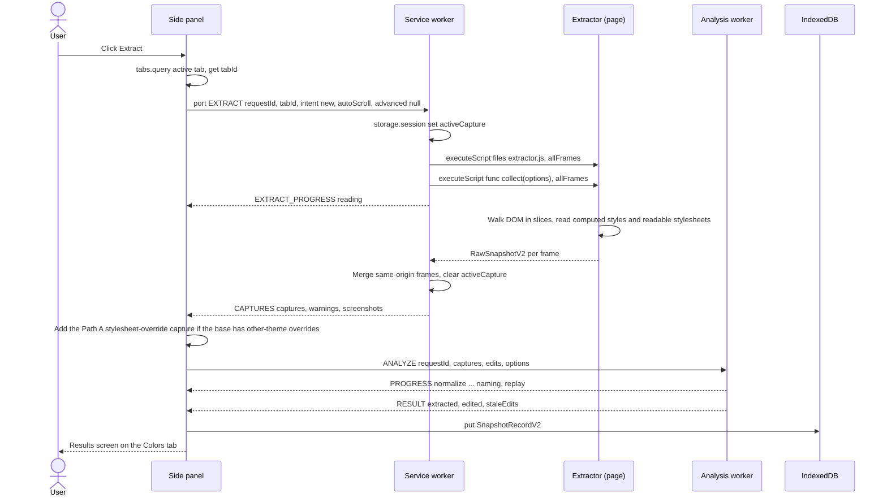
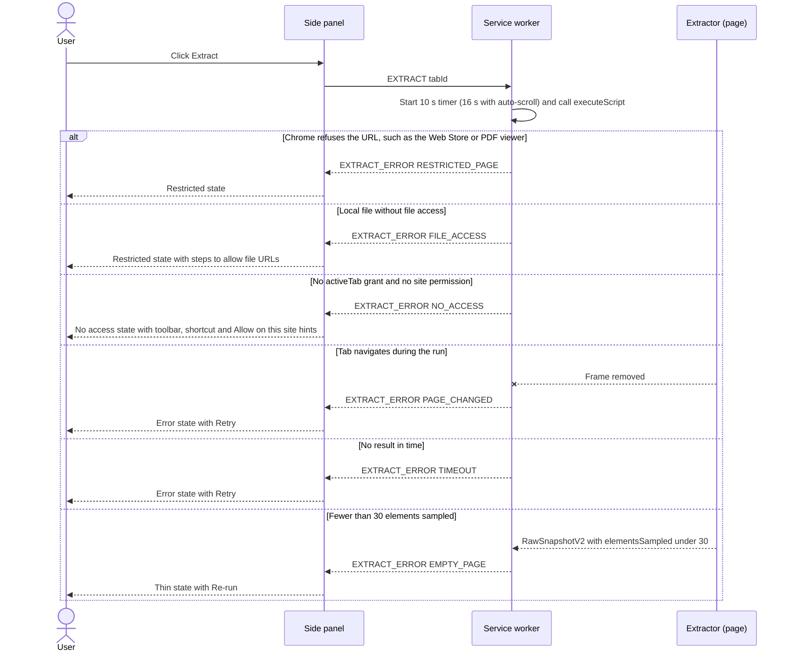
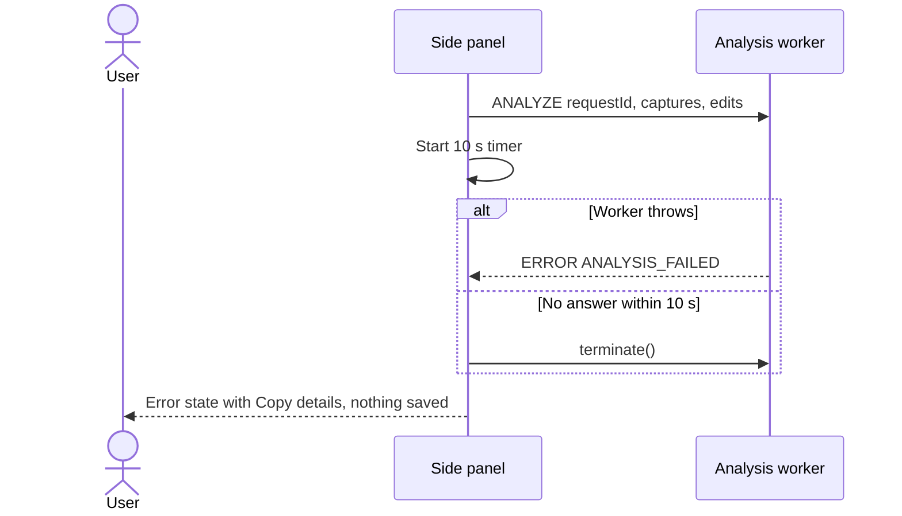
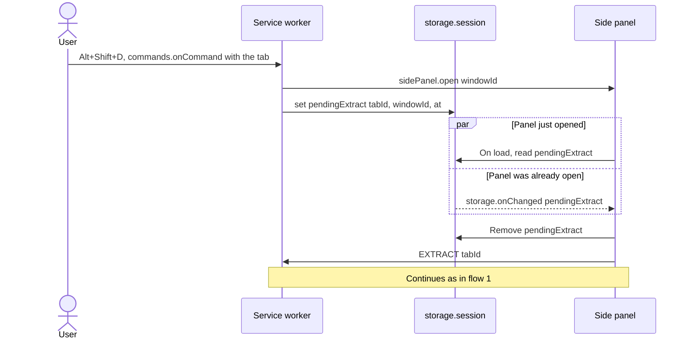
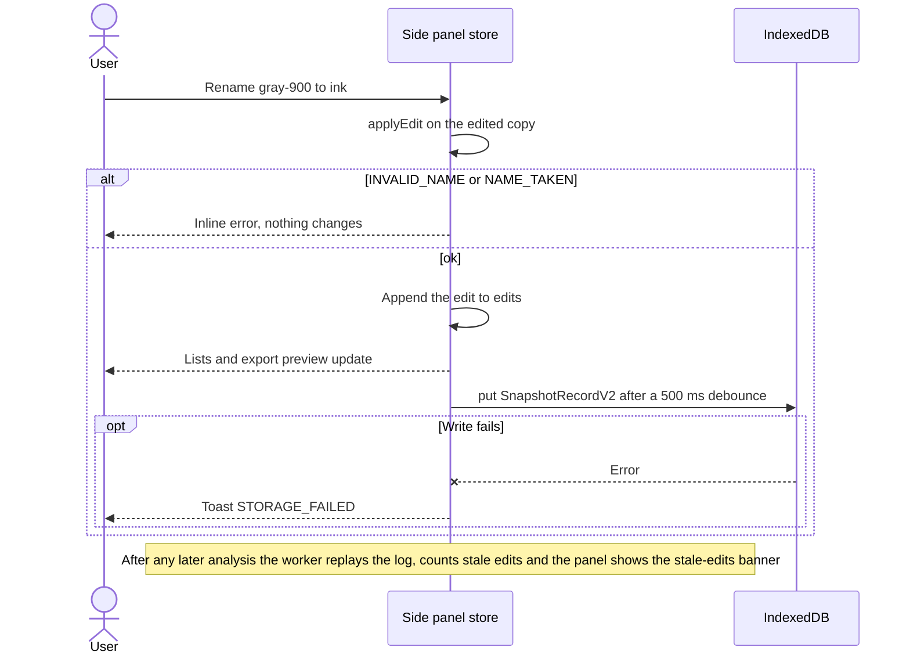
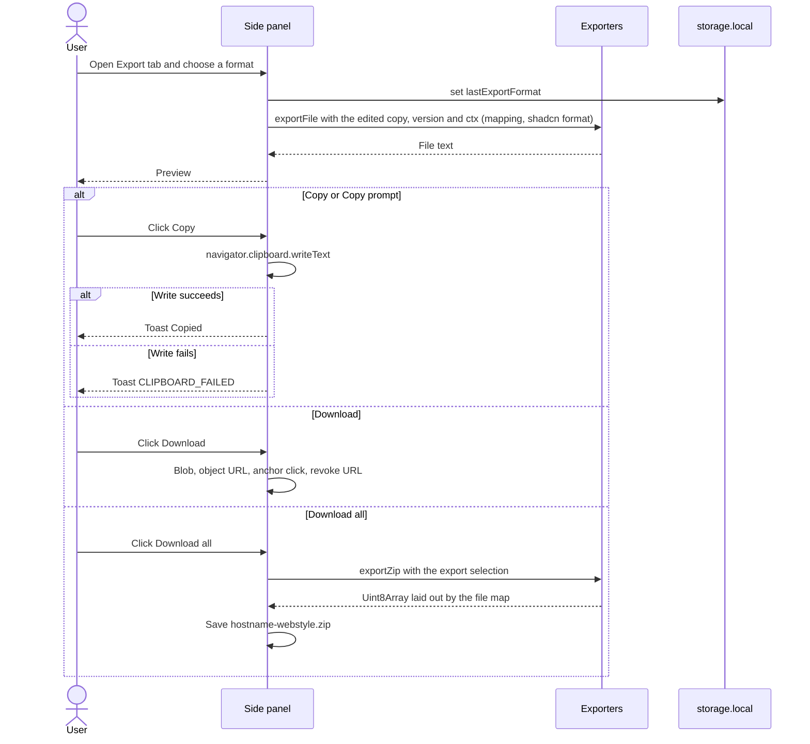
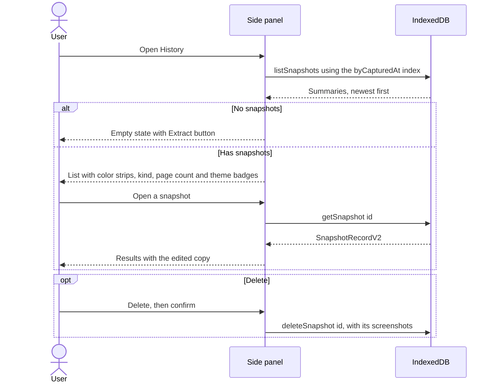
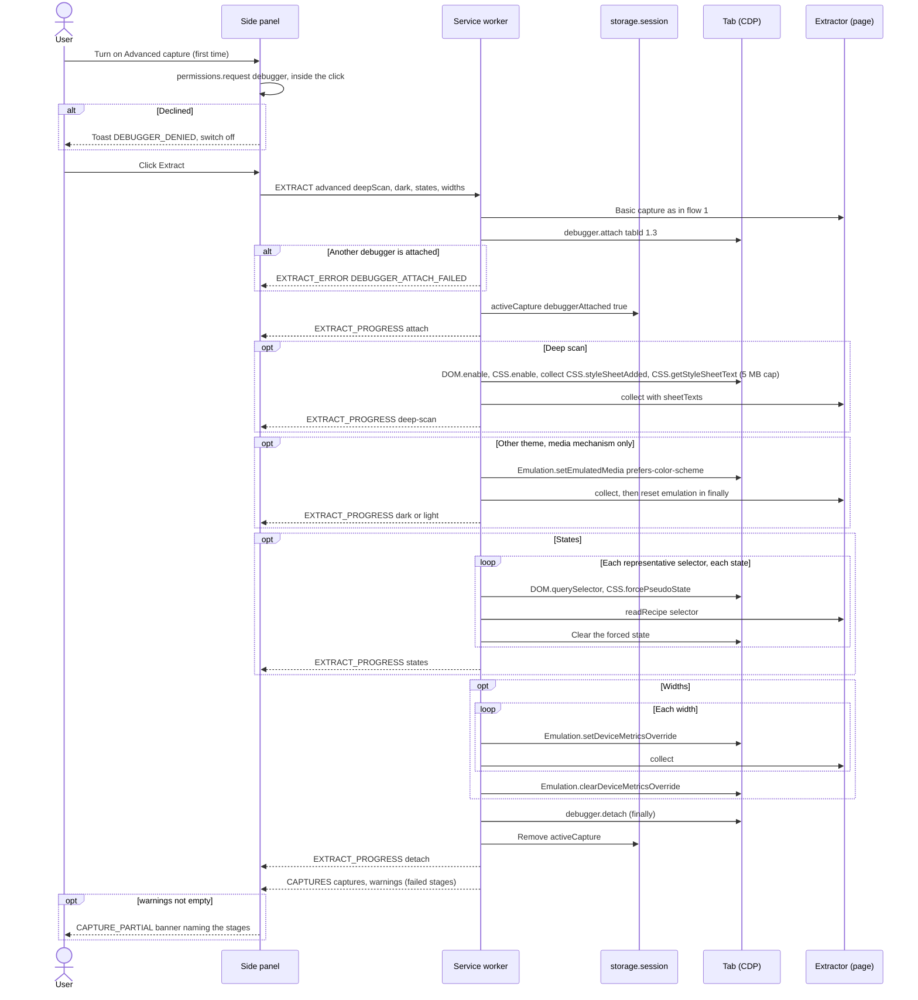
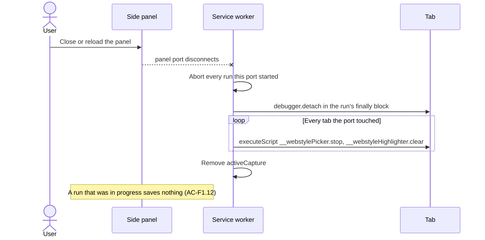
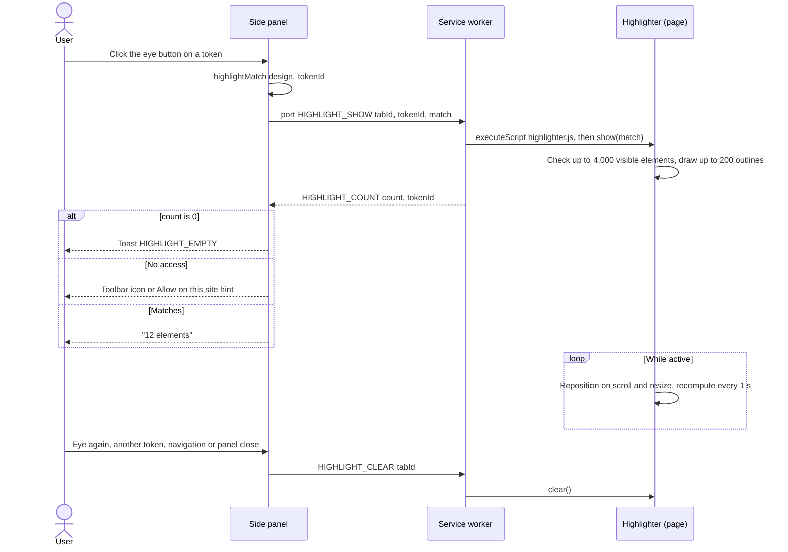

# Message sequences

These flows cover every message in the extension, failures and cleanup included. Solid arrows are requests, dashed arrows are replies, and a cross means the call failed. Flows 1 to 7 are the v1 flows updated for v2; flows 8 to 13 are new.

## 1. Extract (happy path)

The page is touched through `executeScript` only: once to install `self.__webstyle`, then once to call `collect(options)`. Everything after that happens inside the extension.



## 2. Extraction failures

Every failure ends in a named UI state; none leaves the panel spinning.



## 3. Analysis failure

A failed analysis saves nothing, so history never holds a broken snapshot.



## 4. Keyboard shortcut

`sidePanel.open` must be the first call in the command handler, with no `await` before it, or Chrome drops the user gesture. The panel ignores a `pendingExtract` older than 10 s.



## 5. Edit and autosave

Edits go into the edit log, so they survive re-runs, merges and Advanced re-captures.



## 6. Export



## 7. History



## 8. Advanced capture

The debugger is attached only for the plan and always detached in a `finally` block. A failed stage keeps the others.



Each stage stops at 8 s and the plan at 20 s. A navigation, a tab close or `debugger.onDetach` during the plan ends it with PAGE_CHANGED and nothing from the plan is saved. Chrome shows its "started debugging this browser" bar while attached.

## 9. Panel disconnect cleanup



## 10. Service worker restart recovery

The service worker keeps no state in variables. If Chrome stops it mid-capture, the next start cleans up from `activeCapture`.

```mermaid
sequenceDiagram
  participant SW as Service worker (new instance)
  participant S as storage.session
  participant T as Tab
  participant P as Side panel
  SW->>S: get activeCapture
  alt Record exists
    opt debuggerAttached
      SW->>T: debugger.detach, errors ignored
    end
    SW->>T: Remove picker and highlight overlays
    SW->>S: Remove activeCapture
  end
  P--xSW: Old port disconnected
  P->>P: Pending replies resolve empty; the run fails and can be retried
  P->>SW: Next message opens a new port
```

## 11. Element picker

```mermaid
sequenceDiagram
  actor U as User
  participant P as Side panel
  participant SW as Service worker
  participant K as Picker (page)
  U->>P: Pick element
  P->>SW: port PICK_START tabId
  SW->>K: executeScript picker.js, then __webstylePicker.start()
  alt Injection fails
    SW-->>P: EXTRACT_ERROR PICK_FAILED or an access code
    P-->>U: Toast
  else Ready
    SW-->>P: PICK_READY
    P-->>U: Picking screen
    loop Hover, arrows
      K-->>P: PICK_HOVER tag, width, height
    end
    opt Parent, Child or Select button in the panel
      P->>SW: PICK_KEY ArrowUp, ArrowDown or Enter
      SW->>K: __webstylePicker.key
    end
    alt Click or Enter
      K->>K: Remove overlay
      K-->>P: PICK_RESULT selector, rect, tag, role
      P->>SW: EXTRACT intent component, rootSelector
      Note over P,SW: Continues as in flow 1; saved as a component snapshot
    else Escape or navigation
      K->>K: Remove overlay
      K-->>P: PICK_CANCELLED
      P-->>U: Previous screen
    else Back in the panel
      P->>SW: PICK_STOP
      SW->>K: __webstylePicker.stop()
    end
  end
```

## 12. Highlight ("Where is this used?")



## 13. Write to project

```mermaid
sequenceDiagram
  actor U as User
  participant P as Side panel
  participant DB as IndexedDB projects
  participant FS as Project folder
  U->>P: Write to my-app
  P->>DB: Get the ProjectLink handle and file map
  P->>FS: queryPermission readwrite
  opt Not granted
    P->>FS: requestPermission inside the click
    alt Denied
      P-->>U: Toast FS_PERMISSION_DENIED
    end
  end
  P->>P: exportFiles for the export selection, mapFiles to the project's paths
  P->>FS: Read existing files
  P->>P: planWrites: new, updated or unchanged; marked-block merge for AGENTS.md and CLAUDE.md
  P->>FS: Write new and updated files, creating folders; never delete
  alt Some writes fail
    P-->>U: Dialog FS_WRITE_FAILED listing the files
  else All written
    P-->>U: Summary dialog with new, updated and unchanged files
  end
  P->>DB: Save lastWrittenAt
```
