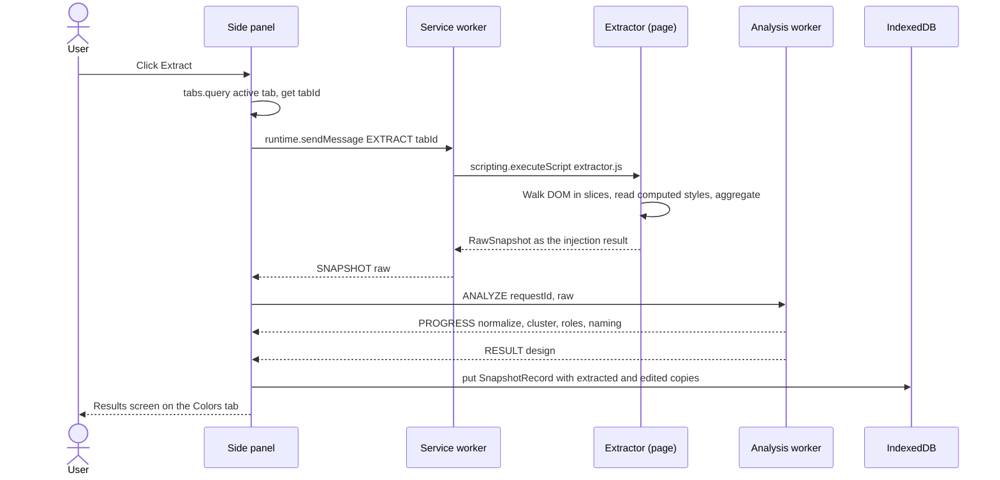
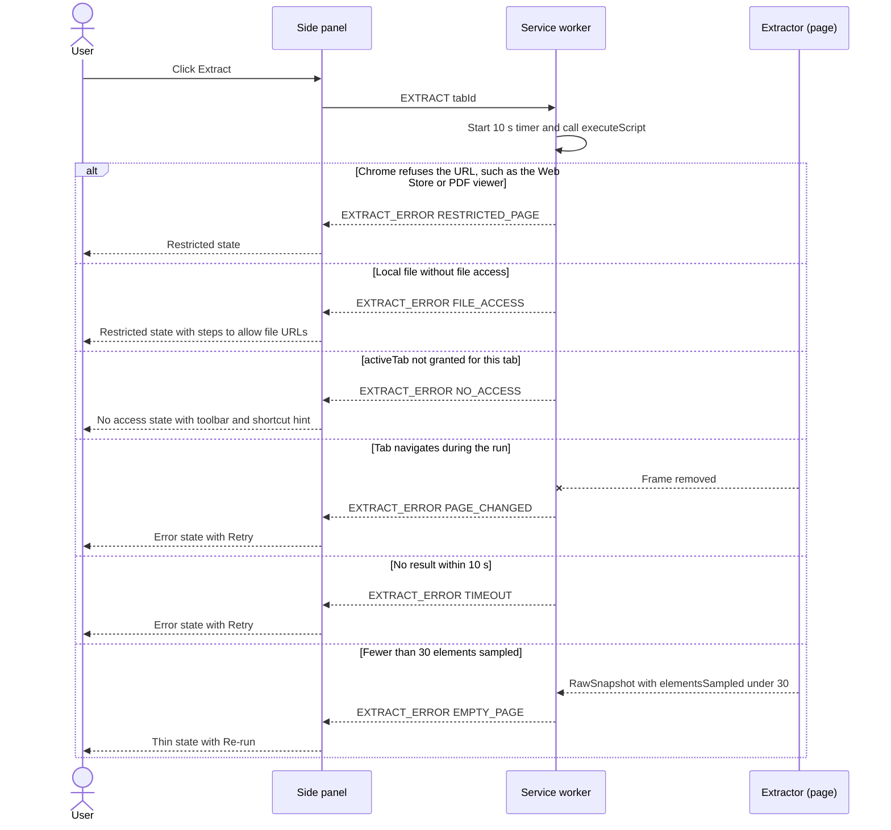
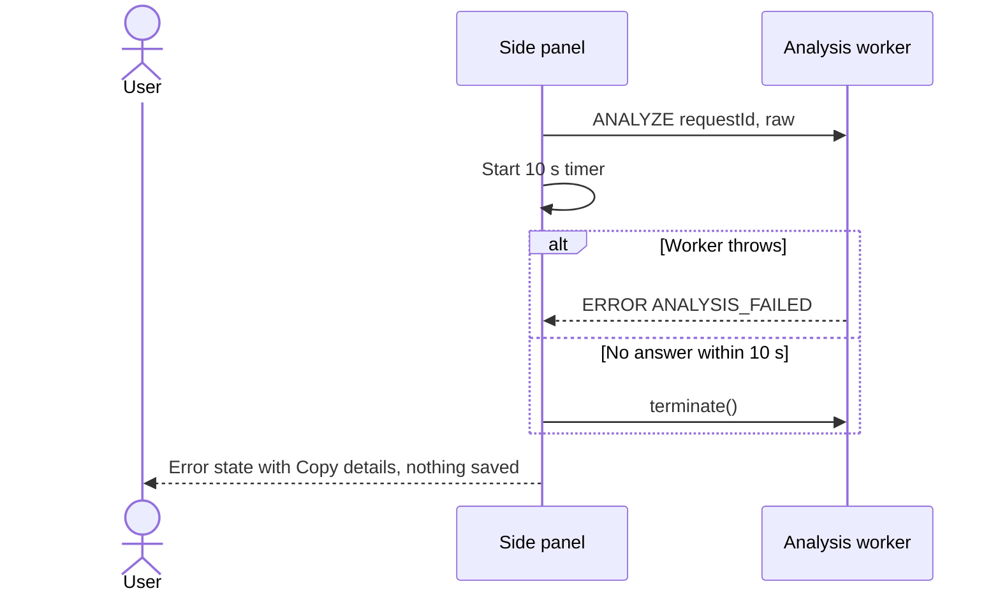
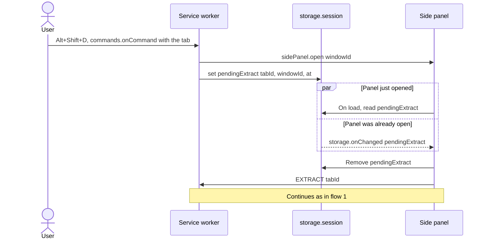
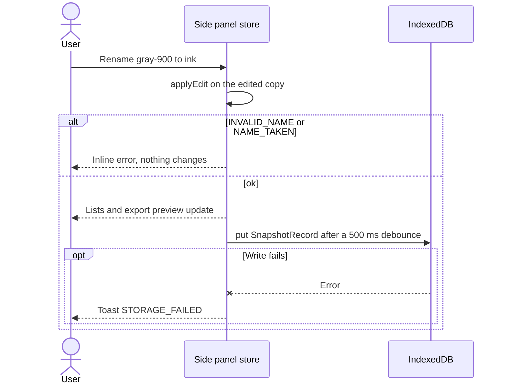
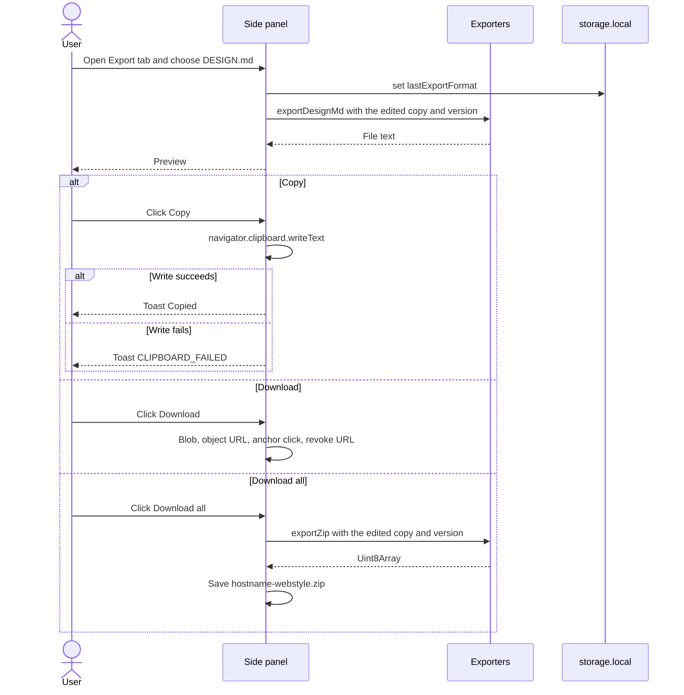
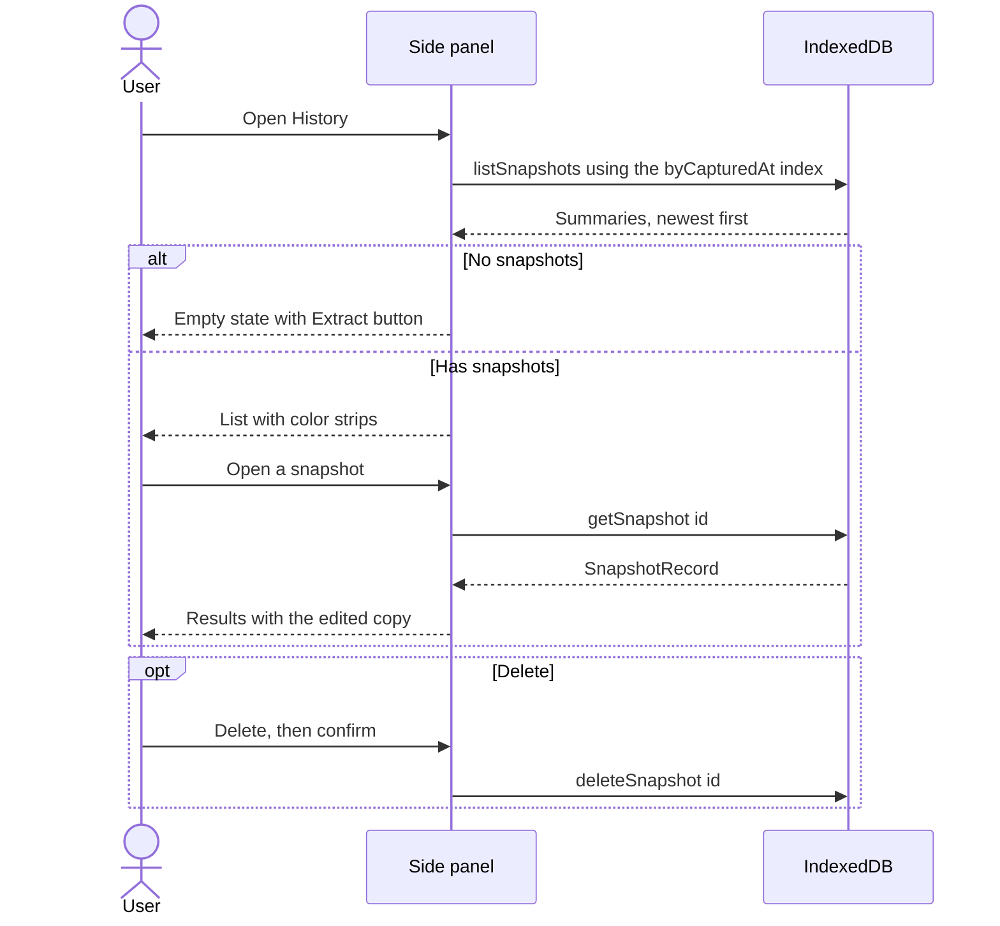

# Message sequences

Seven flows cover every message in the extension, failures included. Solid arrows are requests, dashed arrows are replies, and a cross means the call failed.

## 1. Extract (happy path)

The page is touched once, through a single `executeScript`; everything after that happens inside the extension.

## 2. Extraction failures

Every failure ends in a named UI state; none leaves the panel spinning.

## 3. Analysis failure

A failed analysis saves nothing, so history never holds a broken snapshot.

## 4. Keyboard shortcut

`sidePanel.open` must be the first call in the command handler, with no `await` before it, or Chrome drops the user gesture. The panel ignores a `pendingExtract` older than 10 s.

## 5. Edit and autosave

## 6. Export

## 7. History

