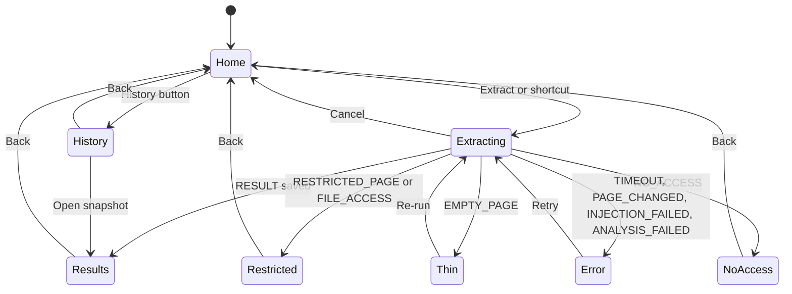

# UI spec

The panel is a dark developer tool: near-black surfaces, one soft-blue accent and monospace for every value. The user's extracted colors are the brightest things on screen, so the interface around them stays quiet.

## Principles

- The extracted colors are the hero; the interface uses grays plus one accent.
- Every value (hex, px, token name, code) is set in JetBrains Mono.
- Dense but scannable: 13 px body text, 32 px rows.
- Keyboard first: every action is reachable with Tab, with a visible focus ring.
- Dark theme only in v1. No light theme, no theme toggle.

## Color tokens

Define these once in `entrypoints/sidepanel/theme.css` inside a Tailwind v4 `@theme` block, so classes such as `bg-surface` and `text-muted` exist. Components never use raw hex. Every text color meets at least 4.5:1 contrast on `bg`.

| Token | Value | Use |
| --- | --- | --- |
| `--color-bg` | #0a0a0b | Panel background |
| `--color-surface` | #121214 | Cards, code preview |
| `--color-surface-2` | #1a1a1d | Hover, inputs, menus |
| `--color-surface-3` | #232327 | Pressed, selected, badges |
| `--color-border` | #26262a | Dividers, card borders |
| `--color-border-strong` | #3a3a40 | Hovered and focused borders, menus |
| `--color-text` | #ededef | Primary text (about 17:1) |
| `--color-muted` | #a1a1aa | Secondary text (about 7.7:1) |
| `--color-faint` | #82828c | Hints, hex values, labels (about 5.2:1) |
| `--color-accent` | #7aa2f7 | Primary buttons, active tab, focus ring (about 7.9:1) |
| `--color-accent-hover` | #96b5fa | Primary button hover |
| `--color-on-accent` | #0a0a0b | Text on accent |
| `--color-success` | #4ade80 | Check marks, success toasts |
| `--color-warning` | #fbbf24 | Thin and partial warnings |
| `--color-danger` | #f87171 | Delete actions, errors |
| `--color-swatch-ring` | rgb(255 255 255 / 0.08) | 1 px inset ring so dark swatches stay visible |

## Typography

Fonts are bundled locally through Fontsource: `--font-sans: "Inter Variable", system-ui, sans-serif` and `--font-mono: "JetBrains Mono", ui-monospace, monospace`.

| Token | Size / line height | Weight | Use |
| --- | --- | --- | --- |
| `text-xs` | 11 / 16 px | 500 | Section labels, uppercase with 0.04em tracking |
| `text-sm` | 12 / 16 px | 400 | Mono values, secondary info |
| `text-base` | 13 / 20 px | 400 | Body, list rows |
| `text-md` | 14 / 20 px | 500 | Buttons, dialog titles |
| `text-lg` | 16 / 24 px | 600 | Screen titles |

## Spacing, radius, motion

- Spacing uses a 4 px base: 4, 8, 12, 16, 24, 32. Panel padding is 16 px, rows are 32 px, the header is 44 px.
- Radius: 4 px swatches, 6 px controls, 8 px cards and dialogs, full for pills.
- Only menus, dialogs and toasts are elevated: `0 8px 24px rgb(0 0 0 / 0.5)` plus a 1 px `border-strong` border.
- Motion: 120 ms ease-out for hovers and toggles, 180 ms for menus and dialogs, none under `prefers-reduced-motion`.
- Layout: designed at 360 px wide and fluid from 320 to 600 px, since Chrome lets users resize the side panel. The header and the results tab bar are sticky; content scrolls.

## Components

Radix UI primitives supply behavior and accessibility; Tailwind supplies the look. Icons come from lucide-react at 16 px.

| Component | Spec |
| --- | --- |
| Primary button | `accent` fill, `on-accent` text, 32 px tall, 12 px side padding, 6 px radius, `text-md`. Hover `accent-hover`. Disabled at 40% opacity |
| Secondary button | `surface-2` fill, `border` border, `text` text; hover `border-strong` |
| Ghost button | Transparent with `muted` text; hover `surface-2` fill and `text` text |
| Icon button | 28 x 28 px, 16 px icon, tooltip with its label, `aria-label` set |
| Tabs | Radix Tabs; 36 px bar; labels `text-base` 500 in `muted`; active label `text` with a 2 px `accent` underline; arrow keys move between tabs |
| Token row | 32 px tall: 20 px swatch with `swatch-ring`, name (mono 12, `text`), hex (mono 12, `faint`), role badge, usage bar (40 x 4 px) with percent (mono 11), menu button shown on hover and focus. Excluded rows at 40% opacity with an Excluded badge |
| Role badge | 18 px pill, `text-xs`, `surface-3` fill, `muted` text |
| Scale strip | One 24 px swatch per step 100 to 900, step number below in mono 11; empty steps drawn as a 1 px dashed `border` outline |
| Section label | `text-xs` uppercase in `faint`, 24 px space above, count right-aligned |
| Code preview | `surface` fill, `border` border, 8 px radius, mono 12 / 18 px, line numbers in `faint`, scrolls inside, no syntax highlighting |
| Toast | Radix Toast at bottom center, `surface-3`, `border-strong`; 1.5 s for Copied, 4 s for errors |
| Menu | Radix DropdownMenu, `surface-2`, 28 px items, destructive items in `danger` |
| Dialog | Radix Dialog for delete and reset confirmations, max 320 px, title `text-md` 600, Cancel (secondary) and confirm (primary or danger) right-aligned |
| State block | Centered: 24 px icon in `faint`, title `text-md` 600, one line of `muted` body, one action button |
| Progress list | Three rows (Reading page, Analyzing, Saving) with spinner, check or pending dot; the spinner becomes a static icon under reduced motion |

Icons used: Pipette (logo, Extract), History, Copy, Download, FileArchive, MoreHorizontal, Check, AlertTriangle, Lock, RotateCcw, Trash2, ChevronLeft.

**Extension icon:** an original mark: a white eyedropper on an `accent` rounded square, exported at 16, 32, 48 and 128 px into `public/icon/`.

## Screens

The panel has four screens (Home, Extracting, Results, History) plus the failure states, and every path back leads to Home.



The wireframes below are drawn at the 360 px design width. They fix layout and content, not exact pixels; the tokens and components above fix the look.

### Home

```text
┌────────────────────────────────────────────┐
│ ◈ WebStyle                       [⟲]  [⋯]  │  header 44px: logo, History, menu
├────────────────────────────────────────────┤
│  example.com                               │  text-lg ("Current tab" if the URL is not readable)
│  https://example.com/pricing               │  mono 12, faint, truncated
│                                            │
│  ┌──────────────────────────────────────┐  │
│  │        Extract design system         │  │  primary button, full width
│  └──────────────────────────────────────┘  │
│  or press Alt+Shift+D                      │  text-sm, faint, keycap style
│                                            │
│  RECENT                                    │  section label
│  ■■■■■  acme.dev              2 h ago      │  top-5 color strip, hostname, date
│  ■■■■■  shop.example          Oct 12       │
└────────────────────────────────────────────┘
```

On first run, Recent is replaced by three numbered lines: Extract a page, Review the tokens, Export to your agent. The header menu holds Change shortcut (opens chrome://extensions/shortcuts), Source code on GitHub and Delete all history.

### Extracting

```text
│  example.com                               │
│                                            │
│  ✓  Reading page                           │  check in success
│  ◌  Analyzing                              │  spinner
│  ·  Saving                                 │  pending dot, faint
│                                            │
│  [ Cancel ]                                │  secondary button
```

### Results: Colors tab

```text
┌────────────────────────────────────────────┐
│ [‹]  example.com · Oct 18            [⋯]   │  menu: Re-run, Reset to extracted, Delete
├────────────────────────────────────────────┤
│ Colors  Type  Layout  Components  Export   │  sticky; scrolls sideways if narrow
│ ‾‾‾‾‾‾                                     │
│ SEMANTIC                                6  │
│ ■ background  white     #ffffff  ▬ 61%  ⋯  │  role badge, token, hex, usage, menu
│ ■ text        gray-900  #111827  ▬ 22%  ⋯  │
│ ■ primary     blue-600  #2563eb  ▬  6%  ⋯  │
│                                            │
│ SCALES                                 14  │
│ gray  ■   ■   ┆   ■   ┆   ■   ■   ┆   ■    │  dashed = empty step
│       100 200 300 400 500 600 700 800 900  │
│ blue  ┆   ┆   ┆   ┆   ■   ■   ■   ┆   ┆    │
│                                            │
│ ▸ 3 excluded                               │  collapsed row
└────────────────────────────────────────────┘
```

Clicking a scale swatch opens its token row under the strip (name, hex, usage, merged-from list, menu). When no primary exists, the Semantic section shows "No primary color detected".

### Results: Type tab

```text
│ FAMILIES                                   │
│ sans   "Inter", system-ui, sans-serif      │
│ mono   "JetBrains Mono", monospace         │
│                                            │
│ SCALE                                      │
│ 4xl   36/40  700  h1   Aa Heading sample   │  sample rendered in the extracted stack
│ 2xl   24/32  600  h2   Aa Heading sample   │
│ base  16/24  400       Aa Body sample      │
│ sm    14/20  400       Aa Body sample      │
│ Previews use fonts installed on this computer│
```

### Results: Layout tab

```text
│ SPACING · base 4px                         │
│ space-1    4px  ▮                          │  bar width = value
│ space-2    8px  ▮▮                         │
│ space-4   16px  ▮▮▮▮                       │
│                                            │
│ RADIUS                                     │
│ radius-sm 4px  ▢    radius-md 8px  ▢       │
│                                            │
│ SHADOWS                                    │
│ shadow-sm  ┌──────┐   shadow-md  ┌──────┐  │  card tiles on a light preview tile
│            └──────┘              └──────┘  │
│ BREAKPOINTS                                │
│ sm 640 · md 768 · lg 1024                  │
│ ⚠ Partial: 2 stylesheets couldn't be read  │  warning banner when meta.partial is set
```

Shadows are invisible on a dark background, so previews sit on a light tile using an extra token `--color-preview` (#f4f4f5); add it to `theme.css` with the others.

### Results: Components tab

```text
│ BUTTON · PRIMARY                           │
│ ┌────────────────────────────────────────┐ │
│ │            [  Button  ]                │ │  live preview built from the tokens
│ └────────────────────────────────────────┘ │
│ background  primary (blue-600)             │  mono key/value list
│ text        white                          │
│ padding     space-2 space-4                │
│ radius      radius-md                      │
│ font        sans 14/20 600                 │
```

Previews use generic labels (Button, Placeholder, Link text, Heading 1), never text from the page.

### Results: Export tab

```text
│ FORMAT                                     │
│ [ DESIGN.md                          ▾ ]   │  DESIGN.md, tokens.json, theme.css (v4),
│                                            │  tailwind.config.js (v3), variables.css
│ ┌────────────────────────────────────────┐ │
│ │ 1  # Design system: example.com        │ │  code preview, scrolls inside
│ │ 2                                      │ │
│ │ 3  Extracted 2026-10-18 from …         │ │
│ └────────────────────────────────────────┘ │
│ [ Copy ]  [ Download ]                     │  primary, secondary
│ [ Download all (.zip) ]                    │  ghost
│ 142 lines · 4.1 KB                         │  faint
```

### History

```text
│ [‹]  History                  [Delete all] │
│ ■■■■■  example.com         Today 14:02  ⋯  │  menu: Open, Delete
│ ■■■■■  acme.dev            Oct 12       ⋯  │
```

## States

| State | Trigger | Icon | Title | Action |
| --- | --- | --- | --- | --- |
| First run | No snapshots on Home | None | Three-step explainer | Extract |
| Extracting | A run starts | Progress list | Page hostname | Cancel |
| Restricted | RESTRICTED\_PAGE, FILE\_ACCESS | Lock | Can't read this page | Back |
| No access | NO\_ACCESS | Lock | Give access to this tab | Back (shortcut shown as a keycap) |
| Thin | EMPTY\_PAGE | AlertTriangle in warning | Too little to read | Re-run |
| Error | TIMEOUT, PAGE\_CHANGED, INJECTION\_FAILED, ANALYSIS\_FAILED | AlertTriangle in danger | Something went wrong | Retry, Copy details |
| History empty | No snapshots in History | History | No snapshots yet | Extract |
| Partial | `meta.partial` is not empty | AlertTriangle in warning | Inline banner on the affected tab | None |

Body text for each state is the message in the api.md error table.

## Accessibility

- Every control is a real button or a Radix primitive with an accessible name.
- Focus ring: 2 px `accent` outline with 2 px offset, never removed.
- Color is never the only signal: swatches show hex, and states pair an icon with text.
- Progress stages and toasts are announced through a polite live region.
- Tab order follows visual order; Escape closes menus and dialogs and returns focus to the trigger.
