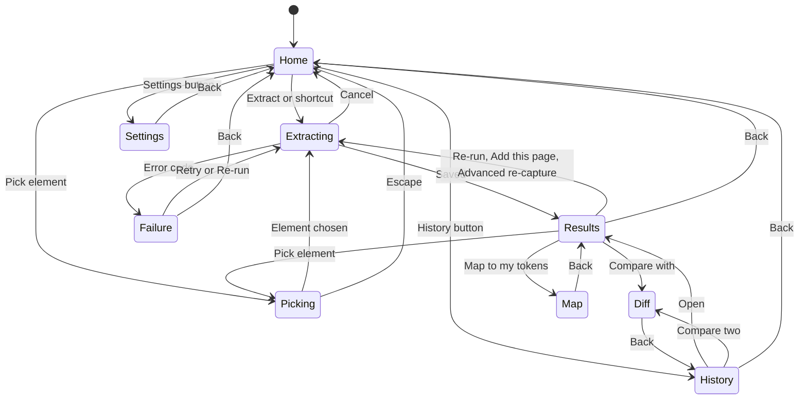

# UI spec

The panel is a developer tool: quiet surfaces, one soft-blue accent and monospace for every value. The user's extracted colors are the brightest things on screen, so the interface around them stays quiet. It follows the system theme, with Dark and Light overrides in Settings (F42). On Firefox the same page runs as a sidebar.

## Principles

- The extracted colors are the hero; the interface uses grays plus one accent.
- Every value (hex, px, token name, code) is set in JetBrains Mono.
- Dense but scannable: 13 px body text, 32 px rows.
- Keyboard first: every action is reachable with Tab, with a visible focus ring.
- Two themes, dark and light, built from the same tokens. Components never use raw hex, so switching theme needs no reload.
- Every user-visible string goes through `t()` (F44).

## Color tokens

Defined once in `entrypoints/sidepanel/theme.css` inside a Tailwind v4 `@theme` block, so classes such as `bg-surface` and `text-muted` exist. Dark values sit on `:root`. Light values apply under `:root[data-theme='light']`, and under `@media (prefers-color-scheme: light)` when no `data-theme` is set. `App.jsx` sets `data-theme` to `dark` or `light` from Settings, or removes it for System, so System follows the OS live. Every text color meets at least 4.5:1 contrast on `bg` in both themes.

| Token | Dark | Light | Use |
| --- | --- | --- | --- |
| `--color-bg` | #0a0a0b | #ffffff | Panel background |
| `--color-surface` | #121214 | #f7f7f8 | Cards, code preview |
| `--color-surface-2` | #1a1a1d | #efeff1 | Hover, inputs, menus, banners |
| `--color-surface-3` | #232327 | #e5e5e8 | Pressed, selected, badges |
| `--color-border` | #26262a | #e4e4e7 | Dividers, card borders |
| `--color-border-strong` | #3a3a40 | #d4d4d8 | Hovered and focused borders, menus |
| `--color-text` | #ededef (about 17:1) | #18181b (about 17.7:1) | Primary text |
| `--color-muted` | #a1a1aa (about 7.7:1) | #52525b (about 7.7:1) | Secondary text |
| `--color-faint` | #82828c (about 5.2:1) | #71717a (about 4.8:1) | Hints, hex values, labels |
| `--color-accent` | #7aa2f7 (about 7.9:1) | #3358d4 (about 6.0:1) | Primary buttons, active tab, focus ring |
| `--color-accent-hover` | #96b5fa | #2a49b3 | Primary button hover |
| `--color-on-accent` | #0a0a0b | #ffffff | Text on accent |
| `--color-success` | #4ade80 | #15803d | Check marks, success toasts, AAA and AA badges |
| `--color-warning` | #fbbf24 | #b45309 | Thin and partial warnings, low confidence, AA-large |
| `--color-danger` | #f87171 | #dc2626 | Delete actions, errors, failing contrast |
| `--color-swatch-ring` | rgb(255 255 255 / 0.08) | rgb(0 0 0 / 0.08) | 1 px inset ring so swatches stay visible |
| `--color-preview` | #f4f4f5 | #ffffff | Light tile behind shadow and component previews |

## Typography

Fonts are bundled locally through Fontsource: `--font-sans: "Inter Variable", system-ui, sans-serif` and `--font-mono: "JetBrains Mono", ui-monospace, monospace`.

| Token | Size / line height | Weight | Use |
| --- | --- | --- | --- |
| `text-xs` | 11 / 16 px | 500 | Section labels, uppercase with 0.04em tracking |
| `text-sm` | 12 / 16 px | 400 | Mono values, secondary info |
| `text-base` | 13 / 20 px | 400 | Body, list rows |
| `text-md` | 14 / 20 px | 500 | Buttons, dialog titles |
| `text-lg` | 16 / 24 px | 600 | Screen titles |

## Spacing, radius, motion

- Spacing uses a 4 px base: 4, 8, 12, 16, 24, 32. Panel padding is 16 px, rows are 32 px, the header is 44 px.
- Radius: 4 px swatches, 6 px controls, 8 px cards and dialogs, full for pills.
- Only menus, popovers, dialogs and toasts are elevated: `0 8px 24px rgb(0 0 0 / 0.5)` in dark, `0 8px 24px rgb(0 0 0 / 0.12)` in light, plus a 1 px `border-strong` border.
- Motion: 120 ms ease-out for hovers and toggles, 180 ms for menus and dialogs, none under `prefers-reduced-motion`.
- Layout: designed at 360 px wide and fluid from 320 to 600 px. The header and the results tab bar are sticky; content scrolls.

## Components

Radix UI primitives supply behavior and accessibility; Tailwind supplies the look. Icons come from lucide-react at 16 px.

| Component | Spec |
| --- | --- |
| Primary button | `accent` fill, `on-accent` text, 32 px tall, 12 px side padding, 6 px radius, `text-md`. Hover `accent-hover`. Disabled at 40% opacity |
| Secondary button | `surface-2` fill, `border` border, `text` text; hover `border-strong` |
| Ghost button | Transparent with `muted` text; hover `surface-2` fill and `text` text |
| Icon button | 28 x 28 px, 16 px icon, tooltip with its label, `aria-label` set |
| Tabs | Radix Tabs; 36 px bar; labels `text-base` 500 in `muted`; active label `text` with a 2 px `accent` underline; arrow keys move; the bar scrolls sideways when narrow |
| Token row | 32 px tall: 20 px swatch with `swatch-ring`, name (mono 12, `text`), site variable under it (mono 11, `faint`) when present, hex (mono 12, `faint`), role badge, confidence dot, usage bar (40 x 4 px) with percent (mono 11), eye button when highlight is on, menu button. Excluded rows at 40% opacity with an Excluded badge |
| Role badge | 18 px pill, `text-xs`, `surface-3` fill, `muted` text |
| Scale strip | One 24 px swatch per step 100 to 900, step number below in mono 11; empty steps drawn as a 1 px dashed `border` outline |
| Section label | `text-xs` uppercase in `faint`, 24 px space above, count right-aligned |
| Code preview | `surface` fill, `border` border, 8 px radius, mono 12 / 18 px, line numbers in `faint`, scrolls inside, no syntax highlighting |
| Toast | Radix Toast at bottom center, `surface-3`, `border-strong`; 1.5 s for Copied, 4 s for errors |
| Menu | Radix DropdownMenu, `surface-2`, 28 px items, destructive items in `danger` |
| Dialog | Radix Dialog for confirmations, summaries and import results, max 320 px, title `text-md` 600, Cancel (secondary) and confirm (primary or danger) right-aligned |
| State block | Centered: 24 px icon in `faint`, title `text-md` 600, one line of `muted` body, one action button |
| Progress list | One row per stage that will run, with spinner, check or pending dot; the spinner becomes a static icon under reduced motion |
| Segmented (ModeSwitch, StateSwitcher, Appearance, shadcn format) | Radix ToggleGroup, 28 px tall, arrow keys move. Mode: Light / Dark. States: Default / Hover / Focus / Active, only states with data enabled |
| Switch row | Radix Switch with label and optional description; used for capture options and settings |
| Popover | Radix Popover for the Advanced capture options on Home |
| ConfidenceDot | 8 px: hollow `muted` ring for medium, filled `warning` for low, nothing for high; tooltip with reasons |
| CheckerSwatch | Swatch over a 6 px checkerboard so alpha is visible, with the effective color as a small second chip |
| GradientStrip | 100% x 16 px preview with radius 4 and swatch ring |
| CurvePreview | 48 x 32 px SVG of the easing curve; a dot travels it on hover unless reduced motion |
| PagesChip and page list | Pill showing "N pages"; opens a list with remove buttons (the last page cannot be removed) |
| Contrast pair row | "Aa" in the text color on the background color, ratio in mono, level badge (`success` for AAA and AA, `warning` for AA-large, `danger` for fail) |
| StatCard | Count with label and an expandable list, used in Insights |
| PermissionRow | Label, status (granted, not granted), Grant or Revoke button |
| FileMapEditor | One row per format with a relative-path input, validated (no `..`, no leading `/`) |
| Banner | Full-width, `surface-2` with an info or warning icon, dismissible per snapshot |
| DiffRow and map row | Old and new swatches or values with an arrow, a status badge and the distance in mono |

Icons used: Pipette (logo, Extract), Crosshair (Pick element), History, Settings, Copy, Download, FileArchive, FolderOutput, FolderPlus, FilePlus2, FileText, FileUp, GitCompare, Eye, Layers, Box, Link2, Sparkles, Info, MoreHorizontal, Check, Plus, X, AlertTriangle, Lock, RotateCcw, Trash2, Loader2, ChevronLeft, ChevronRight, ChevronDown, ArrowUp, ArrowDown, ArrowRight.

**Extension icon:** an original mark: a white eyedropper on an `accent` rounded square, exported at 16, 32, 48 and 128 px into `public/icon/`.

## Screens

The panel has nine screens (Home, Extracting, Results, History, Settings, Picking, Diff, Map, and the failure State screen), and every path back leads to Home.



Failure is the State screen showing Restricted, No access, Thin or Error (see States below).

The wireframes below are drawn at the 360 px design width. They fix layout and content, not exact pixels.

### Home

```text
┌────────────────────────────────────────────┐
│ ◈ WebStyle                 [⟲]  [⚙]  [⋯]   │  header 44px: logo, History, Settings, menu
├────────────────────────────────────────────┤
│  example.com                               │  text-lg ("Current tab" if the URL is not readable)
│  https://example.com/pricing               │  mono 12, faint, truncated
│  ┌──────────────────────────────────────┐  │
│  │        Extract design system         │  │  primary button, full width
│  └──────────────────────────────────────┘  │
│  [ Pick element ]          or Alt+Shift+D  │
│                                            │
│  ○ Scroll to load content                  │  switches, default from Settings
│  ● Advanced capture            Options ▸   │  popover: deep scan, dark, states, widths
│  ○ Include screenshots                     │
│                                            │
│  RECENT                                    │
│  ▣ ■■■■■  example.com · 3 pages   2 h ago  │  ▣ site, ▢ page, ◇ component
└────────────────────────────────────────────┘
```

On first run, Recent is replaced by three numbered lines: Extract a page, Review the tokens, Export to your agent. The header menu holds Change shortcut (opens chrome://extensions/shortcuts), Source code on GitHub and Delete all history. The Advanced capture description warns that Chrome shows a "started debugging this browser" bar while it runs. Advanced capture is hidden on Firefox.

### Extracting

```text
│  example.com                               │
│  ✓  Reading page                           │  only the stages that will run:
│  ✓  Deep scan                              │  Scrolling, Reading page, Starting Advanced
│  ◌  Dark theme                             │  capture, Deep scan, Dark or Light theme,
│  ·  States                                 │  States, each width, Finishing Advanced
│  ·  Analyzing                              │  capture, Analyzing, Saving
│  ·  Saving                                 │
│  [ Cancel ]                                │  secondary button
```

### Results header and Colors tab

```text
│ [‹] example.com · Oct 18  [3 pages] [⋯]    │  menu: Re-run, Add this page, Pick element,
│ [ Light | Dark ]        [Allow on this site]│  Advanced re-capture, Compare with…, Map to my
│ ⚠ Some details couldn't be captured: states │  tokens, Export snapshot, Reset to extracted, Delete
│ Colors Type Layout Motion Components Insights Export │
│ SEMANTIC                                   │
│ ■■ background  white · gray-950   61%  👁 ⋯ │  light and dark swatches
│    --background                            │  site variable, faint mono
│ ■■ primary     blue-600 · blue-400  6% ◦ 👁 ⋯│  ◦ = medium confidence
│ SCALES                                     │
│ gray  ■   ■   ┆   ■   ┆   ■   ■   ┆   ■    │  dashed = empty step
│ TRANSLUCENT                                │
│ ▦ black/10  #0000001a  on #ffffff → #e6e6e6 │
│ GRADIENTS                                  │
│ ▬▬▬▬▬▬▬▬ hero  135deg blue-600 → blue-400   │
│ ▸ 3 excluded                               │
```

The Light / Dark switch appears only when both themes exist. Banners: v1 migration, partial capture, stale edits (with "Clear edits that no longer apply") and the class-mechanism note ("This site switches themes with a class; the other theme comes from its stylesheets."). When no primary exists, Semantic shows "No primary color detected". The token menu has Rename, Set role, Merge into, Exclude and, for tokens with a site variable, Use site name or Use generated name.

### Type tab

Families with the Web fonts card (family, weights, styles, provider), Text styles rendered with their transform and tracking, the Scale as live samples, and Letter spacing. Previews use generic text and fonts installed on this computer.

### Layout tab

Spacing (bars), Containers (bars at relative widths), Grid (column-count chips), Gaps, Radius, Borders, Shadows (on the `preview` tile), Opacity, Z-index (a stack from bottom to top layer), Breakpoints and Responsive (two tables, only with width captures). A partial banner appears when `meta.partial` is set.

### Motion tab

Durations with proportional bars, easings with curve previews, commonly transitioned properties and whether the site honors reduced motion.

### Components tab

```text
│ FOCUS RING                                 │
│ [ Button ]  outline 2px solid focus-ring, offset 2px · forced │
│                                            │
│ BUTTON · PRIMARY        [Default|Hover|Focus|Active] │
│ ┌────────────────────────────────────────┐ │
│ │            [  Button  ]                │ │  preview in the chosen state
│ └────────────────────────────────────────┘ │
│ background  blue-700  ← changed            │
│ text        white                          │
│ Source: forced states (exact)              │  or "From stylesheet rules (approximate)"
│ [screenshot thumbnail]                     │
```

Recipes for every kind found (button, input, link, headings, card, badge, navbar, tabs, alert, table). Previews use generic labels (Button, Placeholder, Link text, Heading 1, Card title, Badge, Tab 1, Alert message), never page text. Component snapshots show "Picked component" first.

### Insights tab

```text
│ FRAMEWORK                                  │
│ Tailwind CSS v4 · high   --tw- vars, utility classes │
│ ICONS                                      │
│ Lucide · high · 20px · stroke 2            │
│ ACCESSIBILITY            [Failing only ○]  │
│ Aa text on background        17.7  AAA     │
│ Aa gray-400 on white          2.5  Fail    │
│ Focus ring vs background      4.1  Pass    │
│ CONSISTENCY                                │
│ 37 colors merged into 14 ▸ · 6 off-scale spacing values ▸ │
│ CHECK THESE FIRST                          │
│ primary (dark) · from stylesheet overrides │
│ Read 2 frames, skipped 1 · 4 shadow roots  │  coverage line
```

### Export tab

```text
│ FORMAT  [ DESIGN.md                    ▾ ] │  the 13 formats
│ [ Copy prompt ]                            │  prominent
│ ┌────────────────────────────────────────┐ │
│ │ 1  # Design system: example.com        │ │
│ └────────────────────────────────────────┘ │
│ [ Copy ]  [ Download ]                     │
│ INCLUDE IN ZIP AND PROJECT WRITES          │
│ ☑ DESIGN.md ☑ prompt ☑ tokens ☑ theme.css  │
│ ☐ v3 config ☑ variables ☑ shadcn ☐ style guide │
│ ☑ AGENTS.md ☑ Cursor rules ☑ CLAUDE.md     │
│ ☐ Figma ☐ audit ☐ screenshots              │
│ [ Download all (.zip) ] [ Write to my-app ▾ ] │
│ 312 lines · 9.8 KB                         │
```

The shadcn preview has the oklch / hsl choice next to it; the Figma preview has the import help text. "Write to {project}" is hidden on Firefox. A note appears when screenshots could not be taken.

### History

```text
│ [‹]  History        [Select] [Import] [Export all] │
│ ▣ ■■■■■  example.com · 3 pages · L D   Today 14:02  ⋯ │  kind, pages, theme badges
│ ▢ ■■■■■  acme.dev                      Oct 12       ⋯ │
│ Select mode: [Compare] [Export selected] [Delete selected] │
```

Compare is enabled with exactly two snapshots selected.

### Settings

```text
│ [‹] Settings                               │
│ APPEARANCE   [ System | Dark | Light ]     │
│ CAPTURE                                    │
│ Advanced capture   Permission: granted [Revoke] │
│ ○ Scroll to load content by default        │
│ ○ Include screenshots by default           │
│ NAMES   ● Use site variable names          │
│ EXPORTS shadcn format [ oklch | hsl ]      │
│ HIGHLIGHT ON PAGE  ○                       │
│ ALLOWED SITES                              │
│ example.com                     [Remove]   │
│ PROJECTS                                   │
│ my-app   last written Oct 18   [Files] [Unlink] │
│ [ Link a project folder ]                  │
│ ABOUT   v2.0.0 · Source code · Shortcut    │
```

Advanced option defaults (deep scan, dark, states, widths) are set in the Home popover, and the export selection in the Export tab checklist. Projects and the Advanced capture row are hidden on Firefox.

### Picking

```text
│ [‹] Pick an element                        │
│ Click an element on the page.              │
│ Esc cancels · ↑ parent · ↓ child · Enter selects │
│ Current: div.card · 320 x 180              │
│ [↑ Parent] [↓ Child] [✓ Select] [Cancel]   │  buttons send the same keys to the page
```

### Diff

```text
│ [‹] Compare                                │
│ A example.com · Oct 1   B example.com · Oct 18 │
│ 3 added · 2 removed · 4 changed · 1 renamed │
│ [All|Added|Removed|Changed|Renamed]        │
│ ■→■ primary  #2563eb → #1d4ed8  (0.04)     │
│ + radius-xl 16px                           │
│ [ Export diff.md ]                         │
```

### Map

```text
│ [‹] Map to my tokens                       │
│ my-tokens.json · 18 exact · 5 close · 7 none │
│ [Unmatched only ○]                         │
│ blue-600  #2563eb → brand.primary   Exact  │
│ black/10  #0000001a → none          None   │
│ ● Use my token names in exports            │
│ [ Export mapping.md ]                      │
```

## States

| State | Trigger | Icon | Title | Action |
| --- | --- | --- | --- | --- |
| First run | No snapshots on Home | None | Three-step explainer | Extract |
| Extracting | A run starts | Progress list | Page hostname | Cancel |
| Restricted | RESTRICTED\_PAGE, FILE\_ACCESS | Lock | Can't read this page | Back |
| No access | NO\_ACCESS | Lock | Give access to this tab | Back (shortcut shown as a keycap) |
| Thin | EMPTY\_PAGE | AlertTriangle in warning | Too little to read | Re-run |
| Error | TIMEOUT, PAGE\_CHANGED, INJECTION\_FAILED, ANALYSIS\_FAILED | AlertTriangle in danger | Something went wrong | Retry, Copy details |
| Advanced failed | DEBUGGER\_ATTACH\_FAILED | AlertTriangle in danger | Couldn't start Advanced capture | Run basic extraction, Retry |
| History empty | No snapshots in History | History | No snapshots yet | Extract |
| Partial | `meta.partial` not empty, or failed Advanced stages | AlertTriangle in warning | Inline banner on the affected tab | Dismiss |
| Migrated | `migratedFromV1` | Info | Banner: Captured with v1 | Re-run |
| Stale edits | `staleEdits` above 0 | Info | Banner: N edits no longer match a token | Clear edits that no longer apply |

Body text for each state is the message in the api.md error table.

## Accessibility

- The panel meets WCAG 2.1 AA in both themes.
- Every control is a real button or a Radix primitive with an accessible name.
- Focus ring: 2 px `accent` outline with 2 px offset, never removed.
- Color is never the only signal: swatches show hex, confidence dots have tooltips, contrast badges have text, and states pair an icon with text.
- Progress stages and toasts are announced through a polite live region.
- Tab order follows visual order; Escape closes menus, popovers and dialogs and returns focus to the trigger.
- The keyboard-only path covers Home, Advanced options, Extract, the Light / Dark switch, the state switcher, Insights, Export and Copy prompt.
