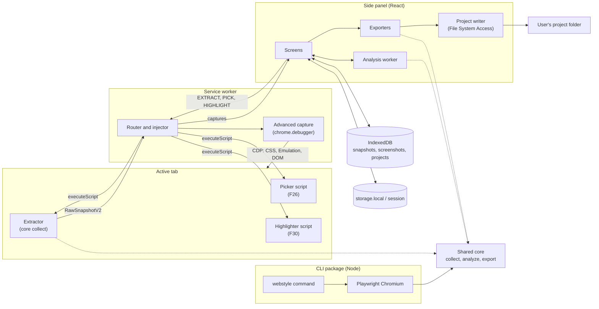
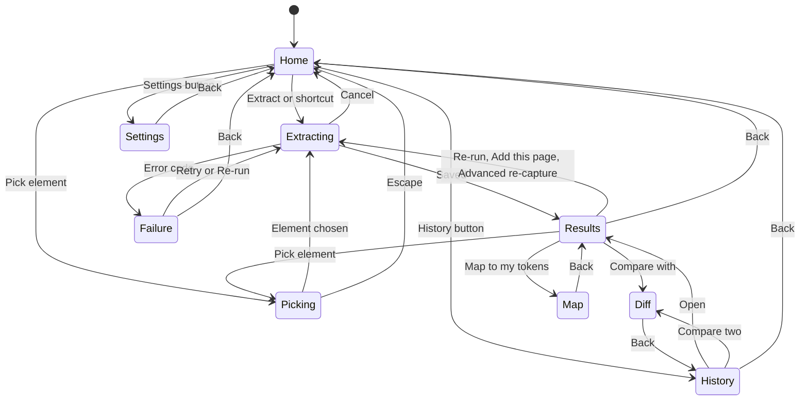

# WebStyle Extractor for AI Agents: v2 Specification

**Status:** ready to build · **Written:** 2026-10-18 · **Builds on:** v1.0 (shipped)

> **For Claude Code.** This file specifies every feature after v1.0, up to the final v2.0 release. Save it as `docs/v2-spec.md`. The v1 docs in `docs/` stay the base; where this file conflicts with them, **this file wins**. Build it one milestone at a time (M8 to M21, section 12), one milestone per session, starting each session in plan mode. When a milestone changes something a v1 doc defines (types, messages, permissions, UI, rules), update that v1 doc in the same change so `docs/` always describes the code.

## Contents

1. How to use this file
2. What changes from v1
3. Decision log
4. Feature index
5. Architecture changes
6. Data model v2
7. Messages and error codes v2
8. Features in detail (F9 to F44)
9. Export formats v2
10. UI changes
11. Non-functional requirements v2
12. Milestones M8 to M21
13. Testing, definition of done and v2.0 success criteria

---

## 1. How to use this file

1. Save this file as `docs/v2-spec.md`.
2. In `CLAUDE.md`, replace the **Hard rules** section with the block in section 2.2, and add this line to the "Read when the task touches them" list: `docs/v2-spec.md: v2 features; read the sections listed for the current milestone`.
3. For each milestone, start Claude Code in plan mode (Shift+Tab twice) and paste the prompt from section 12.1 with the milestone ID.
4. Feature IDs continue from v1 (F1 to F8 are v1). Acceptance criteria use the same `AC-F<feature>.<n>` format and the same rule: every criterion has a test named with its ID.
5. Values marked "start value" are first guesses to tune on the fixtures and the 20-site manual check. Change them freely, but update this file when you do.

---

## 2. What changes from v1

### 2.1 Rule changes

| Area | v1 rule | v2 rule |
| --- | --- | --- |
| Network | No network requests anywhere | Unchanged for the extension, including every new feature. The headless CLI (F41) is a separate package that loads the URL the user passes and sends nothing anywhere else |
| Permissions | Exactly `activeTab`, `scripting`, `sidePanel`, `storage` | Required permissions unchanged. New **optional** permissions, never requested at install: `debugger` (Advanced capture, F23) and host permissions `https://*/*` and `http://*/*` requested one site at a time (F25, F26, F30) |
| Page writes | Extractor never writes to the page | Four opt-in, temporary exceptions: element picker overlay (F26), "where is this used" highlight (F30), auto-scroll (F22), and debugger emulation during Advanced capture (F13, F23, F24), which visibly changes the page while it runs. Overlays live in a closed shadow root with `pointer-events: none` and are removed on exit |
| Reading | Computed styles, tag names and roles only; never page text | Never page text, unchanged. Newly allowed: class names, ARIA attributes, `document.fonts` metadata and font host names. Screenshots (F36) are opt-in images of components, stored locally; the only page imagery ever kept |
| Panel theme | Dark only | Follows the system, with a Dark or Light override (F42) |
| Invented values | Only values found on the page | Unchanged. Translucent tokens keep their real alpha; their blended "effective" color is shown as computed context, not exported as a new token. Generated shades remain forbidden |
| DESIGN.md size | Under 300 lines | Under 450 lines; the compact prompt (F33) is 40 lines or fewer |
| Extractor size | 50 KB or less | Core extractor 70 KB or less; picker and highlighter are separate scripts of 15 KB or less each |
| Browsers | Chrome only | Chrome, Edge (same build) and Firefox (F43); Safari still out |
| Token ids | Index-based (`c1`, `t1`) | Value-based and stable across re-analysis, so edits survive re-runs and merges (section 6.3) |
| Edits | The edited copy is stored | An edit log is stored and replayed onto every new analysis (section 6.3) |

### 2.2 New Hard rules block for CLAUDE.md

Replace the v1 **Hard rules** section of `CLAUDE.md` with this:

```markdown
## Hard rules

- The extension makes no network requests from any context: no analytics, no remote code, no CDN imports, no `eval`. Only the separate CLI package may load pages.
- Required permissions are exactly `activeTab`, `scripting`, `sidePanel` and `storage`. Optional permissions are exactly `debugger` and the host patterns `https://*/*` and `http://*/*`, requested only from a user click, one site at a time for hosts. Never request at install. No `content_scripts` key.
- The page is read-only except for the four opt-in exceptions in docs/v2-spec.md section 2.1. Every exception is temporary and cleaned up on exit, error, navigation or panel close.
- Never read or store page text. Class names, ARIA attributes, font metadata and opt-in component screenshots are allowed.
- Never invent token values or generate shades. Only values found on the page appear in output.
- The debugger is attached only during a capture and always detached in a `finally` block, and when the panel disconnects.
- Core extractor bundle 70 KB or less; picker and highlighter bundles 15 KB or less each.
- Code in `src/analyze`, `src/export`, `src/edit`, `src/diff` and `src/mapping` is pure: no `chrome.*`, no DOM, full unit tests. Every exporter has a snapshot test.
- The service worker holds no state in variables. Persist anything that must survive.
- Components use the theme tokens in docs/ui.md. No hex values in component code.
- Name tests after acceptance-criteria IDs, for example `AC-F13.4`.
- Build one milestone at a time from docs/v2-spec.md section 12 and stop at its end.
- If a doc and the code disagree, the doc wins. Ask before changing a decision, and update the doc in the same change.
```

---

## 3. Decision log

You chose the feature scope (everything in section 4). The rows marked "Default" are my picks for the design questions those features raise; change any of them before its milestone starts, and update this table.

| Decision | Choice | Decided by |
| --- | --- | --- |
| v2 scope | Every feature F9 to F44 in section 4 | You |
| Build order | Translucent colors first, then site variable names, then framework detection, then the rest | You |
| Advanced capture | One optional `debugger` permission powers deep stylesheet scan, full dark-mode emulation, forced hover/focus/active states and responsive widths. Off by default, asked on first use | Default |
| Deep scan method | Read every stylesheet's text through the debugger (`CSS.getStyleSheetText`), not `fetch`, so the extension stays network-free | Default |
| Dark mode without the debugger | Read dark overrides from readable stylesheets (`prefers-color-scheme` media blocks and `.dark` / `[data-theme]` selector blocks). Never toggle classes on the page | Default |
| States without the debugger | Match `:hover`, `:focus`, `:focus-visible` and `:active` rules in readable stylesheets against sampled elements | Default |
| Paired themes in DTCG | Two files: `tokens.json` (primitives plus light semantic) and `tokens.dark.json` (dark semantic overrides) | Default |
| Translucent naming | `<base>/<alpha%>` rounded to the nearest 5, such as `black/10` or `blue-600/20` | Default |
| Site variable names | Used as the primary token name when they match; the generated scale name is kept as an alias. On by default, switchable in Settings | Default |
| Token naming for new categories | Numeric where a value scale exists (`duration-150`, `border-2`, `z-50`), t-shirt sizes where v1 already uses them (containers, letter spacing) | Default |
| shadcn/ui export format | Current shadcn style with `oklch()` values and `:root` / `.dark` blocks; legacy HSL triplets as a Settings option | Default |
| Same-site check for merging pages | Same hostname, or hostnames sharing the last two labels; anything else asks for confirmation | Default |
| Multi-page access | "Allow on this site" requests the host permission for that one origin, so adding pages needs no toolbar click | Default |
| Screenshots storage | Separate IndexedDB store, deleted with the snapshot | Default |
| Write to project folder | File System Access API from the side panel; AGENTS.md and CLAUDE.md are edited only inside marked blocks; Tailwind v3 output is written as `design/tailwind.webstyle.js`, never over the project's own config | Default |
| Figma export | Collections "Primitives" and "Semantic" (modes Light and Dark). Target Figma's native variables import format; verify it during M15 and fall back to the Tokens Studio format if native import is unavailable | Default |
| CLI packaging | pnpm workspace package `cli/` in the same repo, published to npm as `webstyle-extractor` with the `webstyle` command | Default |
| CLI argument parsing | Node's built-in `util.parseArgs`, no extra dependency | Default |
| Import validation | `zod` schemas for snapshot import and the CLI's JSON | Default |
| CLI bundling | `tsup` | Default |
| Panel theme | System by default, with Dark and Light overrides | Default |
| Firefox | Sidebar instead of side panel; Advanced capture and Write to project hidden (APIs not available); minimum Firefox 128 | Default |
| Localization | `chrome.i18n` with `_locales/en/messages.json`; English only shipped | Default |
| DESIGN.md truncation | When over 450 lines, drop the lowest-usage scale tokens first, then low-confidence tokens, never semantic roles or rules | Default |
| Page weighting in merges | Each page contributes equally, so one long page cannot dominate | Default |
| Export language | Exported files are always English, whatever the UI language | Default |
| Firefox target | MV3, minimum version 128; `gecko.id` placeholder replaced before submission | Default |
| New dev dependencies | `eslint-plugin-i18next` (F44 lint rule), `axe-core` (style guide and panel checks), `fake-indexeddb` already in v1 | Default |

---

## 4. Feature index

| ID | Feature | Group | Milestone | New permission |
| --- | --- | --- | --- | --- |
| F9 | Translucent colors: blending, base names, roles | A. Accuracy | M8 | None |
| F10 | Site variable names | A. Accuracy | M9 | None |
| F11 | Framework detection | A. Accuracy | M9 | None |
| F12 | Interaction states (hover, focus, active, focus ring) | B. Read more | M11 (M13 for forced states) | None (debugger optional) |
| F13 | Light and dark themes as paired tokens | B. Read more | M11 (M13 for emulation) | None (debugger optional) |
| F14 | Motion: durations and easing | B. Read more | M10 | None |
| F15 | Text styles: letter spacing, text transform, composite styles | B. Read more | M10 | None |
| F16 | Layout structure: containers, grid columns, gaps | B. Read more | M10 | None |
| F17 | Layout values: z-index, opacity, border widths | B. Read more | M10 | None |
| F18 | Gradients | B. Read more | M10 | None |
| F19 | Web fonts from `@font-face` (names only) | B. Read more | M10 | None |
| F20 | More components: card, badge, nav bar, tabs, alert, table | B. Read more | M12 | None |
| F21 | Icon library detection | B. Read more | M12 | None |
| F22 | Coverage: open shadow roots, same-origin iframes, auto-scroll | B. Read more | M12 | None |
| F23 | Advanced capture and deep scan of all stylesheets | C. Capture modes | M13 | `debugger` (optional) |
| F24 | Responsive capture at several widths | C. Capture modes | M13 | `debugger` (optional) |
| F25 | Merge several pages into one site snapshot | C. Capture modes | M17 | Host, per site (optional) |
| F26 | Element picker | C. Capture modes | M17 | Host, per site (optional) |
| F27 | Contrast check | D. Trust | M14 | None |
| F28 | Confidence per token | D. Trust | M14 | None |
| F29 | Consistency report | D. Trust | M14 | None |
| F30 | "Where is this used?" highlight | D. Trust | M17 | Host, per site (optional) |
| F31 | shadcn/ui theme export | E. Outputs | M15 | None |
| F32 | Agent rule exports: AGENTS.md, .cursor/rules, CLAUDE.md snippet | E. Outputs | M15 | None |
| F33 | Compact prompt export | E. Outputs | M15 | None |
| F34 | Living style guide (HTML) | E. Outputs | M15 | None |
| F35 | Figma variables export | E. Outputs | M15 | None |
| F36 | Component screenshots | E. Outputs | M17 | None (uses activeTab) |
| F37 | Write straight to the project folder | E. Outputs | M16 | None |
| F38 | Map to my tokens | E. Outputs | M18 | None |
| F39 | Snapshot diff | E. Outputs | M18 | None |
| F40 | Snapshot import and export (JSON) | E. Outputs | M16 | None |
| F41 | Headless CLI | F. Platform | M19 | Not applicable |
| F42 | Panel light theme | F. Platform | M20 | None |
| F43 | Firefox build and Edge listing | F. Platform | M20 | None |
| F44 | Localization infrastructure | F. Platform | M20 | None |

---

## 5. Architecture changes

v2 keeps the v1 shape (page script reads, service worker routes, side panel analyzes and exports) and adds four things: an Advanced capture module that drives the optional debugger, two small on-demand page scripts (picker and highlighter), project-folder writing, and a CLI that reuses the same core modules outside the browser.

### 5.1 Components



### 5.2 New and changed modules

| Path | Kind | Responsibility |
| --- | --- | --- |
| `entrypoints/extractor.ts` | Changed | Runs `collect()` with v2 options (root element, auto-scroll, stylesheet texts from deep scan) and returns a RawSnapshotV2 |
| `entrypoints/picker.ts` | New, unlisted script, 15 KB or less | Element picker overlay (F26) |
| `entrypoints/highlighter.ts` | New, unlisted script, 15 KB or less | Outlines elements that use a token (F30) |
| `entrypoints/background.ts` | Changed | New messages (section 7), Advanced capture orchestration, debugger cleanup |
| `src/collect/` | Changed | New collectors for every F12 to F22 property; translucent backdrop blending; representative selectors |
| `src/advanced/` | New | `CdpClient` interface and the capture plan: deep scan, dark emulation, forced states, widths |
| `src/analyze/` | Changed | v2 analysis: modes, translucency, site variables, new categories, components, confidence, responsive table |
| `src/detect/` | New, pure | Framework, icon library and theme-mechanism detection from signals |
| `src/contrast/` | New, pure | WCAG contrast results (F27) |
| `src/audit/` | New, pure | Consistency report (F29) |
| `src/edit/` | Changed | Edit log, replay and the new edit kinds |
| `src/export/` | Changed | v2 formats and paired themes (section 9) |
| `src/diff/` | New, pure | Snapshot diff (F39) |
| `src/mapping/` | New, pure | Parse user token files and match tokens (F38) |
| `src/project/` | New | Write files to a linked folder, marked-block merging (F37) |
| `src/io/` | New | Snapshot import and export with zod schemas (F40) |
| `src/i18n.ts` | New | `t(key)` wrapper over `chrome.i18n.getMessage` (F44) |
| `cli/` | New workspace package | The `webstyle` command (F41) |

### 5.3 The CdpClient interface

Advanced capture is written once against this interface. The extension implements it with `chrome.debugger`; the CLI implements it with a Playwright CDP session. This keeps deep scan, emulation, forced states and widths identical in both places.

```ts
// src/advanced/cdp-client.ts
export interface CdpClient {
  send<T = unknown>(method: string, params?: Record<string, unknown>): Promise<T>;
  on(event: string, handler: (params: unknown) => void): () => void; // returns unsubscribe
  detach(): Promise<void>;
}

// src/advanced/plan.ts
export interface AdvancedOptions {
  deepScan: boolean;            // F23
  dark: boolean;                // F13 emulation
  states: boolean;              // F12 forced states
  widths: number[];             // F24, e.g. [375, 768, 1280]; empty = current width only
}
export type AdvancedStage =
  | 'attach' | 'deep-scan' | 'light' | 'dark' | 'states' | `width-${number}` | 'detach';
```

CDP methods used: `DOM.enable`, `DOM.getDocument`, `DOM.querySelector`, `CSS.enable`, `CSS.styleSheetAdded` (event), `CSS.getStyleSheetText`, `CSS.forcePseudoState`, `Emulation.setEmulatedMedia`, `Emulation.setDeviceMetricsOverride`, `Emulation.clearDeviceMetricsOverride`. Check each against the current CDP documentation when building M13.

### 5.4 Access model

| Action | Needs | How the user grants it |
| --- | --- | --- |
| Extract, re-run | Access to the tab | Toolbar click or shortcut (activeTab), or "Allow on this site" |
| Add a page to a snapshot (F25) | Access to the new page | Same as above; "Allow on this site" avoids clicking for every page |
| Pick an element (F26) | Access to the tab | Same as above |
| Highlight on page (F30) | Access to the tab, and Highlight turned on in Settings | Same as above |
| Component screenshots (F36) | Access to the tab | Same as above; uses `tabs.captureVisibleTab` |
| Advanced capture (F12, F13, F23, F24) | Optional `debugger` permission plus tab access | Permission prompt on first use of Advanced capture |
| Write to project (F37) | Read-write permission on a chosen folder | Folder picker, re-confirmed by the browser when needed |

### 5.5 Manifest changes

```ts
// wxt.config.ts: additions to the v1 manifest
manifest: {
  name: '__MSG_extName__',
  description: '__MSG_extDescription__',
  default_locale: 'en',
  permissions: ['activeTab', 'scripting', 'sidePanel', 'storage'], // unchanged
  optional_permissions: ['debugger'],
  optional_host_permissions: ['https://*/*', 'http://*/*'],
  // commands, action and minimum_chrome_version unchanged
}
```

The Chrome Web Store listing must explain why `debugger` is requested (Advanced capture only, opt-in, never at install) and that no data leaves the browser.

---

## 6. Data model v2

### 6.1 Types

All types stay in `src/model/types.ts`. v1 types not mentioned here are unchanged. `ValueStat`, `Hex`, `Step`, `HueFamily` and `TokenRef` keep their v1 definitions.

```ts
// ---------- Shared ----------
export type ThemeMode = 'light' | 'dark';
export type InteractionState = 'default' | 'hover' | 'focus' | 'focus-visible' | 'active';
export interface Confidence { level: 'high' | 'medium' | 'low'; score: number; reasons: string[] }

export type SemanticRole =
  | 'background' | 'surface' | 'text' | 'text-muted' | 'border'
  | 'primary' | 'accent' | 'success' | 'warning' | 'danger'
  | 'focus-ring' | 'overlay';                                   // new in v2

export type UsageContext =
  | 'text' | 'background' | 'border' | 'interactive' | 'gradient' | 'outline';

export type ComponentKind =
  | 'button' | 'input' | 'link' | 'heading'
  | 'card' | 'badge' | 'navbar' | 'tabs' | 'alert' | 'table';  // last six new in v2

export type RecipeProperty =
  | 'background-color' | 'background-image' | 'color' | 'border' | 'border-width'
  | 'border-radius' | 'padding' | 'gap' | 'height' | 'font-family' | 'font-size'
  | 'font-weight' | 'line-height' | 'letter-spacing' | 'text-transform'
  | 'box-shadow' | 'outline' | 'outline-offset' | 'opacity' | 'transition';

export type ExportFormat =
  | 'design-md' | 'prompt' | 'dtcg' | 'tailwind-v4' | 'tailwind-v3' | 'css-vars'
  | 'shadcn' | 'styleguide' | 'agents-md' | 'cursor-rules' | 'claude-md'
  | 'figma' | 'audit';

// ---------- Page side ----------
export interface ColorStat extends ValueStat {
  effectiveHex: Hex;   // blended over its backdrop (F9); same as the value when opaque
  backdropHex: Hex;    // the opaque color it was blended over
}

export interface TextStyleSample {
  family: string; sizePx: number; lineHeightPx: number | null; fontWeight: number;
  letterSpacingEm: number; textTransform: string;
  tags: string[];      // e.g. ['h2'], ['label'], ['button']
  count: number; usage: number; // usage = character count
}
export type LayerHint = 'sticky-header' | 'dialog' | 'menu' | 'toast' | 'tooltip' | 'overlay';
export interface ZIndexSample { value: number; count: number; hints: LayerHint[] }
export interface GradientSample {
  css: string; type: 'linear' | 'radial' | 'conic';
  stops: Array<{ color: string; position: string | null }>;
  count: number; usage: number;
}
export interface FontFaceInfo {
  family: string; weights: number[]; styles: string[];
  provider: 'google-fonts' | 'adobe-fonts' | 'self-hosted' | 'other' | 'unknown';
  providerHost: string | null;  // host name only, never a full URL
  loaded: boolean;
}
export interface VariableDef {
  name: string; value: string;  // value resolved through var() chains
  scope: 'root' | 'dark-media' | 'dark-selector' | 'light-selector' | 'other';
  selector: string;
}
export interface ThemeSignals {
  darkMedia: boolean;           // readable sheets contain prefers-color-scheme: dark rules
  darkSelectors: string[];      // e.g. ['.dark', '[data-theme="dark"]']
  lightSelectors: string[];
  activeMode: ThemeMode;
  colorSchemeProperty: string;  // computed color-scheme of the root
}
export interface SignalHit { id: string; evidence: string; count: number }
export interface ContrastSample {
  effectiveText: Hex; effectiveBg: Hex; sizePx: number; fontWeight: number; count: number;
}
export interface StateSample {
  kind: ComponentKind; variant: string; state: InteractionState;
  styles: Partial<Record<RecipeProperty, string>>; source: 'stylesheet' | 'forced';
}
export interface Representative {
  kind: ComponentKind; variant: string; selector: string; // unique CSS path, no data attributes added
  rect: { x: number; y: number; width: number; height: number }; inViewport: boolean;
}

export interface RawSnapshotV2 extends Omit<RawSnapshot, 'colors'> {
  colors: ColorStat[];
  letterSpacings: ValueStat[];    // em
  textTransforms: ValueStat[];
  textStyles: TextStyleSample[];
  borderWidths: ValueStat[];
  opacities: ValueStat[];
  zIndices: ZIndexSample[];
  durations: ValueStat[];         // ms
  easings: ValueStat[];
  gradients: GradientSample[];
  containers: ValueStat[];        // px max-widths of centered containers
  gridColumns: ValueStat[];       // column counts as strings
  gaps: ValueStat[];              // px
  fontFaces: FontFaceInfo[];
  variableDefs: VariableDef[];
  variableUsage: Record<string, number>; // var(--x) references in readable sheets
  themeSignals: ThemeSignals;
  frameworkSignals: SignalHit[];
  iconSignals: SignalHit[];
  iconSizes: ValueStat[];         // px of inline SVG icons
  iconStrokes: ValueStat[];       // stroke-width of inline SVG icons
  contrastSamples: ContrastSample[];
  stateSamples: StateSample[];
  representatives: Representative[];
  coverage: { frames: { read: number; skipped: number }; shadowRoots: number; autoScrolled: boolean };
}

// ---------- Analysis side ----------
export interface BaseToken {
  id: string;                  // stable, value-based (section 6.3)
  name: string;                // site variable name, generated name or user rename
  aliases: string[];           // other names, e.g. the scale name when a site variable is primary
  siteVariable: string | null; // e.g. '--brand-primary'
  usageShare: number;          // 0 to 1
  confidence: Confidence;
  excluded: boolean;
}
export interface ColorTokenV2 extends BaseToken {
  hex: Hex;                    // as found; '#rrggbbaa' when translucent
  alpha: number;               // 1 when opaque
  baseTokenId: string | null;  // translucent: the opaque token it derives from
  effectiveHex: Hex;           // usage-weighted blend, for display and contrast only
  oklch: { l: number; c: number; h: number | null };
  family: HueFamily | 'white' | 'black';
  step: Step | null;
  modes: ThemeMode[];
  contexts: UsageContext[];
  mergedFrom: Hex[];
}
export interface SizeTokenV2 extends BaseToken { px: number } // spacing, radii, borders, breakpoints, containers, gaps
export interface NumberToken extends BaseToken { value: number } // opacity, grid columns
export interface ZIndexToken extends NumberToken { layer: LayerHint | null }
export interface DurationToken extends BaseToken { ms: number }
export interface EasingToken extends BaseToken { css: string; bezier: [number, number, number, number] | null }
export interface LetterSpacingToken extends BaseToken { em: number }
export interface FontFamilyTokenV2 extends BaseToken { stack: string[]; webFont: FontFaceInfo | null }
export interface TypeSizeTokenV2 extends BaseToken {
  sizePx: number; lineHeightPx: number | null; fontWeight: number; letterSpacingEm: number;
  familyId: string | null; headings: Array<'h1' | 'h2' | 'h3' | 'h4' | 'h5' | 'h6'>;
}
export interface TextStyleToken extends BaseToken {
  familyId: string | null; sizePx: number; lineHeightPx: number | null; fontWeight: number;
  letterSpacingEm: number; textTransform: string; usedFor: string[];
}
export interface ShadowTokenV2 extends BaseToken { value: string; blurPx: number; modes: ThemeMode[] }
export interface GradientToken extends BaseToken {
  css: string; type: 'linear' | 'radial' | 'conic';
  stops: Array<{ colorTokenId: string | null; hex: Hex; position: string | null }>;
}

export interface ModeRef { light?: string; dark?: string } // token ids
export type StateStyles = Partial<Record<InteractionState, Partial<Record<RecipeProperty, TokenRef | string>>>>;
export interface ComponentRecipeV2 {
  id: string; kind: ComponentKind; variant: string; name: string;
  byMode: { light?: StateStyles; dark?: StateStyles };
  stateSource: 'stylesheet' | 'forced' | 'none';
  representativeSelector: string | null;
  screenshotIds: string[];
  confidence: Confidence; excluded: boolean;
}
export interface Detection {
  id: string; name: string; version: string | null; confidence: Confidence; evidence: string[];
}
export interface ContrastResult {
  textTokenId: string; backgroundTokenId: string; mode: ThemeMode;
  ratio: number; large: boolean; level: 'AAA' | 'AA' | 'AA-large' | 'fail'; count: number;
}
export interface AuditReport {
  colorsBeforeMerge: number; colorsAfterMerge: number;
  nearDuplicateGroups: Array<{ kept: Hex; merged: Hex[] }>;
  offScaleSpacing: Array<{ px: number; usageShare: number }>;
  distinct: { fontSizes: number; radii: number; shadows: number; zIndices: number; durations: number };
  contrastFailures: number;
  lowConfidence: string[]; // token ids
}
export interface FocusRing {
  outline: string | null; offsetPx: number | null; boxShadow: string | null;
  colorTokenId: string | null; source: 'stylesheet' | 'forced' | 'browser-default';
}
export interface ResponsiveTable {
  widths: number[];
  textSizes: Array<{ tokenId: string; byWidth: Record<number, number> }>;
  containers: Record<number, number | null>;
  gridColumns: Record<number, number | null>;
  spacingBase: Record<number, 4 | 8 | null>;
}

export interface DesignSystemV2 {
  schemaVersion: 2;
  meta: {
    sourceUrl: string; hostname: string; capturedAt: number;
    pages: string[]; modes: ThemeMode[]; viewports: number[];
    themeMechanism: 'media' | 'class' | 'attribute' | 'none'; themeSelector: string | null;
    framework: Detection[]; icons: Detection[]; webFonts: FontFaceInfo[];
    iconSizePx: number | null; iconStroke: number | null;
    partial: Array<'breakpoints' | 'cssVariables' | 'states' | 'dark' | 'frames'>;
    truncated: boolean;
    capture: { advanced: boolean; deepScan: boolean; autoScroll: boolean };
  };
  colors: ColorTokenV2[];
  semantic: Partial<Record<SemanticRole, ModeRef>>;
  gradients: GradientToken[];
  typography: {
    families: FontFamilyTokenV2[]; sizes: TypeSizeTokenV2[];
    letterSpacings: LetterSpacingToken[]; textStyles: TextStyleToken[];
  };
  spacing: { baseUnitPx: 4 | 8 | null; tokens: SizeTokenV2[] };
  layout: { containers: SizeTokenV2[]; gridColumns: NumberToken[]; gaps: SizeTokenV2[] };
  radii: SizeTokenV2[];
  borderWidths: SizeTokenV2[];
  shadows: ShadowTokenV2[];
  opacities: NumberToken[];
  zIndex: ZIndexToken[];
  motion: { durations: DurationToken[]; easings: EasingToken[] };
  breakpoints: SizeTokenV2[];
  responsive: ResponsiveTable | null;
  focusRing: FocusRing | null;
  components: ComponentRecipeV2[];
  contrast: ContrastResult[];
  audit: AuditReport;
}

// ---------- Storage ----------
export interface Capture {
  id: string; pageUrl: string; mode: ThemeMode; viewportWidth: number;
  method: 'computed' | 'stylesheet-override' | 'emulated'; capturedAt: number;
  raw: RawSnapshotV2;
}
export interface SnapshotRecordV2 {
  id: string; schemaVersion: 2; kind: 'page' | 'site' | 'component';
  hostname: string; title: string; capturedAt: number; updatedAt: number;
  pages: string[];
  captures: Capture[];
  extracted: DesignSystemV2;   // pure analysis of all captures
  edits: Edit[];               // the user's edit log
  edited: DesignSystemV2;      // cache: extracted with edits replayed
  staleEdits: number;          // edits that no longer match a token
  mapping: TokenMapping | null;
  screenshotIds: string[];
  migratedFromV1: boolean;
}
export interface SnapshotSummaryV2 {
  id: string; hostname: string; title: string; capturedAt: number; updatedAt: number;
  kind: 'page' | 'site' | 'component'; pages: number; modes: ThemeMode[]; topColors: Hex[];
}
export interface Settings {
  lastExportFormat: ExportFormat;
  exportSelection: ExportFormat[];     // formats included in zip and project writes
  panelTheme: 'system' | 'dark' | 'light';
  useSiteVariableNames: boolean;       // default true
  shadcnFormat: 'oklch' | 'hsl';       // default 'oklch'
  includeScreenshots: boolean;         // default false
  autoScroll: boolean;                 // default false
  advancedDefaults: { dark: boolean; states: boolean; widths: number[]; deepScan: boolean };
  highlightEnabled: boolean;           // default false
}
export interface ProjectLink {
  id: string; name: string; handle: FileSystemDirectoryHandle;
  fileMap: Partial<Record<ExportFormat | 'screenshots', string>>;
  lastWrittenAt: number | null;
}
export interface TokenMapping {
  sourceName: string; importedAt: number; useMyNames: boolean;
  entries: Array<{ tokenId: string; userToken: string | null; status: 'exact' | 'close' | 'none'; delta: number | null }>;
}

// ---------- Edits (src/edit) ----------
export type Edit =
  | { kind: 'rename'; tokenId: string; name: string }
  | { kind: 'setRole'; tokenId: string; role: SemanticRole; mode: ThemeMode }
  | { kind: 'clearRole'; role: SemanticRole; mode: ThemeMode }
  | { kind: 'exclude'; tokenId: string }
  | { kind: 'include'; tokenId: string }
  | { kind: 'merge'; sourceId: string; targetId: string }
  | { kind: 'renameComponent'; componentId: string; name: string }
  | { kind: 'useSiteName'; tokenId: string; use: boolean };
```

### 6.2 Storage schema v2

| Store | Key | Value |
| --- | --- | --- |
| IndexedDB `webstyle` version 2, store `snapshots` | keyPath `id`; indexes `byCapturedAt`, `byHostname`, `byUpdatedAt` (new) | SnapshotRecordV2 |
| IndexedDB store `screenshots` (new) | keyPath `['snapshotId', 'id']` | `{ snapshotId, id, recipeId, state, blob, width, height }` |
| IndexedDB store `projects` (new) | keyPath `id` | ProjectLink |
| chrome.storage.local | `settings` | Settings v2; missing fields are filled with defaults on read |
| chrome.storage.session | `pendingExtract` | `{ tabId, windowId, at, options }` |
| chrome.storage.session | `activeCapture` (new) | `{ tabId, debuggerAttached, overlays: string[], startedAt }`, used to clean up if the service worker restarts mid-capture |

### 6.3 Stable ids and the edit log

- Token ids are `<category>:<canonical value>`: `color:#2563eb`, `color:#000000@10` (alpha percent), `space:16`, `radius:8`, `border:1`, `container:1280`, `gap:24`, `text:16/24/400`, `family:inter`, `duration:150`, `easing:<normalized css>`, `shadow:<hash>`, `gradient:<hash>`, `z:50`, `opacity:0.5`, `component:button:primary`. The hash is an FNV-1a hex digest of the normalized CSS string.
- Two tokens with the same id are the same token by definition, across re-runs, merged pages and themes.
- Every edit is appended to `edits`. After any analysis (re-run, add page, advanced capture, migration), `edited = replay(extracted, edits)` using `applyEdit` in order.
- Edits whose token no longer exists are skipped and counted in `staleEdits`. They stay in the log, because a later merge may bring the token back, until the user chooses "Clear edits that no longer apply".
- "Reset to extracted" clears the edit log after confirmation.

### 6.4 Migration from v1

Runs in the IndexedDB `upgrade` callback from version 1 to 2, and again in `src/io` when importing a v1 file.

1. Wrap the v1 `raw` in one Capture: `mode` from `raw.colorScheme`, `viewportWidth` from `raw.viewport.width`, `method: 'computed'`. Fill every new RawSnapshotV2 field with an empty value, and set each color's `effectiveHex` and `backdropHex` to its own value.
2. Set `extracted = analyze(captures)` with the v2 engine.
3. Derive the edit log by comparing the v1 extracted and edited copies: renames, role changes (as `mode: 'light'`), exclusions and merges, matched by value. Edits that cannot be matched are dropped and counted.
4. Set `kind: 'page'`, `pages: [url]`, `updatedAt = capturedAt`, `mapping: null`, `screenshotIds: []`, `migratedFromV1: true`.
5. Show a one-time notice: "Upgraded N snapshots; M edits could not be carried over." Migrated snapshots show a banner: "Captured with v1. Re-run to read states, themes and more."

---

## 7. Messages and error codes v2

All message types stay in `src/messaging.ts`. The v1 listener rule still applies: the `onMessage` listener is a plain function that returns `true` synchronously when it will reply later.

### 7.1 Panel port

The panel opens a long-lived port on load: `chrome.runtime.connect({ name: 'panel' })`. When the port disconnects (panel closed or reloaded), the service worker cancels any running capture, detaches the debugger, removes picker and highlight overlays, and clears `activeCapture`.

### 7.2 Runtime messages (panel and service worker)

| Message | Direction | Payload | Reply or effect |
| --- | --- | --- | --- |
| EXTRACT (changed) | Panel to service worker | `{ type, requestId, tabId, intent: 'new' \| 'rerun' \| 'add-page' \| 'component', snapshotId?, rootSelector?, autoScroll, advanced: AdvancedOptions \| null }` | `CAPTURES { requestId, captures, warnings }` or `EXTRACT_ERROR { requestId, code, detail }` |
| EXTRACT_PROGRESS (new) | Service worker to panel | `{ type, requestId, stage: 'reading' \| 'scrolling' \| AdvancedStage }` | Panel updates the progress list |
| CANCEL (new) | Panel to service worker | `{ type, requestId }` | Stops the run, detaches the debugger, replies nothing |
| PICK_START (new) | Panel to service worker | `{ type, tabId }` | Injects the picker; replies `PICK_READY` or `EXTRACT_ERROR` |
| PICK_RESULT (new) | Picker script to panel | `{ type, selector, rect, tag, role }` | Panel sends EXTRACT with `intent: 'component'` and `rootSelector` |
| PICK_CANCELLED (new) | Picker script to panel | `{ type }` | Panel returns to the previous screen |
| PICK_STOP (new) | Panel to service worker | `{ type, tabId }` | Removes the picker overlay |
| HIGHLIGHT_SHOW (new) | Panel to service worker | `{ type, tabId, tokenId, match: { property: HighlightProperty; values: string[] } }` | Injects or updates the highlighter; replies `{ count }` |
| HIGHLIGHT_CLEAR (new) | Panel to service worker | `{ type, tabId }` | Removes outlines |

`HighlightProperty` is one of `color`, `background-color`, `border-color`, `outline-color`, `font-family`, `font-size`, `letter-spacing`, `padding`, `margin`, `gap`, `border-radius`, `border-width`, `box-shadow`, `opacity`, `z-index`, `transition-duration`, `background-image`.

These run directly in the panel through `src/platform/` wrappers, not as messages, because they must happen inside the user's click: `chrome.permissions.request` (debugger and site access) and `showDirectoryPicker` (F37). Screenshots (F36) are taken by the service worker during the capture and returned with the captures.

### 7.3 Worker messages (panel and analysis worker)

| Message | Direction | Payload | Reply |
| --- | --- | --- | --- |
| ANALYZE (changed) | Panel to worker | `{ type, requestId, captures, edits, options: { useSiteVariableNames } }` | PROGRESS (0 or more), then `RESULT { requestId, extracted, edited, staleEdits }` or ERROR |
| MAP (new) | Panel to worker | `{ type, requestId, design, fileText, fileName }` | `MAP_RESULT { requestId, mapping }` or ERROR `MAPPING_PARSE_FAILED` |
| DIFF (new) | Panel to worker | `{ type, requestId, a, b }` (two DesignSystemV2) | `DIFF_RESULT { requestId, diff }` |

Analysis progress stages: `normalize`, `translucency`, `variables`, `cluster`, `roles`, `typography`, `layout`, `motion`, `components`, `detect`, `contrast`, `confidence`, `audit`, `naming`, `replay`.

### 7.4 New error codes

v1 codes are unchanged. Messages are the exact UI text and go in `strings.ts` (later `messages.json`).

| Code | Raised when | UI | Message shown |
| --- | --- | --- | --- |
| DEBUGGER_DENIED | The user declines the `debugger` permission | Toast; Advanced options switch off | Advanced capture needs permission to use Chrome's debugger. Basic extraction still works. |
| DEBUGGER_ATTACH_FAILED | Attach fails, for example another debugger is attached | Error state with "Run basic extraction" | Couldn't start Advanced capture on this tab. Close other debugging tools and retry, or run a basic extraction. |
| CAPTURE_PARTIAL | One Advanced stage fails but others succeed | Results with a warning banner naming the failed stages | Some details couldn't be captured: {stages}. |
| SITE_ACCESS_DENIED | The user declines access to a site | Toast | Without access to this site, click the toolbar icon on each page instead. |
| CROSS_SITE_PAGE | "Add this page" on a different site | Confirmation dialog | This page is on {host}, not {snapshotHost}. Add it anyway? |
| PICK_CANCELLED | Escape, navigation or panel close during picking | Back to the previous screen, no message | None |
| PICK_FAILED | The picker cannot be injected | Toast | Couldn't start the element picker on this page. |
| HIGHLIGHT_EMPTY | No visible element matches | Toast | No matching elements are visible on this page. |
| SCREENSHOT_FAILED | `captureVisibleTab` rejects | Results kept, note in Export | Screenshots couldn't be taken on this page. |
| FS_UNSUPPORTED | File System Access is not available (Firefox) | Write to project hidden | None |
| FS_PERMISSION_DENIED | The browser denies folder access | Toast | Folder access was not allowed. Choose the folder again in Settings. |
| FS_WRITE_FAILED | A file write fails | Dialog listing failed files | Some files couldn't be written: {files}. |
| IMPORT_INVALID | An imported file fails validation | Dialog with the first problem | This file isn't a valid WebStyle snapshot: {problem}. |
| IMPORT_TOO_NEW | Imported schemaVersion is higher than supported | Dialog | This file was made with a newer version of WebStyle Extractor. Update the extension to open it. |
| MAPPING_PARSE_FAILED | A user token file cannot be read | Dialog | Couldn't read tokens from {file}. Supported: DTCG JSON, CSS custom properties, Tailwind v4 @theme. |

---

## 8. Features in detail

Each feature has: why it exists, how it works, the user flow where there is UI, and acceptance criteria. "Start value" marks a threshold to tune on fixtures.

### Group A: Accuracy foundations (build first)

#### F9 Translucent colors

**Why.** Many sites draw borders, muted text and overlays with translucent colors such as black at 10%. v1 counted the raw `rgba()` value, so those colors got the wrong names and roles, or were dropped as nearly invisible.

**How it works.**

- Collector: for every text, background, border and outline color with alpha between 0 and 1, find its backdrop. Walk up the ancestors, compositing any translucent backgrounds on the way, until an opaque `background-color`. If none is found, use the root's computed background; if that is transparent too, use `#ffffff` for a light page or `#121212` for a dark page (start value).
- Blend per channel in sRGB, the way browsers composite: `out = a * fg + (1 - a) * bg`. Store `effectiveHex` and `backdropHex` on the ColorStat (the usage-weighted most common pair for that value).
- If a background image (not a gradient) sits between the element and the backdrop, keep the result but lower the token's confidence.
- Analysis: opaque colors cluster as in v1. Translucent colors group by base RGB (OKLab distance under 0.02) and alpha rounded to the nearest 0.05 (start value).
- Base name: the matching opaque token's name, `white`, `black`, or the family-step name of its RGB. No opaque base token is created when none exists on the page.
- Token name: `<base>/<alpha%>`, for example `black/10` or `blue-600/20`.
- Roles and contrast use `effectiveHex`, so a translucent token can hold `text-muted`, `border` or the new `overlay` role.
- Exports write the original 8-digit hex. DESIGN.md lists the alpha and the typical effective color, and tells the agent to use opacity modifiers (`border-black/10`) in Tailwind.

**User flow.** The Colors tab gains a Translucent section. Each row shows a checkerboard swatch, the token name, the hex with alpha and "on #ffffff looks like #e6e6e6".

**Acceptance criteria.**

- [x] AC-F9.1 A color with alpha between 0 and 1 is blended over its backdrop: the nearest opaque ancestor background with translucent ancestors composited in between, else the root background, else `#ffffff` (light) or `#121212` (dark).
- [x] AC-F9.2 Blending is per-channel sRGB, verified on known pairs (`rgba(0,0,0,0.1)` on `#ffffff` gives `#e6e6e6`).
- [x] AC-F9.3 Translucent values with the same base (OKLab distance under 0.02) and alpha (rounded to 0.05) merge into one token.
- [x] AC-F9.4 Translucent tokens are named `<base>/<alpha%>`; no opaque base token is created unless that opaque color exists on the page.
- [x] AC-F9.5 Roles and contrast use effective colors; translucent tokens can hold text-muted, border and overlay.
- [x] AC-F9.6 The overlay role goes to the most-used translucent background with alpha of at least 0.3 that covers at least 25% of the viewport (start values).
- [x] AC-F9.7 Exports write the original 8-digit hex; DESIGN.md shows alpha and effective color and recommends opacity modifiers for Tailwind.
- [x] AC-F9.8 Translucent rows show a checkerboard swatch and the "on X looks like Y" line.
- [x] AC-F9.9 Translucent colors measured over a background image get low confidence.

#### F10 Site variable names

**Why.** The site's own names (`--brand-primary`, `--surface-raised`) are what its developers know. Using them makes agent code fit the existing codebase, and the names reveal roles far more reliably than usage counts.

**How it works.**

- Collector: from readable stylesheets (and deep-scan texts, F23), record custom-property declarations in `:root`, `html`, `:host` and `body`, and in theme scopes (`prefers-color-scheme: dark` blocks, dark and light selectors such as `.dark` or `[data-theme="dark"]`). Root values are resolved with `getComputedStyle(document.documentElement).getPropertyValue(name)`; theme-scope values are resolved by substituting `var()` chains from the collected definitions, with a cycle guard.
- Count every `var(--x)` reference in readable rules into `variableUsage`.
- Also read custom properties exposed by the root's computed style where the browser lists them, so names are found even when stylesheets are unreadable (no scope information in that case; set `meta.partial` to include `cssVariables`).
- Parse values by type: colors with culori, including bare HSL triplets (`222.2 47.4% 11.2%`) and bare RGB channel triplets (`37 99 235`); lengths to px; durations to ms; easings; shadows; font stacks; plain numbers.
- Never use framework-internal variables as names: prefixes `--tw-` and `--un-`, kept in one list in `src/detect/variable-rules.ts`.
- Matching: for each token, candidates are variables of the same type and equal value (colors within OKLab 0.005 including alpha, sizes exact px, durations exact ms, shadows equal after normalizing, families equal first family). Pick the highest `variableUsage`; on a tie prefer names containing role words for semantic tokens, then the shortest.
- Derived name: strip `--` and known category prefixes (`color-`, `colors-`, `clr-`, `wp--preset--color--`, `space-`, `spacing-`, `size-`, `radius-`, `radii-`, `rounded-`, `shadow-`, `font-`, `ff-`, `fs-`, `text-`, `duration-`, `ease-`, `easing-`, `z-`, `zindex-`, `breakpoint-`, `bp-`, `screen-`), then lowercase kebab-case. If the result collides within its category, keep the full name.
- Role words assign semantic roles with high confidence, overriding usage rules: background, bg, page; surface, card, panel, elevated; foreground, fg, text, body; muted, subtle, text-secondary; border, divider, stroke; primary, brand; accent; ring, focus; destructive, danger, error, negative; success, positive; warning, caution; overlay, backdrop, scrim.
- Dark-scope definitions of the same name give the dark value for that token (feeds F13).

**User flow.** Token rows show the site variable in faint mono under the name. The token menu gains "Use site name" or "Use generated name". Settings has a global "Use site variable names" switch.

**Acceptance criteria.**

- [x] AC-F10.1 Custom properties are collected from root and theme scopes in readable sheets, with `var()` chains resolved and cycles stopped.
- [x] AC-F10.2 `var()` references are counted per variable.
- [x] AC-F10.3 Bare HSL triplets and bare RGB channel triplets parse as colors.
- [x] AC-F10.4 Variables with excluded prefixes never name tokens.
- [x] AC-F10.5 A token takes the matching variable with the most references; ties go to role-word names for semantic tokens, then the shortest name.
- [x] AC-F10.6 Derived names strip `--` and the listed prefixes and are lowercase kebab-case; collisions keep the full name.
- [x] AC-F10.7 With "Use site variable names" on (default), the derived site name is the token name and the generated name becomes an alias; off reverses this. The `useSiteName` edit overrides per token.
- [x] AC-F10.8 Role words in variable names assign semantic roles with high confidence, overriding usage rules.
- [x] AC-F10.9 DESIGN.md shows each token's site variable; variables.css writes the original site variable name verbatim for every token that has one.
- [x] AC-F10.10 Variables found only through the computed root style are still matched, and `meta.partial` includes `cssVariables`.

#### F11 Framework detection

**Why.** An agent that knows the site uses Tailwind with shadcn/ui writes matching code instead of inventing custom CSS.

**How it works.** The collector samples up to 5,000 unique class tokens from walked elements (class names only, never text), plus variable names, `data-slot` attributes and readable `@layer` names. `src/detect/framework.ts` scores each framework from this table:

| Framework | id | Signals | Version hint |
| --- | --- | --- | --- |
| Tailwind CSS | `tailwind` | `--tw-` variables; at least 30% of class tokens match utility patterns (responsive prefixes like `md:`, spacing like `px-4`, `text-sm`, `bg-blue-500`, arbitrary values like `w-[37px]`) | v4 when theme variables use `oklch()` or an `@layer theme` exists; otherwise v3 |
| Bootstrap | `bootstrap` | `--bs-` variables; classes `btn`, `btn-primary`, `container`, `row`, `col-*`, `d-flex` | v5 when `--bs-` variables exist; else v4 or older |
| MUI | `mui` | Classes starting with `Mui`; `--mui-` variables | None |
| Chakra UI | `chakra` | `--chakra-` variables; `chakra-` classes | None |
| shadcn/ui | `shadcn` | `--background`, `--foreground`, `--primary-foreground`, `--ring` and `--radius` all present; `data-slot` attributes | "Tailwind v4 style" when values use `oklch()` |
| Radix Themes | `radix-themes` | `.radix-themes` class; `--accent-1` to `--accent-12` variables | None |
| Ant Design | `antd` | `ant-` classes; `--ant-` variables | None |
| Bulma | `bulma` | `button` with `is-primary`; `columns` and `column`; `--bulma-` variables | None |

Confidence: high with two or more independent signal types (variables, classes, attributes, layers), medium with one strong type, low otherwise. Several frameworks can be detected at once (Tailwind plus shadcn/ui is common).

**User flow.** The new Insights tab shows a Framework card with each detection, its version, confidence and evidence.

**Acceptance criteria.**

- [x] AC-F11.1 Up to 5,000 unique class tokens are sampled from walked elements; no text is read.
- [x] AC-F11.2 Each framework in the table is detected on its fixture (Tailwind-like, Bootstrap-like, shadcn-like and the others).
- [x] AC-F11.3 The plain-CSS fixture detects no framework.
- [x] AC-F11.4 A version is reported when the hints allow, otherwise `null`.
- [x] AC-F11.5 Confidence follows the rule above. Low-confidence detections appear in Insights but never in DESIGN.md.
- [x] AC-F11.6 For medium or high confidence, DESIGN.md's Stack section names the framework and a rule tells the agent to use it.
- [x] AC-F11.7 Insights lists every detection with its evidence.

### Group B: Read more from the page

#### F12 Interaction states: hover, focus, active and the focus ring

**Why.** Buttons and links change on hover, focus and press, and the focus ring is what keyboard users rely on. Agents usually skip these states or invent them.

**How it works.** Two paths; the second replaces the first when available.

- **Stylesheet path (default, no permission, M11).** For up to 3 representative elements per recipe, scan readable rules (and deep-scan texts, F23) whose selectors contain `:hover`, `:focus`, `:focus-visible` or `:active`. For each selector in a list, remove those pseudo-classes to get a base selector; the rule applies when `element.matches(base)` is true. Rules inside `@media` blocks that do not currently match are ignored; `@layer` order is approximated by source order. Conflicts resolve by specificity (`src/collect/specificity.ts`), then source order. `var()` values resolve through the element's computed custom properties.
- **Forced path (Advanced capture, M13).** For each representative selector, force one state at a time with `CSS.forcePseudoState`, read the element's computed styles, then clear the forced state. This also catches cross-origin stylesheets and script-driven styles. `stateSource` becomes `'forced'`.
- Each state stores only the properties that differ from the default state.
- **Focus ring.** From `:focus-visible` (preferred) or `:focus` on buttons, links and inputs, record the outline (width, style, color) and offset, or a box-shadow ring such as `0 0 0 3px`. The ring color gets the `focus-ring` role, and the full ring is stored in `DesignSystemV2.focusRing` (section 6.1).
- If no focus style exists, record `source: 'browser-default'`; the consistency report (F29) flags it and DESIGN.md says so.

**User flow.** The Components tab gets a Focus ring card at the top and a state switcher (Default, Hover, Focus, Active) on each recipe that has states. Changed properties are marked, with a source label: "From stylesheet rules (approximate)" or "From forced states (exact)".

**Acceptance criteria.**

- [x] AC-F12.1 Up to 3 representative elements per recipe are matched against readable state rules using the selector with state pseudo-classes removed.
- [x] AC-F12.2 Conflicts resolve by specificity, then source order; rules in non-matching `@media` blocks are ignored.
- [x] AC-F12.3 `var()` values in state rules resolve through the element's computed custom properties.
- [x] AC-F12.4 Each state stores only properties that differ from the default.
- [x] AC-F12.5 With Advanced capture states on, forced pseudo-states replace the stylesheet results and `stateSource` is `'forced'`; every forced state is cleared afterwards, even on error.
- [x] AC-F12.6 The focus ring is captured from `:focus-visible` (preferred) or `:focus` as outline plus offset or a box-shadow ring, and its color takes the focus-ring role.
- [x] AC-F12.7 With no focus style, `source` is `'browser-default'`, the report flags it and DESIGN.md says so.
- [x] AC-F12.8 The Components tab shows the focus ring card, the state switcher, marked changes and the source label.
- [x] AC-F12.9 DESIGN.md recipes list state differences, and a rule tells the agent to show the focus ring on `:focus-visible`.
- [x] AC-F12.10 `meta.partial` includes `states` when some stylesheets were unreadable and forced states were not used.

#### F13 Light and dark themes as paired tokens

**Why.** Many sites support both themes. An agent needs each semantic color in both modes to build dark mode correctly.

**How it works.**

- **Detect the mechanism** from `ThemeSignals`: `media` (`@media (prefers-color-scheme: dark)` rules), `class` (`.dark`, `.theme-dark`, `html.dark`), `attribute` (`[data-theme="dark"]`, `[data-mode="dark"]`, `[data-color-scheme="dark"]`) or `none`. The active mode comes from the root's computed `color-scheme` and background lightness.
- **Path A: stylesheet overrides (default, no permission, M11).** Read custom-property definitions in the other theme's scope (F10) and root-level rules there (`html`, `body`, `:root` colors). Build a second capture with `method: 'stylesheet-override'`. Component-level colors in that theme stay unknown, so `meta.partial` includes `dark`.
- **Path B: emulation (Advanced capture, M13).** For the `media` mechanism, call `Emulation.setEmulatedMedia` with `prefers-color-scheme` set to the other theme, wait two animation frames plus 150 ms (start value), run the full collector, then clear the emulation in a `finally` block. The capture's method is `'emulated'`.
- For `class` and `attribute` mechanisms the page is never toggled (rule 2.1). Path A is used and the panel notes: "This site switches themes with a class; the other theme comes from its stylesheets."
- Analysis runs per mode. Tokens seen in only one theme carry that mode. Semantic roles are assigned per mode and stored as `ModeRef`s. Shadows keep their modes.
- Exports write paired tokens as described in section 9.3, using the site's mechanism.

**User flow.** When both modes exist, the Results header shows a Light / Dark switch; every tab shows the selected theme. Semantic rows show both swatches side by side.

**Acceptance criteria.**

- [x] AC-F13.1 The mechanism is detected as media, class, attribute or none, with its selector; each has a passing fixture.
- [x] AC-F13.2 Path A builds the other theme from variable overrides and root-level rules without changing the page.
- [x] AC-F13.3 Path B re-collects the other theme with emulation for the media mechanism, and clears emulation afterwards, even on error.
- [x] AC-F13.4 Class and attribute mechanisms never toggle the page; Path A runs and the note is shown.
- [x] AC-F13.5 Semantic roles are assigned per mode and stored as ModeRefs.
- [x] AC-F13.6 `meta.modes` lists captured themes; `meta.partial` includes `dark` when the second theme came only from stylesheet overrides.
- [x] AC-F13.7 Every export writes paired tokens as in section 9.3, using the site's mechanism.
- [x] AC-F13.8 The Light / Dark switch appears only when both modes exist; semantic rows show both swatches.
- [x] AC-F13.9 A site with no dark support produces one mode and no switch.

#### F14 Motion: durations and easing

**How it works.**

- Collect computed `transition-duration` and `transition-timing-function` (lists aligned with `transition-property`), and `animation-duration` and `animation-timing-function` where `animation-name` is not `none`. Skip zero durations. Convert seconds to ms. Normalize easings: keywords as-is, `cubic-bezier()` rounded to 3 decimals, `steps()` kept raw.
- Duration tokens are named `duration-<ms>` (for example `duration-150`); keep at most 6 by usage (start value).
- Easing names: keywords keep their names; curves equal to Tailwind's defaults (`cubic-bezier(0.4, 0, 1, 1)` ease-in, `cubic-bezier(0, 0, 0.2, 1)` ease-out, `cubic-bezier(0.4, 0, 0.2, 1)` ease-in-out) take those names; other curves become `ease-custom-<n>` by usage.
- Summarize which properties usually transition (color, background, opacity, transform).
- Detect `prefers-reduced-motion` rules in readable sheets.

**User flow.** A new Motion tab lists durations with proportional bars and easings with small curve drawings. Hovering a curve plays a dot along it, shown static under reduced motion.

**Acceptance criteria.**

- [x] AC-F14.1 Transition and animation durations and easings are collected per element, aligned with `transition-property`, skipping zero durations.
- [x] AC-F14.2 Durations become `duration-<ms>` tokens, at most 6 by usage.
- [x] AC-F14.3 Easings follow the naming rules above.
- [x] AC-F14.4 DESIGN.md's Motion section summarizes the commonly transitioned properties.
- [x] AC-F14.5 `prefers-reduced-motion` support is detected, and a DESIGN.md rule tells the agent to honor reduced motion.
- [x] AC-F14.6 The Motion tab shows durations and curves; previews respect reduced motion.
- [x] AC-F14.7 Exports follow section 9.

#### F15 Text styles: letter spacing, text transform and composite styles

**How it works.**

- Collect `letter-spacing` (`normal` is 0; px converted to em using the element's font size) and `text-transform`.
- Build composite TextStyleSamples per distinct combination of family, size, line height, weight, letter spacing and transform, weighted by character count and tagged with context (`h1` to `h6`, `p`, `label`, `button`, `a`, `small`, `th`, `li`, nav link, badge, `code`).
- Letter-spacing tokens use Tailwind's names when within 0.005 em: tighter (-0.05), tight (-0.025), normal (0), wide (0.025), wider (0.05), widest (0.1). Other values become `tracking-custom-<n>`.
- Keep up to 12 text styles (start value), named in this order: by tag (`h1` to `h6`, `button`, `label`, `code`), then `display` for the largest non-heading style when it is at least 1.5 times base, `overline` for small uppercase with positive tracking, `body` for the most-used paragraph style, then `body-sm` and `caption` for smaller ones.
- TypeSizeTokenV2 also records the size's most common letter spacing.

**User flow.** The Type tab gains a Text styles section, with each style rendered using its transform and tracking, and a Letter spacing list.

**Acceptance criteria.**

- [x] AC-F15.1 Letter spacing is collected and normalized to em; text-transform is collected.
- [x] AC-F15.2 Text-style combinations are weighted by characters and tagged with their contexts.
- [x] AC-F15.3 Letter-spacing tokens use Tailwind names within 0.005 em, otherwise `tracking-custom-<n>`.
- [x] AC-F15.4 Up to 12 text styles are kept and named by the rules above.
- [x] AC-F15.5 The Type tab shows rendered text styles and the letter-spacing list.
- [x] AC-F15.6 Exports: Tailwind v4 `--tracking-*` and an `@utility` per text style, Tailwind v3 `letterSpacing`, DTCG `typography` tokens, a DESIGN.md table (section 9).

#### F16 Layout structure: containers, grid columns and gaps

**How it works.**

- **Containers:** elements whose computed `max-width` is a length of at least 320 px with equal left and right margins (within 1 px), weighted by area; `ch` and `em` converted to px. Keep up to 5, named `container-sm` to `container-2xl` ascending. A `prose` token is added when a max-width between 480 and 800 px wraps paragraphs.
- **Grid columns:** count the tracks in the computed `grid-template-columns` of grid containers (ignoring line names), plus flex rows of 2 or more children with equal widths (within 2 px). Keep counts with usage, such as 12, 3 and 2.
- **Gaps:** `row-gap` and `column-gap` on grid and flex containers when not `normal`. A gap equal to a spacing token references it; others become `gap-<px>` tokens.

**User flow.** The Layout tab gains Containers (bars at relative widths), Grid (column-count chips with usage) and Gaps.

**Acceptance criteria.**

- [x] AC-F16.1 Centered containers are collected and weighted by area; `ch` and `em` convert to px.
- [x] AC-F16.2 Up to 5 container tokens are named sm to 2xl ascending, plus `prose` when detected.
- [x] AC-F16.3 Grid column counts come from computed tracks and equal-width flex rows, with usage.
- [x] AC-F16.4 Gaps are collected; a gap equal to a spacing token references it.
- [x] AC-F16.5 The Layout tab shows containers, grid counts and gaps.
- [x] AC-F16.6 DESIGN.md gets a Layout section, and exports follow section 9.

#### F17 Layout values: z-index, opacity and border widths

**How it works.**

- **Z-index:** positioned elements (not `static`) with a numeric `z-index`. Layer hints come from the element: sticky or fixed at the top containing navigation gives `sticky-header`; `[role="dialog"]`, `[aria-modal="true"]` or `dialog` gives `dialog`; `[role="menu"]` or `[role="listbox"]` gives `menu`; fixed `[role="status"]` or `[aria-live]` in a corner gives `toast`; `[role="tooltip"]` gives `tooltip`; a fixed, full-viewport translucent element gives `overlay`. Tokens are sorted by value and named after their dominant layer (`z-header`, `z-dialog`, `z-menu`, `z-toast`, `z-tooltip`, `z-overlay`), otherwise `z-<value>`. Keep up to 8.
- **Opacity:** elements with opacity between 0 and 1, rounded to 0.05, named `opacity-<percent>` (for example `opacity-50`). Opacity on `:disabled` or `[aria-disabled="true"]` elements becomes `opacity-disabled`.
- **Border widths:** non-zero `border-*-width` values in px, named `border-<px>` (for example `border-1`). The dominant border style (solid, dashed) is noted in DESIGN.md.

**User flow.** The Layout tab gains Borders, Z-index (shown as a stack from bottom to top layer) and Opacity sections.

**Acceptance criteria.**

- [x] AC-F17.1 Z-index values are collected from positioned elements with layer hints from roles and position.
- [x] AC-F17.2 Z-index tokens take layer names when a hint dominates, otherwise `z-<value>`; at most 8.
- [x] AC-F17.3 Opacity values between 0 and 1 are collected, rounded to 0.05 and named `opacity-<percent>`; disabled opacity becomes `opacity-disabled`.
- [x] AC-F17.4 Border widths become `border-<px>` tokens; the dominant border style is noted.
- [x] AC-F17.5 The Layout tab shows the three new sections.
- [x] AC-F17.6 Exports follow section 9; for Tailwind v4 these are plain CSS variables used with the `z-(--z-dialog)` syntax, since v4 has no theme namespace for them.

#### F18 Gradients

**How it works.**

- Parse computed `background-image` for `linear-gradient`, `radial-gradient`, `conic-gradient` and their `repeating-` forms. Split multiple layers with a parenthesis-aware tokenizer; record type, direction or shape, and stops (color plus optional position).
- Stop colors join the palette with the `gradient` context at a quarter of normal weight (start value), so they never dominate roles.
- Deduplicate by normalized CSS and keep up to 6, named `gradient-1` upward by usage, or by site variable when one matches (`--gradient-hero` gives `hero`). Gradient text (`background-clip: text`) is recorded as a usage note.

**User flow.** The Colors tab gains a Gradients section with a preview strip per gradient.

**Acceptance criteria.**

- [x] AC-F18.1 All four gradient types, including repeating and multi-layer backgrounds, are parsed into type, direction and stops.
- [x] AC-F18.2 Stop colors join the palette at reduced weight and never take a semantic role on gradient usage alone.
- [x] AC-F18.3 At most 6 gradient tokens are kept, named by site variable or `gradient-<n>`.
- [x] AC-F18.4 Exported gradients reference color tokens for stops that match one.
- [x] AC-F18.5 The Gradients section shows previews.
- [x] AC-F18.6 Exports follow section 9 (CSS variable, Tailwind v3 `backgroundImage`, DTCG `gradient`, a DESIGN.md table).

#### F19 Web fonts (names only)

**How it works.**

- Read `document.fonts` entries: family, weight, style and status.
- Read readable `@font-face` rules and stylesheet `link` hosts to identify the provider by host name only: `fonts.googleapis.com` or `fonts.gstatic.com` gives Google Fonts; `use.typekit.net` or `p.typekit.net` gives Adobe Fonts; the page's own origin gives self-hosted; anything else gives "other" with its host name.
- Never store or export font URLs or files.
- Link each family token to its web font when the stack's first family matches. Families in stacks that are not loaded are labeled system fonts.

**User flow.** The Type tab gains a Web fonts card: family, weights, styles, provider.

**Acceptance criteria.**

- [x] AC-F19.1 Font faces are read from `document.fonts` with family, weights, styles and loaded status.
- [x] AC-F19.2 The provider is identified from host names only; no URL or file is stored or exported anywhere.
- [x] AC-F19.3 Weights and styles are aggregated per family.
- [x] AC-F19.4 Family tokens link to their web font; unloaded families are labeled system fonts.
- [x] AC-F19.5 The Web fonts card shows every family.
- [x] AC-F19.6 DESIGN.md lists web fonts with weights and provider, and a rule tells the agent to load the same families and weights rather than substitute.

#### F20 More component types

**How it works.** Each new kind gets recipes with the default state, states where relevant (F12), and both themes (F13). Keep up to 3 variants per kind.

| Kind | Detected from | Variants | Recipe properties |
| --- | --- | --- | --- |
| card | A background different from the effective parent background, or a border, or a shadow; radius above 0; contains a heading or text; at least 2 siblings with the same style signature, or a class containing `card`; at least 120 x 80 px | default; interactive when a hover rule exists | background-color, border, border-radius, padding, box-shadow, gap, heading text style |
| badge | At most 32 px tall and 200 px wide; a background or border; radius of at least 4 px or full; font size of 14 px or less; 20 characters or fewer (counted, not read); repeated, or a class containing `badge`, `tag`, `chip` or `pill` | By background hue: neutral, primary, success, warning, danger | background-color, color, border, border-radius, padding, font-size, font-weight, letter-spacing, text-transform |
| navbar | `nav`, `[role="navigation"]`, or a header with 3 or more links in a row | default | height, background-color, border, padding, box-shadow, gap, link style, active-link style (`aria-current`) |
| tabs | `[role="tablist"]` with `[role="tab"]` children | default and selected (`aria-selected="true"`), plus hover | color, background-color, border (the indicator), padding, font-weight, gap |
| alert | `[role="alert"]`, `[role="status"]` with a background, or a class containing `alert`, `notice`, `banner`, `callout` or `toast` | By hue: info, success, warning, danger | background-color, color, border, border-radius, padding, font |
| table | `table` or `[role="table"]` | default | header-cell background and text style, body-cell padding, row dividers, zebra striping when alternate rows differ |

**User flow.** The Components tab shows the new kinds with previews that use generic labels only (Card title, Badge, Tab 1, Alert message, placeholder table cells).

**Acceptance criteria.**

- [x] AC-F20.1 Each kind is detected by the rules in the table on the component fixture page.
- [x] AC-F20.2 Pages without a kind produce no recipe for it.
- [x] AC-F20.3 Badge and alert variants are grouped by background hue family.
- [x] AC-F20.4 Tabs record default and selected styles; navbars record the active-link style.
- [x] AC-F20.5 Tables record header, body, divider and zebra styles.
- [x] AC-F20.6 At most 3 variants per kind, by usage.
- [x] AC-F20.7 Recipe values reference tokens where they match; previews use generic labels and never page text.
- [x] AC-F20.8 DESIGN.md includes a recipe for every kind found.

#### F21 Icon library detection

**How it works.** `src/detect/icons.ts` scores libraries from class names, SVG attributes and icon-font family names. It also collects the size of inline SVG icons (48 px or smaller) and their stroke width, and reports the most common of each.

| Library | id | Signals |
| --- | --- | --- |
| Lucide | `lucide` | `svg.lucide`, classes starting with `lucide-` |
| Heroicons | `heroicons` | SVGs with `data-slot="icon"`, 24 x 24 viewBox and stroke width 1.5 (low confidence alone) |
| Font Awesome | `fontawesome` | `svg.svg-inline--fa`, `fa-` classes, a font family containing "Font Awesome" |
| Material Symbols / Icons | `material` | Font families "Material Symbols ..." or "Material Icons"; classes `material-symbols-*`, `material-icons` |
| Bootstrap Icons | `bootstrap-icons` | `bi-` classes, the "bootstrap-icons" font |
| Phosphor | `phosphor` | `ph` and `ph-` classes |
| Tabler Icons | `tabler` | `tabler-icon` classes |
| Remix Icon | `remix` | `ri-` classes |

**User flow.** Insights gets an Icons card with the library, size and stroke width.

**Acceptance criteria.**

- [x] AC-F21.1 Each library in the table is detected on the icon fixture page.
- [x] AC-F21.2 A page with no icons detects nothing.
- [x] AC-F21.3 Confidence follows the F11 rule; Heroicons from attributes alone is low.
- [x] AC-F21.4 The most common icon size and stroke width are reported.
- [x] AC-F21.5 Insights shows the Icons card.
- [x] AC-F21.6 For medium or high confidence, DESIGN.md's Stack section names the library, size and stroke, with a rule to use the same library.

#### F22 Coverage: open shadow roots, same-origin iframes and auto-scroll

**How it works.**

- **Open shadow roots:** the walker descends into `element.shadowRoot` when it is open, and reads shadow-root and adopted stylesheets for variables and rules. Closed roots stay unreachable. The element cap covers the whole tree.
- **Same-origin iframes:** inject with `allFrames: true`. Frames the extension can access return their own RawSnapshot (frame cap 1,000 elements, start value), merged into the page capture; frames smaller than 100 x 100 px return nothing; frames that refuse injection are counted as skipped.
- **Auto-scroll (opt-in):** before collecting, record the scroll position, then scroll down one viewport height every 250 ms until the page stops growing for 2 steps, 10 screens or 5 s (start values), scroll back to the original position, then collect. The position is restored even on error. Progress shows "Scrolling to load content".

**User flow.** Home gains a "Scroll to load content" switch (default from Settings). Results show "Read 2 frames, skipped 1" and "Included 4 shadow roots" in the Insights coverage line.

**Acceptance criteria.**

- [x] AC-F22.1 Open shadow roots are walked and their stylesheets read; closed roots are not.
- [x] AC-F22.2 Same-origin iframes are read and merged; refused frames are counted as skipped.
- [x] AC-F22.3 Frames smaller than 100 x 100 px are ignored.
- [x] AC-F22.4 Auto-scroll runs only when switched on and stops by the rules above.
- [x] AC-F22.5 The scroll position is restored after auto-scroll, including after an error.
- [x] AC-F22.6 `coverage` reports frames read and skipped, shadow roots and whether auto-scroll ran.
- [x] AC-F22.7 Insights shows the coverage line; `meta.partial` includes `frames` when any frame was skipped.

### Group C: Capture modes

#### F23 Advanced capture and deep scan of all stylesheets

**Why.** Cross-origin stylesheets hide breakpoints, variables and state rules from the normal collector, and full dark-mode, forced states and other widths need the browser to emulate conditions. One opt-in permission covers all of it.

**How it works.**

- **Injection change from v1 (applies to every capture):** `extractor.js` now installs a small API on its isolated-world global (`self.__webstyle` with `collect(options)` and `readRecipe(selector)`), and does nothing if it is already installed. The service worker then calls it with `chrome.scripting.executeScript({ target, func, args })`, which lets it pass options such as `autoScroll`, `rootSelector` and deep-scan stylesheet texts.
- **Permission:** the first time the user turns on Advanced capture, the panel calls `chrome.permissions.request({ permissions: ['debugger'] })` inside the click. Declining raises DEBUGGER_DENIED and turns the switch off.
- **Plan** (`src/advanced/plan.ts`, run by the service worker after the basic capture):
  1. Attach with `chrome.debugger.attach({ tabId }, '1.3')` and set `activeCapture.debuggerAttached`.
  2. **Deep scan:** `DOM.enable`, `CSS.enable`, collect `CSS.styleSheetAdded` events, call `CSS.getStyleSheetText` for each sheet (5 MB total cap, start value), and pass the texts to `collect()`. The page parses them with `new CSSStyleSheet()` and `replaceSync()`, then reads variables, breakpoints, theme scopes and state rules from the parsed rules. No network request is made.
  3. **Dark theme (F13 Path B):** emulate the other color scheme, collect, reset the emulation.
  4. **Forced states (F12):** for each representative selector (3 per recipe, 30 total, start values), resolve a node with `DOM.getDocument` and `DOM.querySelector`, then for each of hover, focus, focus-visible and active force the state, call `readRecipe(selector)`, and clear the forced state. Run this in each captured theme.
  5. **Widths (F24):** for each width, override the device metrics, wait two frames plus 300 ms (start value), collect, and finally clear the override.
  6. Detach in a `finally` block.
- **Cancellation:** detach and clean up on CANCEL, panel disconnect, tab close, navigation or `chrome.debugger.onDetach`. A navigation during the plan raises PAGE_CHANGED.
- **Restart safety:** when the service worker starts, it reads `activeCapture`; if a debugger was attached, it detaches (ignoring errors) and clears the record.
- **Partial results:** a failed stage keeps the other captures and raises CAPTURE_PARTIAL with the stage names.
- **Time limits:** 8 s per stage and 20 s for the whole plan (start values).
- Chrome shows a "started debugging this browser" bar while attached; the option's description in the panel warns about it beforehand.

**User flow.** Home and Settings get an "Advanced capture" switch with four options: Deep scan, Dark theme, Hover and focus states, Widths (chips, default 375, 768 and 1280). Progress lists each stage as it runs.

**Acceptance criteria.**

- [x] AC-F23.1 The debugger permission is requested only from a click on the Advanced capture switch, never at install; declining raises DEBUGGER_DENIED and leaves basic extraction working.
- [x] AC-F23.2 The extractor installs `self.__webstyle` once per page and is called with `executeScript({ func, args })`.
- [x] AC-F23.3 Deep scan reads every stylesheet's text through the debugger, and the e2e no-network test still passes.
- [x] AC-F23.4 On the cross-origin fixture, deep scan recovers the breakpoints and variables that the basic capture marked partial.
- [x] AC-F23.5 Stages run in the order above, each reported through EXTRACT_PROGRESS.
- [x] AC-F23.6 The debugger is detached after success, error, CANCEL, panel close, tab close and navigation, verified by tests for each.
- [x] AC-F23.7 A service worker restart during a capture leads to a detach and a cleared `activeCapture`.
- [x] AC-F23.8 A failed stage produces CAPTURE_PARTIAL while the other captures are kept and analyzed.
- [x] AC-F23.9 Stages stop at 8 s and the plan at 20 s.
- [x] AC-F23.10 The switch's description explains Chrome's debugging bar before the first use.

#### F24 Responsive capture

**How it works.**

- Widths run as Advanced capture stage 5, in the light theme only, at most 4 widths between 320 and 1920 px (start values). A width within 50 px of the current viewport is skipped.
- Width captures feed only the ResponsiveTable; tokens still come from the base capture and the theme captures, so usage is not double counted.
- ResponsiveTable: text sizes per width for `h1` to `h6` and body (matched through TextStyleSample tags), the dominant container width actually applied, the most common grid column count and the spacing base unit per width.

**User flow.** The Layout tab gains a Responsive section with two tables: text sizes by width, and container, grid and spacing by width.

**Acceptance criteria.**

- [x] AC-F24.1 Each chosen width is captured with device-metrics emulation and the override is always cleared.
- [x] AC-F24.2 At most 4 widths between 320 and 1920 px; a width within 50 px of the current one is skipped.
- [x] AC-F24.3 Width captures never change token usage shares.
- [x] AC-F24.4 The ResponsiveTable holds text sizes for headings and body, containers, grid columns and spacing base per width.
- [x] AC-F24.5 The Layout tab shows the Responsive section.
- [x] AC-F24.6 DESIGN.md gets a Responsive section with both tables and a mobile-first rule.
- [x] AC-F24.7 The CLI (F41) produces the same table using Playwright viewports.

#### F25 Merge several pages into one site snapshot

**User flow.**

1. With a snapshot open, the user navigates the tab to another page of the same site.
2. The Results menu shows "Add this page", enabled when the tab's URL is not already in the snapshot and the tab is accessible.
3. If the host fails the same-site rule (decision log), a CROSS_SITE_PAGE confirmation appears.
4. The page is captured with the current options; its captures are appended, the snapshot's kind becomes `site`, analysis re-runs on all captures and the edit log is replayed.
5. A "3 pages" chip in the Results header opens the page list, where any page except the last can be removed (its captures are dropped and analysis re-runs).
6. An "Allow on this site" button requests the host permission for that origin, so later pages need no toolbar click. Settings lists allowed sites with Remove.

**How it works.**

- Captures of the same theme at the base width are pooled: ValueStats are summed after normalizing each page so every page contributes equally (default), variables are united (when one name has different values, the most-used wins and the conflict is listed in the report), breakpoints, samples, font faces and signals are united, and representatives keep up to 3 per recipe across pages.
- At most 20 pages per snapshot (start value).

**Acceptance criteria.**

- [x] AC-F25.1 "Add this page" appears only when the tab's URL is new to the snapshot and the tab is accessible.
- [x] AC-F25.2 A host outside the same-site rule asks for confirmation before adding.
- [x] AC-F25.3 Added pages are pooled with equal weight per page.
- [x] AC-F25.4 Variable conflicts keep the most-used value and appear in the consistency report.
- [x] AC-F25.5 The edit log is replayed after every merge, and stale edits are reported.
- [x] AC-F25.6 The page list removes a page and re-analyzes; the last page cannot be removed.
- [x] AC-F25.7 "Allow on this site" requests exactly `<origin>/*` from a click; once granted, adding pages needs no toolbar click.
- [x] AC-F25.8 Settings lists allowed sites and removes their permission.
- [x] AC-F25.9 A snapshot holds at most 20 pages; the 21st shows a message.

#### F26 Element picker

**User flow.**

1. The user clicks "Pick element" on Home or in the Results header.
2. The panel shows: "Click an element on the page. Esc cancels. Up arrow selects the parent, Down arrow the first child." and sends PICK_START.
3. On the page, the hovered element gets a 2 px accent outline with a small label (tag and size). Clicks are captured so the page's own handlers do not fire. Enter confirms the current element.
4. On selection the overlay disappears and the picker sends PICK_RESULT.
5. The panel runs EXTRACT with `intent: 'component'` and the `rootSelector`. Only that subtree is walked (1,500 elements, start value), and the root gets its own recipe.
6. The result is saved as a `component` snapshot named after its detected kind or tag (renamable). Its Components tab shows "Picked component" first, and its exports include only tokens used inside it.
7. "Add to snapshot..." copies the picked recipe into an existing snapshot's components with the variant `picked`.

**How it works.**

- The overlay is a host element appended to `document.documentElement` with `all: initial`, fixed position and the maximum z-index, holding a closed shadow root with `pointer-events: none`. Listeners are on `window` in the capture phase.
- The overlay is removed on Escape, selection, navigation, PICK_STOP and panel disconnect.
- Selectors are unique CSS paths: an id when it is unique and not auto-generated looking, otherwise tag plus `:nth-of-type` steps up to the nearest such id or `body`, checked to match exactly one element. No attributes are added to the page.

**Acceptance criteria.**

- [x] AC-F26.1 The picker outlines the hovered element and shows tag and size.
- [x] AC-F26.2 Clicks during picking never reach the page's own handlers.
- [x] AC-F26.3 Up and Down arrows move to the parent and first child; Enter confirms; Escape cancels with PICK_CANCELLED.
- [x] AC-F26.4 The overlay is removed on every exit path, verified by tests for each.
- [x] AC-F26.5 The generated selector matches exactly one element and adds nothing to the page.
- [x] AC-F26.6 Component extraction walks only the subtree, within its own cap.
- [x] AC-F26.7 The result is saved as a `component` snapshot with a renamable name.
- [x] AC-F26.8 Its exports include only tokens used inside the component.
- [x] AC-F26.9 "Add to snapshot..." adds the recipe to the chosen snapshot as variant `picked`.
- [x] AC-F26.10 The picker bundle is 15 KB or less.
- [x] AC-F26.11 Without a mouse, the picker starts with the element at the viewport's center selected, and the arrows and Enter work from there.

### Group D: Trust and review

#### F27 Contrast check

**How it works.**

- The collector records ContrastSamples: each text element's effective text color, effective background (F9), font size and weight.
- Each sample is mapped to the nearest color tokens (OKLab distance under 0.02) for text and background, per theme.
- Contrast uses the WCAG 2.x relative-luminance formula. Large text is at least 24 px, or at least 18.66 px with weight 700 or more.
- Levels: normal text passes AAA at 7:1 and AA at 4.5:1; large text passes AAA at 4.5:1 and AA at 3:1. `AA-large` means the pair passes only because the text is large. Everything else is `fail`.
- Non-text checks (WCAG 1.4.11, 3:1): the focus ring color against the background it sits on, and input borders against their background.
- Results are aggregated by token pair and theme, with element counts. WCAG 2.x only; APCA is out of scope.

**User flow.** Insights gets an Accessibility card: each pair as an "Aa" preview with its ratio and level badge, a "Failing only" filter and the theme switch. Non-text checks are listed below the pairs.

**Acceptance criteria.**

- [x] AC-F27.1 Contrast samples use effective colors, including translucent text and backgrounds.
- [x] AC-F27.2 Ratios match the WCAG 2.x formula on known pairs (black on white is 21:1; `#767676` on white is about 4.54:1).
- [x] AC-F27.3 Large-text detection and levels follow the rules above.
- [x] AC-F27.4 Results are aggregated by token pair and theme with counts.
- [x] AC-F27.5 The focus ring and input borders are checked at 3:1.
- [x] AC-F27.6 The Accessibility card shows pairs, levels, the failing filter and the theme switch.
- [x] AC-F27.7 DESIGN.md gets an Accessibility section with safe text pairs and pairs to avoid, plus a rule to use only safe pairs for text.
- [x] AC-F27.8 The consistency report counts contrast failures.

#### F28 Confidence per token

**How it works.** `src/analyze/confidence.ts` scores every token, semantic role, recipe and detection from 0 to 1. Start values:

- **Evidence:** `min(1, log10(count + 1) / 2)`, so about 100 elements is full evidence.
- **Margin (roles only):** the winner's weight minus the runner-up's, divided by the winner's.
- **Consistency (tokens):** the share of its cluster's weight held by the kept value.
- **Boosts:** a matching site variable adds 0.3; forced states and emulated themes count as exact sources.
- **Penalties:** measured over a background image subtracts 0.3; a truncated capture subtracts 0.1; values from unreadable or override-only sources subtract 0.1 to 0.2.
- Tokens: `0.7 * evidence + 0.3 * consistency + boosts - penalties`, clamped to 0 to 1. Roles: `0.5 * evidence + 0.5 * margin + boosts - penalties`, clamped.
- Levels: high at 0.75 and above, medium at 0.45 and above, low below that. Each score keeps short reasons such as "Used on 2 elements", "Named --brand-primary on the site" or "Close runner-up: blue-500".

**User flow.** Rows show a hollow dot for medium and a warning dot for low (none for high), with reasons in a tooltip. Insights lists low-confidence items under "Check these first", and the token lists have a "Low confidence first" sort.

**Acceptance criteria.**

- [x] AC-F28.1 Every token, role, recipe and detection has a score, level and reasons.
- [x] AC-F28.2 The formulas and thresholds above are implemented in one module with unit tests.
- [x] AC-F28.3 A site-variable match raises confidence; a background-image backdrop lowers it.
- [x] AC-F28.4 Rows show the medium and low dots with reasons in a tooltip.
- [x] AC-F28.5 Insights lists low-confidence items, and the "Low confidence first" sort works.
- [x] AC-F28.6 DESIGN.md marks low-confidence items "(verify)" and lists them in Notes.
- [x] AC-F28.7 The compact prompt (F33) leaves out low-confidence tokens that hold no semantic role.

#### F29 Consistency report

**How it works.** `src/audit/` builds the AuditReport: colors before and after merging, near-duplicate groups (kept value and merged values), off-scale spacing values (not a multiple of the base unit) with their usage share, distinct counts of font sizes, radii, shadows, z-index values and durations, contrast failures, a missing focus style, variable conflicts across pages (F25) and the low-confidence list. It reports counts and lists only; there is no overall score.

**User flow.** Insights gets a Consistency card with each count and an expandable list behind it. Export gains `audit.md`.

**Acceptance criteria.**

- [x] AC-F29.1 The report contains every item listed above.
- [x] AC-F29.2 Near-duplicate groups list the kept and merged values.
- [x] AC-F29.3 Off-scale spacing lists values with their usage share; with no base unit, this item is omitted.
- [x] AC-F29.4 No overall score is computed or shown.
- [x] AC-F29.5 The Consistency card shows counts with expandable lists.
- [x] AC-F29.6 `audit.md` exports the same content (section 9).

#### F30 "Where is this used?" highlight

**User flow.**

1. Settings has a "Highlight on page" switch, off by default, described as "Draws temporary outlines on the page. Nothing else on the page changes."
2. With it on, token rows and recipe cards show an eye button. Clicking it outlines the matching elements on the page and shows "12 elements" in the panel.
3. Clicking the eye again, choosing another token, navigating or closing the panel clears the outlines.
4. Without access to the tab, the panel says to click the toolbar icon or use "Allow on this site".

**How it works.**

- Matching by token kind: colors match elements whose color, background, border or outline equals the token's value or any merged value (translucent tokens by raw value); sizes match font size, padding, margin, gap, radius or border width as fits the category; shadows match normalized `box-shadow`; text styles match the full combination; recipes match their representative selectors and the same style signature.
- Only visible elements are checked (4,000 cap), and at most 200 outlines are drawn.
- Outlines are boxes in a fixed layer inside a closed shadow root with `pointer-events: none`, repositioned on scroll and resize with `requestAnimationFrame`. Page elements' own styles are never changed.

**Acceptance criteria.**

- [x] AC-F30.1 The eye buttons appear only when "Highlight on page" is on.
- [x] AC-F30.2 Matching follows the rules above for each token kind.
- [x] AC-F30.3 At most 200 outlines; the panel shows the total match count.
- [x] AC-F30.4 Outlines follow scrolling and resizing.
- [x] AC-F30.5 Outlines clear on toggle, another token, navigation and panel close, verified by tests for each.
- [x] AC-F30.6 No page element's style or attributes change.
- [x] AC-F30.7 Missing access shows the toolbar-icon or "Allow on this site" hint.
- [x] AC-F30.8 With no visible match, HIGHLIGHT_EMPTY is shown.
- [x] AC-F30.9 The highlighter bundle is 15 KB or less.

### Group E: Outputs

Formats and file contents are specified in section 9; these sections define behavior and acceptance criteria.

#### F31 shadcn/ui theme export

**How it works.**

- Writes `shadcn-theme.css`: a `:root` block, a `.dark` block when a dark theme exists (shadcn's convention, whatever the site's own mechanism), and, in the default `oklch` format, the `@theme inline` block that maps shadcn variables to Tailwind colors plus shadcn's radius steps.
- Values come from the mapping in section 9.6, with fallbacks. Foreground colors (`--primary-foreground` and the like) use the matching recipe's text color when one exists; otherwise the extracted color with the highest contrast against the base color. If no extracted color reaches 4.5:1, the variable gets a `/* TODO */` comment instead of an invented value.
- `--chart-1` to `--chart-5` take the five most-used saturated colors, preferring different hue families; fewer are written if fewer exist.
- `--radius` is the most-used radius in rem.
- The legacy `hsl` format (Settings) writes HSL triplets in `:root` and `.dark` only, for shadcn on Tailwind v3.

**Acceptance criteria.**

- [x] AC-F31.1 Every shadcn variable in section 9.6 is written or carries a TODO comment explaining what is missing.
- [x] AC-F31.2 Foregrounds come from recipes or the highest-contrast extracted color; no color is invented.
- [x] AC-F31.3 The `.dark` block appears only when a dark theme exists.
- [x] AC-F31.4 The `oklch` format writes `oklch()` values with 3 decimals plus the `@theme inline` block; the `hsl` format writes bare `H S% L%` triplets without it.
- [x] AC-F31.5 Chart colors are the top saturated colors, preferring distinct hue families.
- [x] AC-F31.6 `--radius` is the most-used radius converted to rem.
- [x] AC-F31.7 Snapshot tests cover both formats on the shadcn-like and plain fixtures.
- [x] AC-F31.8 The Export tab offers the format choice next to the shadcn preview.

#### F32 Agent rule exports: AGENTS.md, .cursor/rules and a CLAUDE.md snippet

**How it works.**

- **AGENTS.md** and **CLAUDE.md** outputs are blocks between `<!-- webstyle:start -->` and `<!-- webstyle:end -->` markers. When written into a project (F37), only the text between existing markers is replaced, or the block is appended at the end if no markers exist. The rest of the file is never touched.
- The AGENTS.md block holds a "Design system" heading, the source line, the agent rules (identical to DESIGN.md's) and pointers to DESIGN.md and `design/theme.css`.
- The CLAUDE.md block holds a "Design system" heading, the import line `@DESIGN.md` and one line telling Claude Code to follow it for all UI work.
- **`.cursor/rules/design-system.mdc`** has YAML front matter (`description`, `globs` covering component and style files, `alwaysApply: false`), then the rules, the compact token summary and a reference to `@DESIGN.md`.

**Acceptance criteria.**

- [x] AC-F32.1 AGENTS.md and CLAUDE.md outputs are marked blocks with the content above.
- [x] AC-F32.2 Writing into an existing file replaces only the text between markers; without markers it appends; nothing else changes (tested on files with and without markers).
- [x] AC-F32.3 The `.mdc` front matter is valid YAML with the three fields.
- [x] AC-F32.4 The rules in all three outputs are identical to DESIGN.md's rules.
- [x] AC-F32.5 The CLAUDE.md block contains the `@DESIGN.md` import line.
- [x] AC-F32.6 Paths follow the default file map (section 9.2).
- [x] AC-F32.7 Snapshot tests cover all three outputs.

#### F33 Compact prompt export

**How it works.** `prompt.md` is a version of DESIGN.md for chat-based builders such as v0, Lovable and Bolt, where the user pastes a prompt instead of committing files. It is 40 lines or fewer: the title, the rules condensed, a stack line (framework, icons, fonts), semantic colors with light and dark values, the type scale, the top 3 text styles, spacing, radius, shadow, the primary button with its states, the focus ring and one motion line. Low-confidence tokens without a role are left out.

**User flow.** The Export tab shows "Copy prompt" as a prominent action next to the format picker.

**Acceptance criteria.**

- [x] AC-F33.1 `prompt.md` is 40 lines or fewer on every fixture.
- [x] AC-F33.2 It contains every item listed above that exists for the site, in that order.
- [x] AC-F33.3 Low-confidence tokens without a role are omitted.
- [x] AC-F33.4 "Copy prompt" copies it in one click.
- [x] AC-F33.5 Snapshot tests cover it.

#### F34 Living style guide (HTML)

**How it works.** `styleguide.html` is a single self-contained page: inline CSS built on the exported CSS variables, and inline JavaScript only for the Light / Dark toggle (when both themes exist) and click-to-copy hex. Fonts are referenced by name with fallbacks, never loaded. Sections mirror DESIGN.md: header with source, date and stack; colors (semantic in both themes, scales, translucent colors on a checkerboard, gradients); typography (families, rendered text styles, scale); spacing bars; layout (containers, grid, gaps, responsive tables); radius; borders; shadows on a light tile; opacity; z-index stack; motion curves (static under reduced motion); breakpoints; components shown side by side in Default, Hover, Focus and Active as static examples; accessibility pairs; notes. Screenshots are embedded as data URIs only when "Include screenshots" is on.

**Acceptance criteria.**

- [x] AC-F34.1 The file makes no network requests when opened (checked by loading it in Playwright with network blocked and asserting nothing was attempted).
- [x] AC-F34.2 Every section above appears when the site has data for it.
- [x] AC-F34.3 The Light / Dark toggle appears only with two themes and switches every semantic value.
- [x] AC-F34.4 Component states are shown side by side, not via real hover.
- [x] AC-F34.5 The page passes an automated accessibility check (axe-core in the e2e test) with no serious violations.
- [x] AC-F34.6 Without screenshots the file is 500 KB or less on every fixture.
- [x] AC-F34.7 Snapshot tests cover its HTML.

#### F35 Figma variables export

**How it works.** `figma-variables.json` holds two collections. **Primitives** has one mode, "Value": every color (opaque and translucent), spacing, radius, border width and font size as numbers, and font families as strings. **Semantic** has the modes "Light" and "Dark", with color roles and the focus ring as aliases of primitives. Names use slash groups so Figma nests them (`color/gray/900`, `space/4`, `radius/md`, `text/muted`). During M15, check the format of Figma's native variables import and target it; if native import is unavailable, emit the Tokens Studio format with the same structure and say so in the Export tab's help text.

**Acceptance criteria.**

- [x] AC-F35.1 Both collections exist with the modes described.
- [x] AC-F35.2 Semantic variables alias primitives; a site without dark mode gets the Light mode only.
- [x] AC-F35.3 Names use slash groups.
- [ ] AC-F35.4 The file imports into Figma (or Tokens Studio, if that fallback is used) without errors, checked by hand once in M15 and recorded in the PR.
- [x] AC-F35.5 The Export tab's help text states which import path the file targets.
- [x] AC-F35.6 Snapshot tests cover the file.

#### F36 Component screenshots

**How it works.**

- Opt-in through "Include component screenshots" (Home and Settings, default off), described as "Saves pictures of components on this page, on this computer only."
- The service worker calls `chrome.tabs.captureVisibleTab` once after the basic collect and once inside the dark-emulation stage when that runs, at least 500 ms apart (Chrome limits how often this can be called). It returns the viewport image with the representatives' rectangles and the device pixel ratio.
- The panel crops each representative that is fully inside the viewport with `OffscreenCanvas` into a PNG, at most one per recipe variant per theme, default state only, and stores the Blobs in the `screenshots` store.
- Screenshots are the only page imagery ever kept. They are deleted with their snapshot and left out of snapshot JSON exports unless the user includes them (F40).
- Exports place them at `design/screenshots/<kind>-<variant>[-dark].png`. DESIGN.md links them under each recipe only when they are exported, and the style guide embeds them as data URIs.

**Acceptance criteria.**

- [x] AC-F36.1 Nothing is captured unless the switch is on.
- [x] AC-F36.2 Captures are at least 500 ms apart and happen at most once per theme per extraction.
- [x] AC-F36.3 Only representatives fully inside the viewport are cropped, at the device pixel ratio.
- [x] AC-F36.4 Screenshots are stored in the `screenshots` store and deleted with their snapshot.
- [x] AC-F36.5 Zip and project writes place them at the documented paths.
- [x] AC-F36.6 DESIGN.md links screenshots only when they are part of the export.
- [x] AC-F36.7 A rejected capture raises SCREENSHOT_FAILED and the extraction still succeeds.
- [x] AC-F36.8 Snapshot JSON exports leave screenshots out unless included.

#### F37 Write straight to the project folder

**User flow.**

1. Settings, Projects: "Link a project folder" opens `showDirectoryPicker({ mode: 'readwrite' })`. The folder's name becomes the project's name and the handle is stored in the `projects` store.
2. Each project's file map is editable; defaults are in section 9.2.
3. The Export tab shows "Write to {project}" (a menu when there are several). It writes every format in the export selection to its mapped path, creating folders as needed.
4. Before writing, `queryPermission({ mode: 'readwrite' })` is checked; if needed, `requestPermission` runs inside the click.
5. A summary dialog lists each file as new, updated or unchanged (existing content is compared, and identical files are not rewritten).

**How it works.** Files are replaced, except AGENTS.md and CLAUDE.md, which get the marked-block merge (F32). The Tailwind v3 output always goes to `design/tailwind.webstyle.js`, never over the project's own config. Nothing is ever deleted. The feature is hidden when `showDirectoryPicker` is unavailable (Firefox).

**Acceptance criteria.**

- [x] AC-F37.1 A folder can be linked, renamed in the list and unlinked; handles persist across panel restarts.
- [x] AC-F37.2 File maps are editable per project and validated as relative paths without `..`.
- [x] AC-F37.3 Write creates missing folders and writes every selected format to its path.
- [x] AC-F37.4 Permission is checked before writing and requested inside the click when needed.
- [x] AC-F37.5 AGENTS.md and CLAUDE.md are changed only inside markers (F32).
- [x] AC-F37.6 The Tailwind v3 output is written as `design/tailwind.webstyle.js`.
- [x] AC-F37.7 Unchanged files are not rewritten, and the summary shows new, updated and unchanged files.
- [x] AC-F37.8 No file is ever deleted.
- [x] AC-F37.9 Failures raise FS_PERMISSION_DENIED or FS_WRITE_FAILED with the failed files listed.
- [x] AC-F37.10 The feature is hidden when the API is unavailable.

#### F38 Map to my tokens

**User flow.**

1. "Map to my tokens" in the Results menu or the Export tab opens a file picker (`.json` or `.css`).
2. The panel parses the file and shows a mapping table: extracted token, the user's token, and a status chip (Exact, Close, None), with an "Unmatched only" filter and summary counts.
3. "Use my token names in exports" renames matched tokens in every export, and DESIGN.md gains a "Values not in your system" section with a rule telling the agent to prefer the existing tokens and flag the new values.
4. "Export mapping.md" saves the table.

**How it works.**

- Parsers in `src/mapping/`: DTCG JSON (nested groups, `$value`, aliases resolved), CSS custom properties (first declaration per name) and Tailwind v4 `@theme` blocks. Types are inferred from values.
- Matching by type: colors by OKLab distance (exact under 0.005, close under 0.02, start values); sizes by px (exact, or close within 1 px); durations (exact, or close within 10 ms); shadows exact after normalizing; font families by first family.
- The mapping is stored on the snapshot and applied at export time, after edits. Mapping again replaces it.

**Acceptance criteria.**

- [x] AC-F38.1 The three file formats parse on fixture token files; unreadable files raise MAPPING_PARSE_FAILED.
- [x] AC-F38.2 DTCG aliases are resolved before matching.
- [x] AC-F38.3 Matching follows the type rules and thresholds above.
- [x] AC-F38.4 The table shows status chips, the unmatched filter and counts.
- [x] AC-F38.5 With "Use my token names" on, every export uses the user's names for matched tokens.
- [x] AC-F38.6 DESIGN.md lists unmatched tokens under "Values not in your system" with the rule.
- [x] AC-F38.7 `mapping.md` exports the table.
- [x] AC-F38.8 The mapping persists on the snapshot and survives re-analysis.
- [x] AC-F38.9 Mapping runs in the analysis worker.

#### F39 Snapshot diff

**User flow.** In History, select two snapshots and click "Compare", or choose "Compare with..." in the Results menu. The Diff screen shows A and B (hostname and date), summary counts per category, and sections of rows such as "primary: #2563eb → #1d4ed8 (OKLab distance 0.04)", with filters for added, removed, changed and renamed. "Export diff.md" saves it. It works across sites, for example to compare a site with a reference.

**How it works.** `src/diff/` matches tokens per category by name first, then by stable id (value). It reports added, removed, changed (same name, new value, with the color distance or px difference), renamed (same value, new name) and an unchanged count; semantic role changes per theme; recipe property changes; and changes in framework, icon library and web fonts.

**Acceptance criteria.**

- [x] AC-F39.1 Compare is enabled with exactly two snapshots selected.
- [x] AC-F39.2 Tokens are matched by name, then by value, per category.
- [x] AC-F39.3 Added, removed, changed, renamed and unchanged are reported correctly on fixture pairs.
- [x] AC-F39.4 Role changes are reported per theme, and recipe changes per property.
- [x] AC-F39.5 Stack changes (framework, icons, fonts) are reported.
- [x] AC-F39.6 The Diff screen shows counts, sections and filters.
- [x] AC-F39.7 `diff.md` exports the same content.

#### F40 Snapshot import and export (JSON)

**How it works.**

- **Export:** "Export snapshot" in the Results menu, or "Export all" and "Export selected" in History. The file is `<hostname>-<YYYY-MM-DD>.webstyle.json` (or `webstyle-history-<YYYY-MM-DD>.webstyle.json` for several) containing `{ format: 'webstyle-snapshots', version: 2, exportedAt, snapshots }`. Project links are never included. Screenshots are included as base64 only when "Include screenshots" is checked in the export dialog.
- **Import:** "Import" in History opens a file picker. The file is validated with zod; records with `schemaVersion: 1` are migrated (section 6.4). A snapshot whose id already exists is imported as a copy with a new id and " (imported)" added to its title. A summary dialog reports the result. Files over 50 MB are refused (start value).
- The CLI (F41) writes and reads the same format.

**Acceptance criteria.**

- [x] AC-F40.1 Single, selected and full exports produce the documented file names and structure.
- [x] AC-F40.2 Project links are never exported; screenshots only when chosen.
- [x] AC-F40.3 Import validates with zod and raises IMPORT_INVALID with the first problem.
- [x] AC-F40.4 A higher version raises IMPORT_TOO_NEW.
- [x] AC-F40.5 Version 1 records are migrated on import.
- [x] AC-F40.6 Id conflicts become copies with new ids.
- [x] AC-F40.7 Files over 50 MB are refused with a message.
- [x] AC-F40.8 A file exported by the extension imports into the CLI's `diff` command, and the CLI's output imports into the extension.

### Group F: Platform

#### F41 Headless CLI

**Why.** An agent can extract a design system by itself, with no browser and no human in the loop: `npx webstyle-extractor extract https://example.com --out .`

**How it works.**

- **Packaging:** a pnpm workspace package in `cli/`, published to npm as `webstyle-extractor` with the `webstyle` command and the same version number as the extension. It imports the shared core (`src/collect`, `src/analyze`, `src/edit`, `src/export`, `src/advanced`, `src/diff`, `src/mapping`, `src/io`) and is bundled with tsup. The collector is also built as an IIFE string.
- **Running a capture:** launch Playwright Chromium in a context created with `bypassCSP: true`, open the URL, wait for the load to settle, install the collector with `page.evaluate`, then call `collect(options)`. Analysis and export run in Node with the same code as the extension.
- **Advanced features:** dark theme with `page.emulateMedia({ colorScheme })`, widths with `page.setViewportSize`, forced states and deep scan through a Playwright CDP session that implements `CdpClient` (section 5.3).
- **Network:** the CLI loads the given pages and their resources like a browser does. It sends nothing anywhere else and has no telemetry.

**Commands.**

```text
webstyle extract <url...> [options]
  --out <dir>             Output folder (default ./webstyle-output/<hostname>)
  --formats <list|all>    Default: design-md,prompt,dtcg,tailwind-v4,css-vars,shadcn,agents-md,cursor-rules,claude-md
  --merge                 Merge all URLs into one site snapshot (same-site rule; add --allow-cross-site to override)
  --dark / --no-dark      Default: capture the other theme when the site uses prefers-color-scheme
  --states                Forced hover, focus and active states
  --deep                  Deep scan of every stylesheet
  --widths <list>         For example 375,768,1280
  --scroll                Auto-scroll before collecting
  --screenshots           Component screenshots
  --site-names / --no-site-names
  --shadcn-format <oklch|hsl>
  --wait <ms>             Extra wait after load (default 0)
  --timeout <ms>          Page timeout (default 30000)
  --json                  Print the snapshot JSON to stdout instead of writing files

webstyle diff <a.webstyle.json> <b.webstyle.json> [--out diff.md]
webstyle map <snapshot.webstyle.json> --tokens <file> [--out mapping.md]
webstyle --version | --help
```

- **Output:** the same files and paths as the default project file map (section 9.2) inside `--out`, plus `snapshot.webstyle.json` (F40 format).
- **Exit codes:** 0 success (partial Advanced capture prints warnings to stderr); 1 usage error or missing browser; 2 page failed to load or timed out; 3 too little to read; 4 internal error.
- **Requirements:** Node 20 or newer. If Chromium is missing, print `npx playwright install chromium` and exit 1.

**Acceptance criteria.**

- [x] AC-F41.1 `webstyle extract` writes the selected formats and `snapshot.webstyle.json` to `--out` using the section 9.2 paths.
- [x] AC-F41.2 For the same fixture and options, CLI output is byte-identical to the extension's zip once capture timestamps are normalized.
- [x] AC-F41.3 Every option above works, with argument parsing covered by unit tests (`util.parseArgs`).
- [x] AC-F41.4 `--merge` produces one site snapshot and enforces the same-site rule unless `--allow-cross-site` is given.
- [x] AC-F41.5 Dark, states, deep scan and widths use the shared Advanced capture code through the Playwright `CdpClient`.
- [x] AC-F41.6 `diff` and `map` produce the same output as the extension's F39 and F38.
- [x] AC-F41.7 Exit codes follow the table; a missing browser prints the install command.
- [x] AC-F41.8 `--json` prints valid F40 JSON to stdout and writes no files.
- [x] AC-F41.9 The package installs and runs with `npx webstyle-extractor` on Node 20 (CI job on a clean runner).
- [x] AC-F41.10 The README documents the CLI, including the line an agent can run.

#### F42 Panel light theme

**How it works.**

- Settings, Appearance: System (default), Dark or Light. The choice sets `data-theme` on the panel's root. Dark values stay on `:root`; light values apply under `[data-theme="light"]`, and under `@media (prefers-color-scheme: light)` for `:root:not([data-theme="dark"])`.
- Light tokens (every text color at least 4.5:1 on `bg`):

| Token | Light value | Contrast on bg |
| --- | --- | --- |
| `--color-bg` | #ffffff | |
| `--color-surface` | #f7f7f8 | |
| `--color-surface-2` | #efeff1 | |
| `--color-surface-3` | #e5e5e8 | |
| `--color-border` | #e4e4e7 | |
| `--color-border-strong` | #d4d4d8 | |
| `--color-text` | #18181b | about 17.7:1 |
| `--color-muted` | #52525b | about 7.7:1 |
| `--color-faint` | #71717a | about 4.8:1 |
| `--color-accent` | #3358d4 | about 6.0:1 |
| `--color-accent-hover` | #2a49b3 | |
| `--color-on-accent` | #ffffff | about 6.0:1 on accent |
| `--color-success` | #15803d | about 5.0:1 |
| `--color-warning` | #b45309 | about 5.0:1 |
| `--color-danger` | #dc2626 | about 4.8:1 |
| `--color-swatch-ring` | rgb(0 0 0 / 0.08) | |
| `--color-preview` | #ffffff | |

**Acceptance criteria.**

- [x] AC-F42.1 Appearance offers System, Dark and Light; System follows the OS live.
- [x] AC-F42.2 Light values match the table and every text token meets 4.5:1 (automated check).
- [x] AC-F42.3 Every screen and state renders correctly in both themes (Playwright screenshots of each screen in both themes, reviewed in the PR).
- [x] AC-F42.4 No component uses hard-coded colors; switching theme needs no reload.
- [x] AC-F42.5 The choice persists in Settings.

#### F43 Firefox build and Edge listing

**How it works.**

- `wxt build -b firefox` targets Firefox MV3, minimum version 128. `browser_specific_settings.gecko.id` uses a placeholder that you must replace with an address you control before submitting to addons.mozilla.org.
- The side panel becomes a Firefox sidebar. `src/platform/` wraps the difference: the toolbar button and the shortcut call `browser.sidebarAction.open()` inside the user gesture.
- APIs Firefox lacks: `debugger` (Advanced capture hidden), File System Access (Write to project hidden). Every other feature works.
- Edge: the Chrome build is submitted to Microsoft Edge Add-ons unchanged, after a smoke test on current Edge.
- Firefox gets unit tests, `web-ext lint` and a manual smoke checklist (extract, review, export, history), because Playwright cannot load Firefox extensions reliably.

**Acceptance criteria.**

- [x] AC-F43.1 `pnpm build:firefox` and `pnpm zip:firefox` produce a Firefox MV3 package.
- [x] AC-F43.2 `web-ext lint` reports no errors.
- [ ] AC-F43.3 The toolbar button and shortcut open the sidebar and extraction works.
- [x] AC-F43.4 Advanced capture and Write to project are hidden on Firefox; nothing else is missing.
- [ ] AC-F43.5 The manual smoke checklist passes on Firefox and is recorded in the PR.
- [ ] AC-F43.6 The Chrome build passes the same smoke checklist on current Edge.
- [x] AC-F43.7 CI builds Chrome and Firefox packages on every pull request.
- [x] AC-F43.8 The gecko id placeholder is flagged in the README's release checklist.

#### F44 Localization infrastructure

**How it works.**

- Every UI string moves from `strings.ts` to `public/_locales/en/messages.json`, with snake_case keys and a description for translators. The manifest name and description use `__MSG_extName__` and `__MSG_extDescription__`.
- `src/i18n.ts` exports `t(key, substitutions?)` over `chrome.i18n.getMessage`. A missing key throws in development and falls back to the key in production.
- `eslint-plugin-i18next`'s no-literal-string rule fails the build on user-visible string literals in components.
- Exported files (DESIGN.md and the rest) stay in English, since they are read by agents.
- Dates and numbers use `Intl` with the UI locale. Right-to-left layouts are out of scope.
- CONTRIBUTING.md gets an "Adding a language" section. Only English ships.

**Acceptance criteria.**

- [x] AC-F44.1 No user-visible string remains outside `messages.json`; the lint rule enforces it.
- [x] AC-F44.2 `t()` handles substitutions and behaves as described for missing keys.
- [x] AC-F44.3 The manifest name and description come from `messages.json`.
- [x] AC-F44.4 Exports stay in English whatever the UI language.
- [x] AC-F44.5 Dates and numbers format with `Intl`.
- [x] AC-F44.6 CONTRIBUTING.md explains adding a language.

---

## 9. Export formats v2

Values in every example are placeholders that show shape, not real output.

### 9.1 Rules for all formats

- v1 rules still apply: excluded tokens and empty sections are omitted, order is deterministic, hex is lowercase, LF line endings, 2-space indents, trailing newline, UTC dates, a generated-by header.
- Names follow the edit log, then site variable names (F10), then the user's names when "Use my token names" is on (F38).
- Translucent colors are written as 8-digit hex. In CSS variable names, `/` becomes `-a` (`blue-600/20` becomes `--color-blue-600-a20`).
- Paired themes follow section 9.3.
- Low-confidence items are marked "(verify)" in Markdown outputs.
- DESIGN.md stays under 450 lines, truncated by the decision-log rule; `prompt.md` stays at 40 lines or fewer.

### 9.2 File map

The zip (`<hostname>-webstyle.zip`), project writes (F37) and the CLI (F41) all use these paths. Single-file downloads keep v1's `<hostname>-<file>` naming. This replaces v1's flat zip layout (AC-F7.5), and v1's `tailwind.config.js` file name becomes `tailwind.webstyle.js` everywhere; update docs/user-flows.md and docs/api.md accordingly in M15.

| Format id | File | Default path |
| --- | --- | --- |
| `design-md` | DESIGN.md | `DESIGN.md` |
| `prompt` | prompt.md | `design/prompt.md` |
| `dtcg` | tokens.json and tokens.dark.json | `design/tokens.json`, `design/tokens.dark.json` |
| `tailwind-v4` | theme.css | `design/theme.css` |
| `tailwind-v3` | tailwind.webstyle.js | `design/tailwind.webstyle.js` |
| `css-vars` | variables.css | `design/variables.css` |
| `shadcn` | shadcn-theme.css | `design/shadcn-theme.css` |
| `styleguide` | styleguide.html | `design/styleguide.html` |
| `agents-md` | Marked block | `AGENTS.md` |
| `cursor-rules` | design-system.mdc | `.cursor/rules/design-system.mdc` |
| `claude-md` | Marked block | `CLAUDE.md` |
| `figma` | figma-variables.json | `design/figma-variables.json` |
| `audit` | audit.md | `design/audit.md` |
| Screenshots | PNG files | `design/screenshots/` |
| From the Diff screen | diff.md | Download only |
| From the Map screen | mapping.md | Download only |

### 9.3 Paired themes in each format

| Format | Light and dark output |
| --- | --- |
| DESIGN.md | Semantic table with Light and Dark columns, plus a "Theme switching" line naming the mechanism and selector |
| tokens.json / tokens.dark.json | tokens.json holds primitives plus light semantic tokens; tokens.dark.json holds only the semantic group with dark aliases to the same primitives. Its `$description` says it must be loaded with tokens.json |
| theme.css (Tailwind v4) | Primitives in `@theme`; semantic variables in `:root` (light) and in the dark block; `@theme inline` maps `--color-<role>` to them; for class or attribute mechanisms, a `@custom-variant dark` with the site's selector |
| tailwind.webstyle.js (v3) | `darkMode: 'media'` or `['selector', '<site selector>']`; semantic colors as `var(--<role>)`; a header comment says to import variables.css |
| variables.css | Primitives and light semantic variables in `:root`; dark semantic variables in `@media (prefers-color-scheme: dark) { :root { } }` or the site's selector |
| shadcn-theme.css | Always `:root` and `.dark` |
| styleguide.html | Light / Dark toggle |
| figma-variables.json | Light and Dark modes in the Semantic collection |
| prompt.md | Each semantic color as "light / dark" on one line |

Tailwind v4 theme.css shape for a class-based site:

```css
/* Generated by WebStyle Extractor v2.0.0 from https://example.com on 2026-10-18 */
@custom-variant dark (&:where(.dark, .dark *));

@theme {
  --color-white: #ffffff;
  --color-gray-950: #0a0a0a;
  --color-blue-600: #2563eb;
  --color-blue-400: #60a5fa;
  --font-sans: "Inter", system-ui, sans-serif;
  --spacing: 4px;
  --radius-md: 8px;
  --tracking-wide: 0.025em;
  --container-lg: 1200px;
  --ease-out: cubic-bezier(0, 0, 0.2, 1);
}

:root {
  --background: var(--color-white);
  --primary: var(--color-blue-600);
  --border: #0000001a;
  --z-dialog: 50;
  --duration-150: 150ms;
  --gradient-hero: linear-gradient(135deg, var(--color-blue-600), var(--color-blue-400));
}

.dark {
  --background: var(--color-gray-950);
  --primary: var(--color-blue-400);
  --border: #ffffff1a;
}

@theme inline {
  --color-background: var(--background);
  --color-primary: var(--primary);
  --color-border: var(--border);
}

@utility text-overline {
  font-size: 12px;
  line-height: 16px;
  font-weight: 600;
  letter-spacing: 0.04em;
  text-transform: uppercase;
}
```

### 9.4 New token categories in each format

Tailwind v4 has theme namespaces for colors, fonts, text sizes, tracking, breakpoints, containers, spacing, radius, shadows and easing, but not for z-index, opacity, durations, border widths or gradients; those are plain variables in `:root`, used with the `utility-(--var)` syntax. Check the current DTCG spec for exact `$value` shapes (as in v1).

| Category | DESIGN.md | DTCG `$type` | Tailwind v4 | Tailwind v3 | variables.css |
| --- | --- | --- | --- | --- | --- |
| Translucent colors | Colors, Translucent | `color` | Semantic aliases as hex8 in `:root`; others as `--color-<base>-a<alpha>` | `colors` (hex8) | `--color-<base>-a<alpha>` |
| Gradients | Colors, Gradients | `gradient` (direction in `$extensions`) | `:root` `--gradient-*`, used as `bg-(image:--gradient-*)` | `backgroundImage` | `--gradient-*` |
| Text styles | Typography, Text styles | `typography` | `@utility text-<name>` | `fontSize` tuples with `lineHeight`, `letterSpacing`, `fontWeight`; text-transform in DESIGN.md | `--text-<name>-*` per property |
| Letter spacing | Typography, Letter spacing | `dimension` (em) | `--tracking-*` | `letterSpacing` | `--tracking-*` |
| Containers | Layout | `dimension` | `--container-*` | `maxWidth` | `--container-*` |
| Grid columns | Layout | `number` | DESIGN.md only | DESIGN.md only | DESIGN.md only |
| Gaps | Layout | `dimension` | Spacing references; others `:root` `--gap-*` | `gap` | `--gap-*` |
| Border widths | Borders | `dimension` | `:root` `--border-*` | `borderWidth` | `--border-*` |
| Opacity | Opacity | `number` | `:root` `--opacity-*` | `opacity` | `--opacity-*` |
| Z-index | Z-index | `number` | `:root` `--z-*`, used as `z-(--z-dialog)` | `zIndex` | `--z-*` |
| Durations | Motion | `duration` | `:root` `--duration-*` | `transitionDuration` | `--duration-*` |
| Easings | Motion | `cubicBezier` | `--ease-*` | `transitionTimingFunction` | `--ease-*` |
| Focus ring | Components, Focus ring | `shadow` or `border`, plus color role | `--color-focus-ring` and the ring spec in DESIGN.md | `ringColor`, `ringWidth`, `ringOffsetWidth` | `--focus-ring-*` |
| Web fonts | Stack, Web fonts | `fontFamily` (provider in `$extensions`) | `--font-*` with a provider comment | `fontFamily` | `--font-*` |
| Responsive table | Responsive | Not exported | Not exported | Not exported | Not exported |
| Recipe states | Components | `$extensions.com.webstyle.recipes` | DESIGN.md only | DESIGN.md only | DESIGN.md only |

### 9.5 DESIGN.md v2

**Rules for the agent** (fixed wording; a rule is omitted when its data is missing):

1. Use only the tokens in this file. Do not add new colors, font sizes, spacing, radii, shadows, durations or z-index values.
2. In components, prefer semantic tokens (background, text, primary, border) over scale tokens.
3. Spacing uses a {base}px base unit. Use the spacing scale, never arbitrary values.
4. Body text is `text` on `background`; secondary text is `text-muted`. Use only the safe text pairs in Accessibility.
5. Match the component recipes below, including their hover, focus and active states.
6. Every interactive element shows the focus ring on `:focus-visible`: {ring}.
7. Support light and dark themes with the paired semantic tokens. The site switches themes with {mechanism}.
8. Use {framework} and the {icon library} icons at {size}px. Load {fonts} rather than substituting.
9. Animate with the motion tokens below and honor `prefers-reduced-motion`.
10. If a needed value is missing, use the nearest existing token and leave a TODO comment.
11. (Only with a token mapping) Prefer the existing tokens from {file}. Values under "Values not in your system" need a decision.

**Section order:** title and source line (pages, themes, capture mode); Rules for the agent; Stack (framework, icons, web fonts); Colors (Semantic with Light and Dark, Scales, Translucent, Gradients); Typography (Families, Text styles, Scale, Letter spacing); Spacing; Layout (containers, grid, gaps); Radius; Borders; Shadows; Opacity; Z-index; Motion; Breakpoints; Responsive; Components (focus ring first, then each recipe with states and screenshots when exported); Accessibility (safe pairs, pairs to avoid, non-text checks); Values not in your system (with a mapping); Notes (partial sections, coverage, low-confidence items, stale edits).

```markdown
# Design system: example.com

Extracted 2026-10-18 from 3 pages of https://example.com · light and dark themes · Advanced capture · WebStyle Extractor v2.0.0

## Rules for the agent

1. Use only the tokens in this file. Do not add new colors, font sizes, spacing, radii, shadows, durations or z-index values.
2. In components, prefer semantic tokens (background, text, primary, border) over scale tokens.
3. Spacing uses a 4px base unit. Use the spacing scale, never arbitrary values.
4. Body text is `text` on `background`; secondary text is `text-muted`. Use only the safe text pairs in Accessibility.
5. Match the component recipes below, including their hover, focus and active states.
6. Every interactive element shows the focus ring on `:focus-visible`: 2px solid focus-ring, offset 2px.
7. Support light and dark themes with the paired semantic tokens. The site switches themes with the `.dark` class on `<html>`.
8. Use Tailwind CSS v4 with shadcn/ui and the Lucide icons at 20px. Load Inter rather than substituting.
9. Animate with the motion tokens below and honor `prefers-reduced-motion`.
10. If a needed value is missing, use the nearest existing token and leave a TODO comment.

## Stack

- Framework: Tailwind CSS v4 with shadcn/ui (high confidence)
- Icons: Lucide, 20px, stroke 2 (high confidence)
- Web fonts: Inter 400, 500, 600, 700 from Google Fonts

## Colors

### Semantic

| Role       | Light token | Light     | Dark token | Dark      | Site variable |
| ---------- | ----------- | --------- | ---------- | --------- | ------------- |
| background | white       | #ffffff   | gray-950   | #0a0a0a   | --background  |
| text       | gray-900    | #111827   | gray-50    | #f9fafb   | --foreground  |
| primary    | blue-600    | #2563eb   | blue-400   | #60a5fa   | --primary     |
| border     | black/10    | #0000001a | white/10   | #ffffff1a | --border      |
| focus-ring | blue-500    | #3b82f6   | blue-400   | #60a5fa   | --ring        |

### Translucent

| Token    | Value     | Looks like on background |
| -------- | --------- | ------------------------ |
| black/10 | #0000001a | #e6e6e6                  |

Use opacity modifiers in Tailwind, for example `border-black/10`.

### Gradients

| Token | Value                                             |
| ----- | ------------------------------------------------- |
| hero  | linear-gradient(135deg, blue-600, blue-400)       |

## Typography

| Text style | Font  | Size/line | Weight | Tracking | Transform | Used for |
| ---------- | ----- | --------- | ------ | -------- | --------- | -------- |
| h1         | sans  | 48/52     | 700    | tight    | none      | h1       |
| body       | sans  | 16/24     | 400    | normal   | none      | p        |
| overline   | sans  | 12/16     | 600    | 0.04em   | uppercase | labels   |

## Motion

duration-150 (most transitions), duration-300 (dialogs) · ease-out · usually animates color, background and opacity

## Components

### Focus ring

outline 2px solid focus-ring, offset 2px (from forced states)

### Button, primary

| State   | Changes                                                        |
| ------- | -------------------------------------------------------------- |
| default | background primary, text white, radius-md, padding space-2 space-4, text-sm 500 |
| hover   | background blue-700                                            |
| active  | background blue-800                                            |

## Accessibility

Safe text pairs: text on background (17.7:1, AAA) · text-muted on background (7.1:1, AAA)
Avoid: gray-400 on white (2.5:1, fails)

## Notes

- Breakpoints were read through deep scan.
- primary in dark mode came from stylesheet overrides (verify).
```

### 9.6 shadcn/ui mapping

| shadcn variable | Source, in order of preference |
| --- | --- |
| `--background` | background |
| `--foreground` | text |
| `--card` | card recipe background, surface, background |
| `--card-foreground` | card recipe text, text |
| `--popover` | menu-layer surface, surface, background |
| `--popover-foreground` | text |
| `--primary` | primary |
| `--primary-foreground` | primary button text, highest-contrast extracted color |
| `--secondary` | secondary button background, surface |
| `--secondary-foreground` | secondary button text, text |
| `--muted` | surface, the lightest gray (darkest in dark mode) |
| `--muted-foreground` | text-muted |
| `--accent` | accent, surface |
| `--accent-foreground` | text |
| `--destructive` | danger |
| `--border` | border |
| `--input` | input recipe border color, border |
| `--ring` | focus-ring, primary |
| `--radius` | most-used radius, in rem |
| `--chart-1` to `--chart-5` | top saturated colors, distinct hue families preferred |

```css
/* Generated by WebStyle Extractor v2.0.0 from https://example.com on 2026-10-18 */
:root {
  --radius: 0.5rem;
  --background: oklch(1 0 0);
  --foreground: oklch(0.21 0.034 264.665);
  --primary: oklch(0.546 0.245 262.881);
  --primary-foreground: oklch(1 0 0);
  --border: oklch(0 0 0 / 0.1);
  --ring: oklch(0.623 0.214 259.815);
}

.dark {
  --background: oklch(0.145 0 0);
  --foreground: oklch(0.985 0.002 247.839);
  --primary: oklch(0.707 0.165 254.624);
}

@theme inline {
  --color-background: var(--background);
  --color-foreground: var(--foreground);
  --color-primary: var(--primary);
  --color-primary-foreground: var(--primary-foreground);
  --color-border: var(--border);
  --color-ring: var(--ring);
  --radius-sm: calc(var(--radius) - 4px);
  --radius-md: calc(var(--radius) - 2px);
  --radius-lg: var(--radius);
  --radius-xl: calc(var(--radius) + 4px);
}
```

### 9.7 Agent rule files

```markdown
<!-- webstyle:start -->
## Design system

This project follows DESIGN.md, extracted from https://example.com on 2026-10-18 with WebStyle Extractor.
Theme tokens: design/theme.css.

1. Use only the tokens in DESIGN.md. Do not add new colors, font sizes, spacing, radii, shadows, durations or z-index values.
2. ... (the same rules as DESIGN.md)
<!-- webstyle:end -->
```

The CLAUDE.md block:

```markdown
<!-- webstyle:start -->
## Design system

@DESIGN.md

Follow DESIGN.md for all UI work in this project.
<!-- webstyle:end -->
```

`.cursor/rules/design-system.mdc`:

```markdown
---
description: Design system rules extracted from example.com
globs: ["**/*.{tsx,jsx,vue,svelte,html,css}"]
alwaysApply: false
---

Follow the design system in @DESIGN.md.

1. Use only the tokens in DESIGN.md. ...
2. ... (the same rules as DESIGN.md)

Key tokens: background white / gray-950 · text gray-900 / gray-50 · primary blue-600 / blue-400 · spacing base 4px · radius-md 8px · font Inter
```

### 9.8 prompt.md

```markdown
Design system for example.com (light and dark). Follow it exactly.
Rules: only these tokens; semantic colors first; 4px spacing scale; focus ring on :focus-visible; support dark mode; honor reduced motion.
Stack: Tailwind CSS v4 + shadcn/ui · Lucide icons 20px · Inter (Google Fonts)
Colors (light / dark): background #ffffff / #0a0a0a · text #111827 / #f9fafb · muted #4b5563 / #9ca3af
  primary #2563eb / #60a5fa · border #0000001a / #ffffff1a · ring #3b82f6 / #60a5fa
Type: xs 12 · sm 14 · base 16/24 · lg 18 · xl 20 · 2xl 24 · 4xl 36 · 5xl 48 (sans)
Text styles: h1 48/52 700 tight · body 16/24 400 · overline 12/16 600 0.04em uppercase
Spacing: 4px base (4, 8, 12, 16, 24, 32, 48) · Radius: md 8, full · Shadow: sm 0 1px 2px #0000000d
Button: primary bg, white text, radius 8, padding 8x16, 14/20 500 · hover #1d4ed8 · active #1e40af
Focus ring: 2px solid ring, offset 2px · Motion: 150ms ease-out
```

### 9.9 audit.md, diff.md and mapping.md

- **audit.md:** title and source line, then sections in this order: Summary counts; Near-duplicate colors (kept and merged values); Off-scale spacing (value and share); Distinct counts; Contrast failures (pair, ratio, theme); Focus style; Variable conflicts across pages; Low-confidence items.
- **diff.md:** title "A vs B" with both sources and dates, summary counts per category, then Added, Removed, Changed (old, new, distance), Renamed, Role changes per theme, Recipe changes, Stack changes.
- **mapping.md:** source token file and date, counts (exact, close, none), then a table of extracted token, value, your token, status and distance, unmatched rows last.

---

## 10. UI changes

All new UI uses the v1 design tokens and components in docs/ui.md (plus the light theme from F42). Every new string goes through `t()` once F44 lands; until then, `strings.ts`.

### 10.1 Screen map



### 10.2 Changes per screen

| Screen | Changes |
| --- | --- |
| Header | Adds a Settings button (gear icon) next to History |
| Home | Below Extract: switches for "Scroll to load content", "Advanced capture" (with an options popover) and "Include screenshots", defaulting from Settings. A secondary "Pick element" button. Recent rows show an icon for page, site or component snapshots |
| Extracting | The progress list shows only the stages that will run: Reading page, Scrolling, Deep scan, Dark theme, States, each width, Analyzing, Saving |
| Results header | Hostname and date, a pages chip (F25), the Light / Dark switch (F13), "Allow on this site" when useful, and the menu: Re-run, Add this page, Pick element, Advanced re-capture, Compare with..., Map to my tokens, Export snapshot, Reset to extracted, Delete. Banners for v1 migration, partial capture and stale edits |
| Results tabs | Colors, Type, Layout, Motion (new), Components, Insights (new), Export; the tab bar scrolls sideways when narrow |
| Colors | Semantic (both themes), Scales, Translucent, Gradients; site variable under each name; confidence dots; eye buttons when highlight is on |
| Type | Families with the Web fonts card, Text styles, Scale, Letter spacing |
| Layout | Spacing, Containers, Grid, Gaps, Radius, Borders, Shadows, Opacity, Z-index stack, Breakpoints, Responsive |
| Motion | Durations, Easings with curve previews, commonly transitioned properties, reduced-motion support |
| Components | Focus ring card first; recipes for every kind with the state switcher; screenshot thumbnails when present; "Picked component" first in component snapshots |
| Insights | Framework, Icons, Accessibility, Consistency, "Check these first" and the coverage line |
| Export | All 13 formats in the picker; preview; Copy and Download; a prominent "Copy prompt"; "Download all (.zip)" with a checklist of included formats; "Write to {project}"; the shadcn format choice; Figma help text; lines and size footer |
| History | A select mode with checkboxes: Compare (exactly two), Export selected, Delete selected; Import and Export all; rows show kind, page count and theme badges |
| Settings (new) | Sections: Appearance; Capture (scroll default, screenshots default, Advanced capture permission with Grant or Revoke and its option defaults); Names (use site variable names); Exports (default selection, shadcn format); Highlight on page; Allowed sites (list with Remove); Projects (linked folders with file maps); About (version, source code link, keyboard shortcut) |
| Picking (new) | Instructions, the current element's tag and size, and Cancel |
| Diff (new) | A and B headers, counts per category, filters, rows, "Export diff.md" |
| Map (new) | Source file name, counts, "Unmatched only" filter, rows, "Use my token names in exports", "Export mapping.md" |

### 10.3 Wireframes for new and changed screens

Drawn at 360 px like the v1 wireframes; they fix layout and content, not pixels.

**Home with capture options**

```text
┌────────────────────────────────────────────┐
│ ◈ WebStyle                 [⟲]  [⚙]  [⋯]   │
├────────────────────────────────────────────┤
│  example.com                               │
│  https://example.com/pricing               │
│  ┌──────────────────────────────────────┐  │
│  │        Extract design system         │  │
│  └──────────────────────────────────────┘  │
│  [ Pick element ]          or Alt+Shift+D  │
│                                            │
│  ○ Scroll to load content                  │  switches
│  ● Advanced capture            Options ▸   │  popover: deep scan, dark, states, widths
│  ○ Include screenshots                     │
│                                            │
│  RECENT                                    │
│  ▣ ■■■■■  example.com · 3 pages   2 h ago  │  ▣ site, ▢ page, ◇ component
└────────────────────────────────────────────┘
```

**Results header and Colors tab**

```text
│ [‹] example.com · Oct 18  [3 pages] [⋯]    │
│ [ Light | Dark ]        [Allow on this site]│
│ ⚠ Some details couldn't be captured: states │  banner (dismissible)
│ Colors Type Layout Motion Components Insights Export │
│ SEMANTIC                                   │
│ ■■ background  white · gray-950   61%  👁 ⋯ │  light and dark swatches
│    --background                            │  site variable, faint mono
│ ■■ primary     blue-600 · blue-400  6% ◦ 👁 ⋯│  ◦ = medium confidence
│ TRANSLUCENT                                │
│ ▦ black/10  #0000001a  on #ffffff → #e6e6e6 │
│ GRADIENTS                                  │
│ ▬▬▬▬▬▬▬▬ hero  135deg blue-600 → blue-400   │
```

**Components tab with states**

```text
│ FOCUS RING                                 │
│ [ Button ]  outline 2px solid focus-ring, offset 2px · forced │
│                                            │
│ BUTTON · PRIMARY        [Default|Hover|Focus|Active] │
│ ┌────────────────────────────────────────┐ │
│ │            [  Button  ]                │ │  preview in the chosen state
│ └────────────────────────────────────────┘ │
│ background  blue-700  ← changed            │
│ text        white                          │
│ Source: forced states (exact)              │
│ [screenshot thumbnail]                     │
```

**Insights tab**

```text
│ FRAMEWORK                                  │
│ Tailwind CSS v4 · high   --tw- vars, utility classes │
│ shadcn/ui · high         --background, data-slot      │
│ ICONS                                      │
│ Lucide · high · 20px · stroke 2            │
│ ACCESSIBILITY            [Failing only ○]  │
│ Aa text on background        17.7  AAA     │
│ Aa gray-400 on white          2.5  Fail    │
│ Focus ring vs background      4.1  Pass    │
│ CONSISTENCY                                │
│ 37 colors merged into 14 ▸ · 6 off-scale spacing values ▸ │
│ CHECK THESE FIRST                          │
│ primary (dark) · from stylesheet overrides │
│ Read 2 frames, skipped 1 · 4 shadow roots  │  coverage line
```

**Export tab**

```text
│ FORMAT  [ DESIGN.md                    ▾ ] │
│ [ Copy prompt ]                            │  prominent
│ ┌────────────────────────────────────────┐ │
│ │ 1  # Design system: example.com        │ │
│ └────────────────────────────────────────┘ │
│ [ Copy ]  [ Download ]                     │
│ INCLUDE IN ZIP AND PROJECT WRITES          │
│ ☑ DESIGN.md ☑ prompt ☑ tokens ☑ theme.css  │
│ ☐ v3 config ☑ variables ☑ shadcn ☐ style guide │
│ ☑ AGENTS.md ☑ Cursor rules ☑ CLAUDE.md     │
│ ☐ Figma ☐ audit ☐ screenshots              │
│ [ Download all (.zip) ] [ Write to my-app ▾ ] │
│ 312 lines · 9.8 KB                         │
```

**Settings**

```text
│ [‹] Settings                               │
│ APPEARANCE   [ System | Dark | Light ]     │
│ CAPTURE                                    │
│ Advanced capture   Permission: granted [Revoke] │
│   ☑ Deep scan ☑ Dark theme ☑ States        │
│   Widths [375] [768] [1280] [+]            │
│ ○ Scroll to load content by default        │
│ ○ Include screenshots by default           │
│ NAMES   ● Use site variable names          │
│ EXPORTS shadcn format [ oklch | hsl ]      │
│ HIGHLIGHT ON PAGE  ○                       │
│ ALLOWED SITES                              │
│ example.com                     [Remove]   │
│ PROJECTS                                   │
│ my-app   last written Oct 18   [Files] [Unlink] │
│ [ Link a project folder ]                  │
│ ABOUT   v2.0.0 · Source code · Shortcut    │
```

**Picking**

```text
│ [‹] Pick an element                        │
│ Click an element on the page.              │
│ Esc cancels · ↑ parent · ↓ child · Enter selects │
│ Current: div.card · 320 x 180              │
│ [ Cancel ]                                 │
```

**Diff**

```text
│ [‹] Compare                                │
│ A example.com · Oct 1   B example.com · Oct 18 │
│ 3 added · 2 removed · 4 changed · 1 renamed │
│ [All|Added|Removed|Changed|Renamed]        │
│ ■→■ primary  #2563eb → #1d4ed8  (0.04)     │
│ + radius-xl 16px                           │
│ [ Export diff.md ]                         │
```

**Map**

```text
│ [‹] Map to my tokens                       │
│ my-tokens.json · 18 exact · 5 close · 7 none │
│ [Unmatched only ○]                         │
│ blue-600  #2563eb → brand.primary   Exact  │
│ gray-500  #6b7280 → neutral.500     Close  │
│ black/10  #0000001a → none          None   │
│ ● Use my token names in exports            │
│ [ Export mapping.md ]                      │
```

### 10.4 New UI components

| Component | Spec |
| --- | --- |
| ModeSwitch | Segmented control, Light / Dark, 28 px tall, Radix ToggleGroup, arrow keys move |
| StateSwitcher | Segmented control, Default / Hover / Focus / Active; only states with data are enabled |
| ConfidenceDot | 8 px: hollow `muted` ring for medium, filled `warning` for low, nothing for high; tooltip with reasons |
| CheckerSwatch | Swatch over a 6 px checkerboard so alpha is visible, with the effective color as a small second chip |
| GradientStrip | 100% x 16 px preview with radius 4 and swatch ring |
| CurvePreview | 48 x 32 px SVG of the easing curve; a dot travels it on hover unless reduced motion |
| PagesChip and PageList | Pill showing "N pages"; opens a list with remove buttons (the last page cannot be removed) |
| ContrastPairRow | "Aa" in the text color on the background color, ratio in mono, level badge (`success` for AAA and AA, `warning` for AA-large, `danger` for fail) |
| StatCard | Count with label and an expandable list, used in Insights |
| PermissionRow | Label, status (granted, not granted), Grant or Revoke button |
| FileMapEditor | One row per format with a relative-path input, validated (no `..`, no leading `/`) |
| Banner | Full-width, `surface-2` with an info or warning icon, dismissible per snapshot |
| DiffRow and MapRow | Old and new swatches or values with an arrow, a status badge and the distance in mono |

---

## 11. Non-functional requirements v2

These replace the matching parts of docs/non-functional.md; everything not mentioned there stays in force.

### 11.1 Security and privacy

- **Network:** the extension still makes zero network requests from any context, in every feature. Deep scan uses the debugger, not `fetch`. The production CSP keeps `connect-src 'none'`. The CLI loads only the pages it is given and sends nothing anywhere.
- **Permissions:** required permissions are unchanged. Optional permissions are exactly `debugger` and the two host patterns. The manifest test asserts both lists. Optional permissions are requested only from a click, host permissions one origin at a time, and Settings can revoke them.
- **Page writes:** only the four exceptions in section 2.1, each opt-in, temporary and cleaned up on every exit path.
- **Debugger hygiene:** attached only during a capture, detached in `finally`, on CANCEL, panel disconnect, tab close, navigation and `onDetach`, and on service-worker start if `activeCapture` says it was left attached.
- **Reading:** never page text. Class names, ARIA attributes, font metadata and host names are allowed. Font URLs and files are never stored.
- **Screenshots:** opt-in, local only, deleted with their snapshot, excluded from JSON exports unless chosen.
- **Project folders:** writes stay inside the linked folder at validated relative paths; nothing is deleted; AGENTS.md and CLAUDE.md change only inside markers.
- **Store disclosure:** the listing explains the optional debugger and host permissions, and still declares that no user data is collected or used.

### 11.2 Performance budgets

| Metric | Budget |
| --- | --- |
| Basic extraction plus analysis | Under 3 s on each fixture (unchanged) |
| With auto-scroll | Under 8 s |
| Full Advanced capture (deep scan, dark, states, 3 widths) | Under 20 s, with per-stage progress |
| Longest main-thread task caused by the extractor | 50 ms or less (unchanged) |
| Core extractor bundle | 70 KB minified or less |
| Picker and highlighter bundles | 15 KB minified or less each |
| Panel initial JavaScript | 300 KB gzipped or less; style guide, diff, mapping, Figma and zip code are lazy-loaded |
| Snapshot record without screenshots | 1.5 MB or less |
| Highlight repositioning | 8 ms or less per frame |
| DESIGN.md / prompt.md | 450 lines / 40 lines or fewer |
| CLI, one URL, basic extraction | Under 10 s including browser launch on CI |

### 11.3 Reliability

- The service worker stays stateless and recovers from a restart mid-capture (F23).
- Every page-side change (overlay, scroll, emulation, forced state) has a cleanup path tested for success, error, cancel, navigation, tab close and panel close.
- Partial captures never discard successful stages.
- Edits survive re-runs, merges and Advanced re-captures through the edit log.
- Storage and file-system failures never hide results.

### 11.4 Accessibility

- The panel meets WCAG 2.1 AA in both themes.
- The keyboard-only e2e path is extended: Home, Advanced options, Extract, the Light / Dark switch, the state switcher, Insights, Export, Copy prompt.
- The picker works without a mouse: it starts with the element at the viewport's center selected, and the arrows and Enter work from there.
- The style guide passes axe-core with no serious violations.

### 11.5 Compatibility

Chrome 116 or newer and current Edge with every feature; Firefox 128 or newer without Advanced capture and Write to project; Node 20 or newer for the CLI.

### 11.6 New edge cases

| Case | Expected behavior |
| --- | --- |
| A site uses both a dark media query and a dark class | Record both; exports use the class selector, since it takes priority on the site |
| Another debugger is attached to the tab | DEBUGGER_ATTACH_FAILED; the basic capture is kept |
| Navigation during Advanced capture | PAGE_CHANGED; debugger detached; nothing saved from the interrupted plan |
| Thousands of custom properties | Keep the 3,000 most-referenced definitions (start value) |
| Deep-scan stylesheets over 5 MB in total | Stop at the cap and mark `cssVariables` and `breakpoints` partial |
| Translucent text over an image | Low confidence (AC-F9.9) |
| Picking inside a cross-origin iframe | The iframe is selectable only as a whole element |
| Single-page app re-renders during highlight | Outlines are recomputed on scroll, resize and every 1 s while active (start value) |
| The linked project folder was moved or deleted | FS_WRITE_FAILED with a suggestion to link it again |
| Pages of one site support different themes | Modes are united; a role missing in one theme on some pages is filled from the pages that have it |
| The same value is named differently by variables on different pages | The most-referenced name wins; the conflict appears in the report |
| The OS theme changes while the panel is open with System appearance | The panel switches live |
| The CLI opens a page that needs a login | It sees what a signed-out browser sees; the README says so |
| The CLI is blocked by bot protection | Exit code 2 with a clear message |

---

## 12. Milestones M8 to M21

Each milestone fits one Claude Code session and ends with tests that prove its acceptance criteria. Do them in order. Release tags mark points where the extension can ship.

| Milestone | Delivers | Acceptance criteria | Release |
| --- | --- | --- | --- |
| M8 | Schema v2, migration, stable ids, edit log, translucent colors | F9 | |
| M9 | Site variable names, framework detection, Insights tab | F10, F11 | v1.1.0 |
| M10 | Motion, text styles, layout structure, layout values, gradients, web fonts | F14 to F19 | |
| M11 | Interaction states and themes from stylesheets, paired exports | F12 (stylesheet path), F13 (Path A) | |
| M12 | More components, icon detection, coverage | F20, F21, F22 | v1.2.0 |
| M13 | Advanced capture: deep scan, dark emulation, forced states, widths | F23, F24, the rest of F12 and F13 | |
| M14 | Contrast, confidence, consistency report | F27, F28, F29 | v1.3.0 |
| M15 | shadcn, agent rules, compact prompt, style guide, Figma, final DESIGN.md | F31 to F35 | |
| M16 | Write to project, snapshot import and export, Settings | F37, F40 | v1.4.0 |
| M17 | Multi-page merge, element picker, highlight, screenshots | F25, F26, F30, F36 | |
| M18 | Map to my tokens, snapshot diff | F38, F39 | v1.5.0 |
| M19 | Headless CLI | F41 | |
| M20 | Panel light theme, localization, Firefox and Edge | F42, F43, F44 | |
| M21 | Hardening and the v2.0 release | Section 13 | v2.0.0 |

### 12.1 Prompts for each session

Start in plan mode (Shift+Tab twice) and paste this, replacing M8 with the milestone:

```text
Read CLAUDE.md, then the M8 section in section 12 of docs/v2-spec.md and every section it lists under Read.
Propose a step-by-step plan for M8 only: files to create or change, any migrations, the tests you will
write (named by acceptance-criteria ID), which v1 docs you will update, and anything in the docs that is
unclear or contradictory. Do not write code yet.
```

After you have corrected and approved the plan, leave plan mode and paste:

```text
Implement the approved plan. Run pnpm lint, pnpm typecheck, pnpm test and pnpm test:e2e. Tick the
criteria you completed in docs/v2-spec.md, update the v1 docs this milestone affects, and stop at the end
of the milestone with a summary of what changed.
```

### M8 Schema v2, migration, stable ids, edit log and translucent colors

Read: sections 2, 5.2, 6, 7.3, F9, and the translucent rows of 9.1 and 9.4.

- Add the v2 types and the IndexedDB version 2 upgrade with the migration in section 6.4.
- Switch token ids to the stable scheme and store the edit log with replay and stale-edit counting; add the stale-edit banner and "Clear edits that no longer apply".
- Implement F9 in the collector (backdrop blending), analysis (grouping, naming, roles, overlay) and UI (Translucent section), and write translucent tokens in every existing export.
- Update docs/data-model.md and docs/api.md.

Done when F9's criteria pass, v1 fixture snapshots migrate with their edits, and replay tests cover every edit kind.

### M9 Site variable names and framework detection

Read: F10, F11, section 10.2 (Insights row).

- Collect variable definitions and references, add value parsers, name matching, name-based roles and the per-token and global switches.
- Add `src/detect/framework.ts` and the Insights tab with the Framework card.
- Add the Stack section and site-variable column to DESIGN.md, and verbatim site names to variables.css.

Done when F10's and F11's criteria pass. Tag v1.1.0.

### M10 Motion, text styles, layout structure, layout values, gradients and web fonts

Read: F14 to F19, section 9.4, section 10.2 (Colors, Type, Layout, Motion rows).

- Add the six collectors, their analysis and tokens, the Motion tab and the new sections in Colors, Type and Layout.
- Write the new categories in every existing export as section 9.4 describes, and add the matching DESIGN.md sections.

Done when F14 to F19's criteria pass and every existing exporter's snapshot tests are updated.

### M11 Interaction states and themes from stylesheets

Read: F12 (stylesheet path), F13 (mechanism detection and Path A), section 9.3, section 10.3 (Results header, Components).

- Add the specificity module, state-rule matching, the focus ring and the state switcher.
- Add theme-mechanism detection, Path A captures, per-mode analysis, ModeRefs, the Light / Dark switch and paired output in every existing export.

Done when the stylesheet-path criteria of F12 (AC-F12.1 to F12.4, F12.6 to F12.10) and the Path A criteria of F13 (all except AC-F13.3) pass.

### M12 More components, icon detection and coverage

Read: F20, F21, F22.

- Add the six component detectors and recipes with previews.
- Add `src/detect/icons.ts` and the Icons card.
- Walk open shadow roots, inject into all frames with merging, and add auto-scroll with its switch.

Done when F20, F21 and F22's criteria pass. Tag v1.2.0.

### M13 Advanced capture

Read: section 5.3, 5.4, 5.5, 7.1, 7.2, F23, F24, the forced path of F12, Path B of F13, the Capture section of Settings in 10.3.

- Change injection to the `self.__webstyle` API with `executeScript({ func, args })`.
- Add `CdpClient` (chrome.debugger implementation), the capture plan, deep scan, dark emulation, forced states and widths, with every cleanup path and restart safety.
- Add the optional permission flow, the Advanced options UI, progress stages, CAPTURE_PARTIAL, the Responsive section and the first Settings screen (Appearance placeholder, Capture).

Done when F23 and F24's criteria, AC-F12.5 and AC-F13.3 pass, including the cleanup tests.

### M14 Contrast, confidence and the consistency report

Read: F27, F28, F29, section 10.3 (Insights).

- Add `src/contrast/`, the confidence module and `src/audit/`.
- Complete Insights (Accessibility, Consistency, "Check these first", coverage line) and add the confidence dots and sort.
- Add DESIGN.md's Accessibility section, "(verify)" marks and Notes, and the `audit.md` export.

Done when F27, F28 and F29's criteria pass. Tag v1.3.0.

### M15 New exports and the final DESIGN.md

Read: F31 to F35, all of section 9.

- Add the shadcn, AGENTS.md, Cursor rules, CLAUDE.md, prompt, style guide and Figma exporters with snapshot tests.
- Switch the zip to the section 9.2 file map, rename the Tailwind v3 file, and add the export-selection checklist and "Copy prompt".
- Bring DESIGN.md to the section 9.5 template with the 450-line truncation rule.
- Check the current DTCG and Figma import formats and record the results in the PR.

Done when F31 to F35's criteria pass and docs/user-flows.md and docs/api.md reflect the new zip layout.

### M16 Write to project and snapshot import and export

Read: F37, F40, F32 (marked blocks), section 10.3 (Settings, Export).

- Add the `projects` store, folder linking, file-map editing, the writer with marked-block merging and the summary dialog.
- Add zod schemas, export (single, selected, all) and import with migration and id-conflict handling.
- Add the Projects and Exports sections to Settings.

Done when F37 and F40's criteria pass (AC-F40.8 is completed in M19). Tag v1.4.0.

### M17 Multi-page merge, element picker, highlight and screenshots

Read: F25, F26, F30, F36, section 5.4, section 7.2, section 10.3 (Picking, Results header).

- Add "Add this page", pooling with equal page weights, the page list, "Allow on this site" and the Allowed sites settings.
- Add the picker script, the Picking screen, component snapshots and "Add to snapshot...".
- Add the highlighter script, its setting and the eye buttons.
- Add screenshot capture, cropping, storage and export.

Done when F25, F26, F30 and F36's criteria pass, with every overlay cleanup path tested.

### M18 Map to my tokens and snapshot diff

Read: F38, F39, section 9.9, section 10.3 (Map, Diff).

- Add the three token-file parsers, matching, the Map screen, "Use my token names" in every export and `mapping.md`.
- Add `src/diff/`, History's select mode with Compare, the Diff screen and `diff.md`.

Done when F38 and F39's criteria pass. Tag v1.5.0.

### M19 Headless CLI

Read: F41, section 5.3, section 9.2, F40.

- Set up the pnpm workspace and the `cli/` package with tsup and the IIFE collector build.
- Add the Playwright runner, the Playwright `CdpClient`, the three commands, output writing and exit codes.
- Add the parity test against the extension's zip, a clean-runner CI job and an npm publish dry run.

Done when F41's criteria and AC-F40.8 pass.

### M20 Panel light theme, localization, Firefox and Edge

Read: F42, F43, F44.

- Add the light tokens and Appearance setting, and screenshot every screen in both themes.
- Move strings to `messages.json` with `t()` and the lint rule.
- Add the Firefox build, the sidebar wrapper, feature hiding, `web-ext lint`, the manual checklist and the Edge smoke test.

Done when F42, F43 and F44's criteria pass.

### M21 Hardening and the v2.0 release

Read: sections 11 and 13.

- Check every budget in section 11.2 and fix what fails.
- Extend the no-network e2e test to every feature, and run the debugger and overlay cleanup tests repeatedly.
- Check accessibility in both themes and walk the edge cases in section 11.6.
- Run the 20-site manual check, including dark mode and states, and tune start values (updating this file).
- Fold every change into the v1 docs, update README, CONTRIBUTING and the store listings (permission justifications, new screenshots), replace the gecko id placeholder, and build the v2.0.0 Chrome and Firefox packages and the npm release.

Done when the section 13 definition of done and success criteria hold.

---

## 13. Testing, definition of done and v2.0 success criteria

### 13.1 New fixtures

All synthetic pages written for the repo, never copies of real sites.

| Fixture | Covers |
| --- | --- |
| `translucent.html` | Translucent borders and muted text, a modal overlay, translucent text over an image |
| `variables.html` | Role-named custom properties, `var()` chains, bare HSL and RGB triplets, `--tw-` internals |
| `dark-media.html`, `dark-class.html`, `dark-attribute.html` | Each theme mechanism |
| `states.html` | Hover, focus, focus-visible and active rules, specificity conflicts, state rules inside `@media`, a button with no focus style |
| `motion.html` | Transitions, animations, custom curves, reduced-motion rules |
| `typography.html` | Text styles, uppercase labels, letter spacing, `@font-face` rules with Google, Adobe, same-origin and other hosts (never fetched) |
| `layout.html` | Containers, grids, gaps, z-index layers, opacity, border widths |
| `gradients.html` | All gradient types, repeating and multi-layer backgrounds, gradient text |
| `components.html` | Cards, badges, nav bar, tabs, alerts, tables |
| `frameworks/*.html` | One page per framework signature in F11, plus plain CSS |
| `icons/*.html` | One page per icon library in F21, plus no icons |
| `coverage.html` | Open and closed shadow roots, same-origin and cross-origin iframes, lazy-loaded content |
| `responsive.html` | Media queries that change type sizes, containers and grid columns |
| `multi-page/` | Two pages of one site and one page on a second host name |
| `user-tokens/` | DTCG JSON, CSS custom properties and Tailwind v4 `@theme` files for mapping |
| `snapshots/` | v1 records for migration, v2 exports for import, invalid and too-new files |

### 13.2 Test types

- **Unit (Vitest):** analysis stages, blending, gradient parsing, specificity, selector generation, detection, contrast, confidence, audit, diff, mapping parsers, zod schemas, edit replay, marked-block merging, file-map validation, CLI argument parsing and snapshot tests for every exporter.
- **End to end (Playwright, Chromium with the extension):** every collector on its fixture; Advanced capture with the real debugger; cleanup tests for cancel, panel close, navigation, tab close and a simulated service-worker restart; picker and highlight cleanup; project writes into a temporary folder; the no-network test across every feature; the style guide with network blocked and axe-core; keyboard-only paths.
- **CLI:** end-to-end runs against a local fixture server, and byte parity with the extension's zip.
- **Firefox:** unit tests, `web-ext lint` and the manual smoke checklist.
- **Manual:** the 20-site accuracy check (now including dark mode and states), the Figma import check, and screenshots of every screen in both panel themes.

### 13.3 Definition of done

A milestone is done when all of these hold:

- [ ] Its acceptance criteria are ticked in this file
- [ ] A test for each criterion passes, named with the criterion's ID
- [ ] Lint and typecheck are clean
- [ ] The budgets in section 11.2 hold
- [ ] The no-network e2e test passes
- [ ] Every page-side change it adds has passing cleanup tests
- [ ] The v1 docs it affects are updated, and the decision log reflects any changed default
- [ ] A manual run of its flows in a loaded build works

### 13.4 v2.0 success criteria

Targets we set, not industry benchmarks.

| Criterion | Target |
| --- | --- |
| Base accuracy | Primary color, body font and base spacing correct on at least 18 of 20 test sites (unchanged) |
| Dark mode | Dark primary, background and text correct on at least 8 of the 10 test sites that support dark mode |
| States | Focus ring and primary button hover correct on at least 15 of 20 test sites with Advanced capture |
| Site names | On test sites that use custom properties, at least 80% of semantic roles carry the site's variable name |
| Translucency | No translucent border or muted text misnamed on the fixtures or the test sites |
| Agent usefulness | An agent given only DESIGN.md builds a button, card and input with correct states and dark mode on at least 15 of 20 test sites |
| CLI parity | Byte-identical output on every fixture |
| Privacy | The no-network test passes for every feature; the debugger is never left attached in repeated cleanup tests |
| Adoption | 500 installs and 100 GitHub stars within 60 days of v2.0 |
